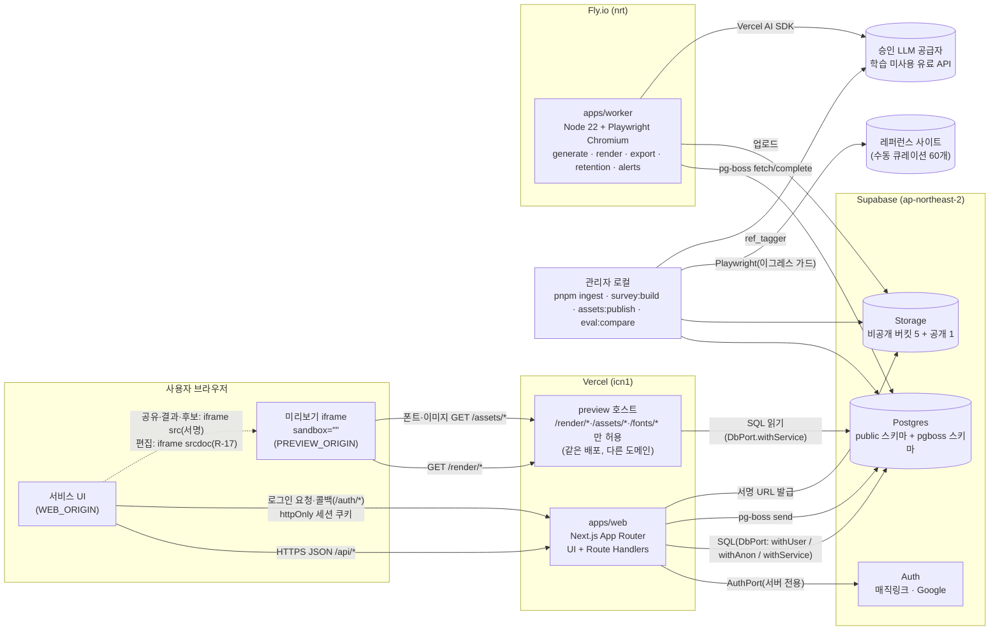
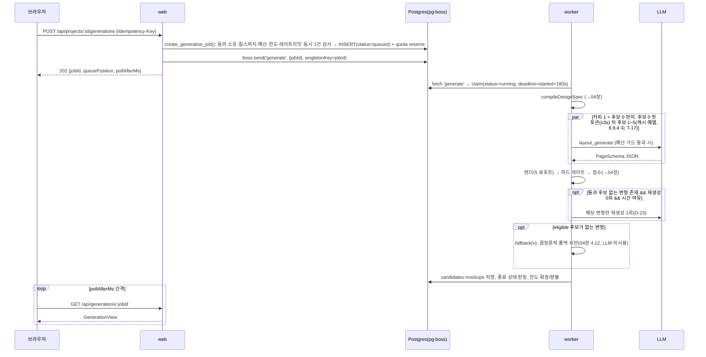
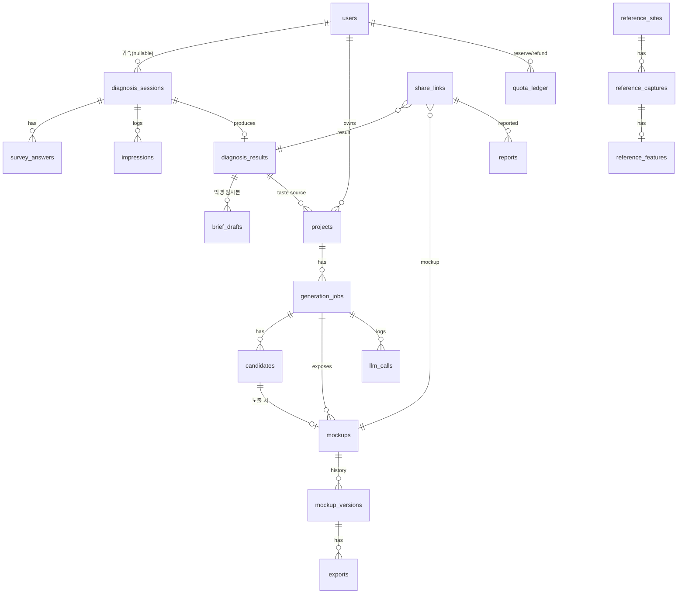

# 06. 기술 아키텍처

이 장은 취향핏(TasteFit) MVP의 실행 구조, 데이터, 계약(API·잡·LLM), 보안, 운영을 정의한다. 진단 알고리즘(→02장), 토큰·택소노미 값(→03장), 레이아웃 트리 스키마·채점 수식·노출 규칙(→04장), 레퍼런스 데이터 내용(→05장), 테스트 계획·출시 게이트(→07장), 정책 문구·보관 기간의 법적 근거(→08장), 레포 구조·마일스톤(→09장)은 해당 장이 원본이다. 이 장은 그 값들을 **저장·전달·실행하는 방법**만 정한다.

## 6.0 설계 원칙

| ID | 원칙 | 강제 수단 |
|---|---|---|
| P1 | 무거운 일(LLM·Chromium)은 웹 요청 경로에서 하지 않는다. 웹은 10초 안에 끝나는 일만 한다. | ESLint `no-restricted-imports`(apps/web에서 `playwright*`, `ai`, `@ai-sdk/*`, `packages/llm` import 금지), CI 번들 검사 |
| P2 | LLM은 데이터(JSON)만 출력한다. 실행 가능한 HTML/CSS/JS를 받지도, 실행하지도 않는다(D-21). | zod 스키마 강제, 렌더러는 신뢰 코드만 사용 |
| P3 | 사용자 콘텐츠를 렌더한 문서는 서비스와 다른 등록 도메인에서, 스크립트 없이 띄운다(D-43). | 미리보기 전용 오리진 + `sandbox=""` + CSP |
| P4 | 운영 인프라는 외부 URL에 접속하지 않는다. 외부 사이트 크롤링은 관리자 로컬에서만 한다. | 워커 Playwright 라우트 차단, ingest는 배포 대상 아님 |
| P5 | 모든 생성물은 재현 가능하다. 시안은 생성 당시 설정 스냅샷(모델·프롬프트·택소노미·렌더러 버전)을 갖는다. | `generation_jobs.config_snapshot` NOT NULL |
| P6 | 비용은 호출 전에 막는다. 잡당·일일 상한을 초과하는 LLM 호출은 보내지 않는다(D-24). | 게이트웨이 예산 가드, `spend_daily` 예약 |
| P7 | 외부 키가 없어도 전체 테스트가 통과한다(D-42). | `LLM_MODE=mock` 기본값, 로컬 Supabase |
| P8 | 브라우저는 DB·PostgREST·Storage·`supabase-js`를 쓰지 않는다. 로그인(매직링크·Google·TOTP)도 서버 Route Handler가 `AuthPort`로 처리한다. 모든 데이터는 API를 거치고, 서버는 `DbPort`(6.1.2 R-5)로만 DB에 접근한다. RLS와 쓰기 권한 화이트리스트(6.3.5)는 2차 방어선으로 모든 테이블에 켠다(T-11). | 클라이언트 번들에 `@supabase/*` import 0건, 서버 코드 `.from(`·`.rpc(` 0건 guard(R-3) |
| P9 | 추가 인프라를 만들지 않는다. MVP에서 Redis·별도 큐·별도 검색엔진을 쓰지 않는다. | 스택 표(6.14) 외 의존성 추가 시 결정 레지스터 갱신 필요 |

## 6.1 시스템 구성

### 6.1.1 구성도



### 6.1.2 구성요소 책임과 경계

| 구성요소 | 배포 단위 | 책임 | 금지(경계) | 보유 비밀 |
|---|---|---|---|---|
| **apps/web** (WEB_ORIGIN) | Vercel 프로젝트 1개 | 서비스 UI, REST API(Route Handlers), 로그인 요청·인증 콜백·TOTP 검증(`AuthPort`, httpOnly 세션 쿠키 발급)과 콜백마다 `provision_user` 호출(T-12, 6.5.4), 익명 세션 쿠키, 모든 DB 접근을 `DbPort`로(R-5), 진단 엔진 실행(동기), 프로젝트·잡 생성과 큐 투입, 서명 URL 발급, 버전 저장 시 서버 재컴파일·동기 게이트 재검사(R-17), 관리자 화면. 클라이언트 번들에서 isomorphic 컴파일러(`@tastefit/renderer`)와 `evaluateTokens`(04장)로 편집 미리보기 생성(01장 D-0105) | Playwright·LLM SDK import, 10초 초과 동기 작업, LLM 호출, 외부 URL fetch(Turnstile 검증·Supabase 제외), 클라이언트 컴포넌트의 `@supabase/*` import, 역할 없는 DB 쿼리(R-5) | Supabase service role, `SUPABASE_ANON_KEY`(서버 전용), DB URL(pooled), PREVIEW_SIGNING_SECRET, IP_HMAC_KEY, CONSENT_HASH_KEY |
| **preview 호스트** (PREVIEW_ORIGIN) | web과 같은 배포, 다른 등록 도메인. 미들웨어가 Host로 분기 | 공유·결과·후보 미리보기: 서명 검증 → DB에서 레이아웃 트리·토큰 읽기 → `@tastefit/renderer`로 정적 HTML 컴파일 → 엄격 CSP 헤더와 함께 응답. 이미지·아이콘을 `/assets/<sha256>.<ext>`로, 페이지 서브셋 폰트를 `/fonts/*`(6.6.1)로 서빙 | `/render/*`, `/assets/*`, `/fonts/*`, `/healthz` 외 모든 경로 404. 쿠키 읽기·쓰기 금지. 응답에 `<script>` 0개 | web과 동일 런타임(별도 비밀 없음) |
| **apps/worker** | Fly.io 앱 1개(머신 1대 이상) | pg-boss 컨슈머: `generate`, `render`, `export`, `account-delete`, `retention`(크론), `alerts`(크론), `reconcile`(크론), `survey-build`(로컬 환경 전용). LLM 게이트웨이 호출, Chromium 렌더·게이트 측정·스크린샷, zip 생성 | 외부 URL 탐색(라우트 차단), 공개 HTTP 서비스 제공(내부 `/healthz`만), 사용자 요청 직접 수신 | Supabase service role, DB URL(direct), LLM API 키 |
| **ingest CLI** (`pnpm ingest`) | 배포하지 않음. 관리자 로컬 Docker(worker 이미지 재사용) | 레퍼런스 URL 캡처·특징 추출·비전 태깅·pHash·스크린샷 업로드(→05장 5.4~5.6, 08장 8.1.4). `sources.status ∈ {manual_only, blocked, excluded}`·`excluded_domains`에는 요청 0 | 운영 서버에 설치·상시 실행 금지 | 실행 시 주입하는 service role 키, `ref_tagger` 역할 LLM 키(지출 상한 `REF_TAGGING_BUDGET_USD`) |
| **빌드 스크립트** | 관리자 로컬/CI | `survey:build`(설문 자극물 사전 렌더, D-14), `eval:golden`·`eval:compare`(6.15, →07장), `db:seed`(택소노미 시드, →09장) | — | service role(로컬 실행 시) |
| **Postgres** | Supabase | 앱 데이터, RLS·쓰기 권한 화이트리스트(6.3.5), pg-boss 큐(`pgboss` 스키마), 레이트리밋·멱등성·예산 원장 | 앱 외부 직접 접속(관리자 SQL 콘솔 제외). PostgREST(`/rest/v1`)는 앱이 쓰지 않는다(브라우저·서버 모두, T-11) | — |
| **Supabase Auth** | Supabase | 매직링크, Google OAuth, TOTP, Turnstile 캡차(로그인 요청). 호출 주체는 web 서버의 `AuthPort` supabase 드라이버뿐이다(브라우저 직접 호출 없음) | — | Google OAuth 클라이언트 비밀(대시보드 설정) |
| **Supabase Storage** | Supabase | 설문 이미지·렌더 결과·내보내기·레퍼런스 스크린샷·LLM 원문 저장(6.6) | private 버킷 public 전환 금지 | — |
| **packages/llm** | 라이브러리 | 유일한 LLM 진입점. models.yaml 로드, 승인 공급자 검증, 예산 가드, 폴백, 로깅, MockProvider | worker·ingest·eval 외에서 import 금지 | — |
| **packages/renderer** | 라이브러리(순수) | PageSchema + DesignTokens → 정적 HTML/CSS 문자열(내보내기 3종은 `@tastefit/exporter`가 이 출력으로 조립, →04장) | DOM·네트워크·파일 I/O, `tailwind`/`shadcn`/`lucide-react` 런타임 의존(D-28), `dangerouslySetInnerHTML` | — |

패키지 목록·책임·의존 금지 규칙의 원본은 →09장 9.1.3이다(`@tastefit/*` 스코프). 이 장은 9.1.3에 다음 규칙을 더한다.

| 추가 규칙 | 내용 | 검사 |
|---|---|---|
| R-1 | `ai`, `@ai-sdk/*`, `@tastefit/llm`은 apps/worker, `scripts/eval-*`, ingest CLI에서만 import한다(apps/web 금지: 웹에는 LLM 키가 없다) | `scripts/guard/deps.ts` |
| R-2 | 신규 패키지 `@tastefit/api-contract`(API 요청·응답 zod, 오류 코드 enum, 이벤트 레지스트리 zod)를 둔다. apps/web·e2e·tests가 공유한다. 의존 허용 zod, layout-schema(타입만). 의존 금지 db, llm, renderer (D-0601) | 동일 |
| R-3 | (T-11, 옛 "브라우저 번들의 `supabase-js`는 `auth.*`만" → T-11로 대체) 브라우저 번들에 `@supabase/*` 모듈 0개. `supabase-js` import는 `AuthPort`·`StoragePort`의 supabase 드라이버 파일(`packages/*/src/drivers/supabase*`, 패키지 배치 원천 09장 9.1.3) 안에서만 허용. `rg "\.from\(\|\.rpc\(" apps/web apps/worker packages --glob '!packages/*/src/drivers/supabase*'`(Kysely `selectFrom` 등은 해당 없음) 결과 0건 | `scripts/guard/deps.ts` + 빌드 산출물 정적 검사(AC-06-59) |
| R-5 | **`DbPort`**(`@tastefit/db`, 두 프로파일 공통, T-11). web·worker·스크립트의 모든 앱 쿼리는 아래 셋 중 하나 안에서만 실행한다. 역할 없는 쿼리를 만드는 API는 export하지 않는다(풀·Kysely 인스턴스 비공개).<br/>· `withUser(uid, aal, fn)` = `BEGIN; SET LOCAL ROLE authenticated; SELECT set_config('request.jwt.claims', '{"sub":<uid>,"role":"authenticated","aal":<aal>}', true); fn(tx); COMMIT`<br/>· `withAnon(fn)` = 같은 방식, `SET LOCAL ROLE anon`, 클레임 `{"role":"anon"}`<br/>· `withService(fn)` = `BEGIN; SET LOCAL ROLE service_role; SELECT set_config('request.jwt.claims', '{"role":"service_role"}', true); fn(tx); COMMIT`<br/>드라이버 **Kysely + `pg`**, 타입은 **kysely-codegen**(`pnpm db:types`가 `DATABASE_URL_DIRECT`에서 `packages/db/src/types.gen.ts` 생성, Docker 불필요. `supabase gen types`는 쓰지 않는다). 접속 사용자: native = shim의 `tastefit_app`(LOGIN, NOBYPASSRLS, `anon`·`authenticated`·`service_role` 멤버. shim의 `service_role`은 BYPASSRLS), supabase 프로파일·staging·prod = Supabase 기본 접속 사용자(Supavisor 트랜잭션 모드에서도 `SET LOCAL`·`set_config(…, true)`는 트랜잭션 안에서 유효). pg-boss는 자체 연결을 쓰되 `pgboss` 스키마만 다룬다 | `scripts/guard/deps.ts`(`pg`·`kysely` import는 `packages/db`만), AC-06-03·03b·59 |
| R-4 | `@tastefit/renderer`와 `evaluateTokens`는 isomorphic이어야 한다(Node·브라우저 공용, `fs`·`path`·네트워크 import 0). apps/web 클라이언트 컴포넌트는 이 둘만 생성 계열 패키지에서 import할 수 있다(R-17) | 번들 검사 + 브라우저 단위 테스트 |

### 6.1.3 구성요소 × 데이터 항목 흐름표 (S-26, LG2-03)

이 표가 개인정보 흐름의 원천이고 `legal/data-flows.yaml`이 그 코드다. 열은 08장 8.7.2의 처리 항목 P1~P13이다. ● = 처리·저장, ○ = 통과·일시 처리. 국내 리전에서 실행하는 국외 법인 호스팅을 국외 이전으로 볼지는 사람 확인 전까지 보수적으로 표에 넣는다(08장 8.14 Q5).

| 구성요소(processor_id) | P1 | P2 | P3 | P4 | P5 | P6 | P7 | P8 | P9 | P10 | P11 | P12 | P13 |
|---|---|---|---|---|---|---|---|---|---|---|---|---|---|
| web / Vercel(`vercel`) | ○ | ○ | ○ | ○ | ○ |  |  | ○ | ○ | ○ | ● |  | ○ |
| worker / Fly.io(`flyio`) |  | ○ | | ○ | ● | ○ | ○ |  |  |  | ● | |  |
| Supabase(`supabase`) | ● | ● | ● | ● | ● | ● | ● | ● | ● | ● |  |  | ● |
| LLM `gen_layout`·`gen_copy`(`llm-primary`, `llm-secondary`) |  |  |  | ○ |  |  |  |  |  |  |  |  |  |
| LLM `judge_vision`(`llm-judge`) |  |  |  |  | ○ |  |  |  |  |  |  |  |  |
| LLM `ref_tagger`(`llm-primary`, 관리자 로컬) |  |  |  |  |  |  |  |  |  |  |  |  |  |
| Sentry(`sentry`) |  |  |  |  |  |  |  |  |  |  |  | ● |  |
| Resend(`email-sender`) |  |  | ○ |  |  |  |  |  |  |  |  |  | ○ |
| Cloudflare Turnstile(`turnstile`) |  |  |  |  |  |  |  |  |  | ○ | ○ |  |  |

- 최소 기대값(CI `compliance:flows`가 검사): `flyio ⊇ {P2, P4, P5, P6}`, `vercel ⊇ {P1, P2, P3, P4, P8, P9, P11, P13}`, `llm-judge ⊇ {P5}`.
- `compliance:flows` 검사: ① `legal/processors.yaml`의 각 `processor_id`의 `items` ⊇ 이 표의 해당 행(● ∪ ○) ② `models.yaml`의 역할 4개 각각의 `processor_id`가 processors.yaml에 있음(`llm-judge` 포함) ③ 모든 항목의 `country`가 비어 있지 않음. `processors.yaml.items`는 이 파일에서 파생하고 손으로 따로 쓰지 않는다.
- `ref_tagger`는 레퍼런스 사이트 화면만 다루며 이용자 개인정보 항목이 없다(05장).
- 수용 기준 AC-06-58: 위 표와 다른 `data-flows.yaml`(행 1칸 삭제)로 `pnpm compliance:flows` → FAIL. processors.yaml에서 `llm-judge`를 빼면 FAIL.

## 6.2 처리 흐름

### 6.2.1 동기/비동기 분류

| 기능 | 방식 | 위치 | 지연 목표 | 근거 |
|---|---|---|---|---|
| 진단 세션 시작·응답·뒤로가기 | 동기(클라이언트 낙관 계산 + 서버 확정) | web | 서버 처리 p95 ≤ `perf.surveyServerP95Ms`(200ms), API 관측 p95 ≤ `perf.surveyApiP95Ms`(300ms), 다음 문항 표시 p95 ≤ 150ms | 순수 함수 + 사전 렌더 이미지(D-14). 런타임 렌더·LLM 0건 |
| 진단 결과 조회 | 동기 | web | 서버 처리 p95 ≤ `perf.resultServerMs`(200ms), 화면 표시 ≤ 1s | 유형 판정·닮은 사이트는 메모리 계산(레퍼런스 ≤ 60행) |
| 프로젝트(브랜드 입력) 저장 | 동기 | web | p95 ≤ 300ms | 정규화·차단 목록 검사 포함 |
| 시안 생성 | **비동기**: `202 Accepted` + 폴링 | web → `generate` 큐 → worker | 처리 p50 ≤ 60s, p95 ≤ 90s, 120s 폴백, 180s 강제 종료(D-24) | 서버리스 실행 시간·Chromium 크기 제약 회피 |
| 편집 미리보기 | 클라이언트 컴파일 → `srcdoc` 교체(R-17) | 브라우저 | 스타일 조작 p95 ≤ 200ms, 구조 변경 p95 ≤ 500ms(01장 1.8.5) | 서버 왕복 0, Chromium 미사용 |
| 버전 저장(D-0115 시점) | 동기(서버 재컴파일 + 렌더 불필요 게이트) + 비동기(렌더 게이트·썸네일) | web → `render` 큐 | 저장 응답 p95 ≤ 400ms, 렌더 게이트 완료 p95 ≤ 15s | 6.4.3 "버전 저장" |
| 내보내기 | 비동기: `202` + 폴링 | web → `export` 큐 | 완료 p95 ≤ 20s | zip에 폰트·이미지 포함 |
| 계정 삭제 | 비동기 | web → `account-delete` 큐 | 완료 ≤ 1시간 | Storage 객체 삭제 포함 |
| 보관 기간 파기 | 크론 | worker `retention` | 매일 03:00 KST | →08장 8.7.7 |
| 레퍼런스 ingest | 수동 CLI | 관리자 로컬 | 페이지당 ≤ 60s | P4 |

**진행 상태 전달**: MVP는 폴링만 쓴다(SSE는 **MVP 제외**, Phase 2). 클라이언트는 `GET /api/generations/:jobId`를 응답의 `pollAfterMs`(경과 60초까지 2,000ms, 이후 5,000ms) 간격으로 호출하고, `ETag`/`If-None-Match`로 변화가 없으면 `304`를 받는다. 04장 4.12에 따라 변형별 노출이 확정되는 즉시 `mockups` 행이 생기므로 폴링 응답의 `mockups[]`가 1→3개로 늘어난다(점진 노출은 폴링으로 구현). 탭을 닫았다가 돌아오면 `GET /api/projects/:id`의 `activeJobId`로 대기 화면 또는 결과를 복원한다.

### 6.2.2 진단 시퀀스

```mermaid
sequenceDiagram
  participant C as 브라우저
  participant W as web
  participant D as Postgres
  C->>W: POST /api/surveys (쿠키 anon_id 없으면 발급)
  W->>D: in_progress·abandoned 세션 조회(anon_id) → 있으면 재개, 없으면 생성(seed, versions)
  W-->>C: 201/200 SurveyView(question 1)
  loop 최대 16문항(D-13)
    C->>C: @tastefit/diagnosis로 낙관적 갱신 → 다음 문항 이미지 선로드
    C->>W: POST /api/surveys/:id/responses {seq, itemKey, shownItemIds, answer, latencyMs, ux?}
    W->>W: applyAnswer → nextQuestion(→02장 2.3.1)
    W->>D: BEGIN; INSERT survey_answers + impressions; UPDATE diagnosis_sessions(state, last_active_at); COMMIT
    W-->>C: SurveyView(next question | done)
  end
  C->>W: GET /api/surveys/:id/result
  W->>D: diagnosis_results 조회(완료 시 finalize 1회 계산·저장)
  W-->>C: ResultView
```

- 응답 처리는 한 트랜잭션이다. `SELECT … FROM diagnosis_sessions WHERE id=$1 FOR UPDATE`로 직렬화하고, 기대 `seq`(활성 응답 수 + 1)와 다르면 6.4.4 멱등 규칙을 적용한다. 같은 `(session_id, question_id)` 재삽입은 유니크 제약으로 막힌다.
- 진단 엔진(`@tastefit/diagnosis`)은 결정론적 순수 함수(세션 seed 고정)이므로 클라이언트와 서버가 같은 결과를 낸다. 클라이언트는 다음 문항 표시 p95 ≤ 150ms(→07장 7.5.1)를 위해 낙관적으로 먼저 계산·표시하고, **서버 응답이 권위**다. 서버 응답의 `question.itemId`가 클라이언트 계산과 다르면 클라이언트는 서버 값으로 교체하고 `survey_desync` 카운터를 로그에 남긴다(정상 상태 0건).
- 클라이언트가 받는 상태는 `EngineState` 직렬화본(02장 2.3.1, `seed` 포함)이며, 문항 풀 메타데이터(활성 `survey_items`의 ID·자산 2벌 URL·실측 L1·`alt_text`·`dominant_colors`·`focus_region`)는 `GET /api/survey-items?taxonomyVersion=`(공개, 1년 immutable 캐시)로 1회 받는다.

### 6.2.3 생성 시퀀스와 잡 상태



**상태 머신**(상태 enum 단일 원본, D-009·IF-03)

```
queued ──claim──▶ running ──▶ 종료 상태 판정(노출 확정 후)
  │                  └──(사용자 취소)──▶ canceled
  ├──(사용자 취소)──▶ canceled
  └──(GEN_ENABLED=false 전환 / 큐 투입 3회 실패)──▶ failed

종료 상태 판정:
  n_real  = 노출된 비폴백 시안 수,  n_fb = 노출된 폴백 시안 수
  succeeded  ⇔ n_real = 3
  partial    ⇔ 1 ≤ n_real ≤ 2          (누락 변형은 폴백으로 채움, 04장 4.12)
  fallback   ⇔ n_real = 0 ∧ n_fb ≥ 1
  failed     ⇔ n_real = 0 ∧ n_fb = 0    (180s 초과 후 폴백 동기 생성까지 실패, 인프라 오류)
```

| 상태 | 한도(quota) 처리(→00장 9.3) | `generate_complete.status` |
|---|---|---|
| succeeded, partial | 예약 확정 | 동일 값 |
| fallback, failed | 환불(`quota_ledger.kind='refund'`) | 동일 값 |
| canceled | 취소 시점의 비폴백 노출 수(`n_real`)가 ≥ 1이면 차감(노출된 시안은 계속 볼 수 있음), 0이면 환불하되 **노출 0 취소 환불은 계정당 KST 하루 2회까지**이고 3번째부터는 노출 0이어도 차감한다. `queued`·`running`은 구분하지 않는다(S-16·T-20, 00장 §9.3·04장 4.12·01장 1.6.5와 같은 문장). 취소 즉시 진행 중 LLM 호출을 abort하고 `llm_calls.status='aborted'`로 남긴다. 계정 원가 남용은 `USER_DAILY_COST_CAP_USD`(6.10.3·6.10.4)가 자동 차단하고 A4가 차단 발동을 알린다 | 이벤트 미발생 |

| phase | 의미 | progressPct |
|---|---|---|
| `queued` | 대기열 | 0 |
| `compiling` | 디자인 명세 컴파일 | 5 |
| `generating` | LLM 후보 생성 | 10 + 40 × (완료 호출 수 / 6) |
| `rendering` | 렌더·측정 | 55 + 15 × (완료 후보 / 대상 후보) |
| `scoring` | 하드 게이트·점수·비전 심사 | 75 |
| `repairing` | 재생성 1회 | 85 |
| `fallback` | 누락 변형 폴백 시안 생성 | 90 |
| `selecting` | 노출 선택·저장 | 95 |
| `done` | 종료 | 100 |

- 수용 기준 AC-06-55(S-16 통합 테스트 3건): ① `queued` 취소 → 잔여 한도 불변 ② `running`·노출 0에서 취소 → 불변 ③ `running`·비폴백 1개 노출 후 취소 → 1 감소. (①②는 그날 그 계정의 첫 두 번 안의 환불 취소로 실행한다. 3번째부터는 AC-06-63.)

**취소 처리 규칙(T-20, PM3-02)** — 원천은 이 절이고 00장 §9.3 `canceled` 행·01장 1.6.5 시트 문구가 같은 규칙을 쓴다.

```
refundable_cancels_today(u) = count(quota_ledger q join generation_jobs j on q.job_id = j.id
                                    where q.user_id = u and q.kind = 'refund' and j.status = 'canceled'
                                      and kst_day(q.created_at) = kst_day(now()))
취소 시(cancel_generation_job, 사용자 잠금 pg_advisory_xact_lock(hashtext(u)) 안):
  n_real ≥ 1                                   → 예약 확정(차감)
  n_real = 0 ∧ refundable_cancels_today(u) < 2 → refund 1행
  n_real = 0 ∧ refundable_cancels_today(u) ≥ 2 → 예약 확정(차감), 응답 meta.refunded=false
워커: 취소 신호(generation_jobs.status='canceled' 감지, 폴링 ≤ 1s 또는 pg NOTIFY) → job AbortController.abort()
      → 진행 중 callLlm은 AbortSignal로 끊고 llm_calls 1행(status='aborted', 이미 받은 usage가 있으면 그만큼 정산)
      → 남은 예약 release, 대기 중 렌더 취소
```

- 시트 문구 분기: 확인 시트를 열 때 `GET /api/me`의 `quota.refundableCancelsLeft`(= 2 − `refundable_cancels_today`, 하한 0)가 0이면 01장 `gen.cancel.noRefund` 문구를 쓴다(필드 정의는 6.4, 06-d).
- **AC-06-63**(T-20): 통합 테스트(Mock) ① 같은 계정이 노출 0 취소를 같은 KST 날짜에 3회 하면 1·2번째는 잔여 한도 불변, 3번째는 1 감소하고 `quota_ledger` refund 행은 2개다. ② Mock 호출당 원가를 US$0.30으로 둔 픽스처에서 계정 누적 `sum(llm_calls.cost_usd where owner_id=A, purpose='user_job', 오늘)`이 `USER_DAILY_COST_CAP_USD`(1.5)를 넘은 뒤 A의 생성 요청은 429 `QUOTA_DAY`(`details.reason='cost_cap'`)이고, 같은 시각 계정 B의 요청은 202이며, A4 알림 1건에 `blocked=true`가 실린다. ③ `MOCK_LLM_LATENCY_MS=20000`으로 호출 중 취소하면 5초 안에 그 잡의 미종료 `llm_calls`가 0개이고 그 행들의 `status='aborted'`다.

`phase` 값과 라벨 문구의 매핑은 →01장 생성 대기 화면이 정한다.

### 6.2.4 생성 시간 예산

| 단계 | p50 목표 | 개별 상한 | 비고 |
|---|---|---|---|
| 명세 컴파일 | 0.2s | 1s | 결정론적 코드 |
| LLM 카피 덱 1 + 레이아웃 6(카피·후보 0 먼저, 첫 토큰 뒤 후보 1~5) | 25s(예열 TTFT ≈ 1~2s 포함) | 호출당 40s(04장 4.7.1), 예열 대기 ≤ 3s | 스키마 무효 시 같은 모델로 수선 호출 1회 포함. 순서 원천 6.9.4 ① |
| 렌더 + 게이트(6개, 머신당 컨텍스트 3개) | 10s | 후보당 p95 5s, 하드 15s | 뷰포트 5종(D-25), 04장 4.10.1 |
| 점수 + 비전 심사 | 6s | 30s | `judge_vision`은 플래그 `JUDGE_VISION_MODE`·예산 의존(→04장, 07장 D-0714) |
| 재생성(필요 시) | 0s(미발생) / 35s | 호출 40s + 렌더 5s | **시작 조건: 경과 ≤ 70s** |
| 노출 선택·저장 | 0.5s | 2s | |
| **합계** | **≈ 42s** | | p50 ≤ 60s, p95 ≤ 90s(D-24) |

**시간 경계 규칙**(워커가 `AbortSignal`로 강제, 04장 4.12와 같은 규칙의 실행 측 정의):

```
T0 = started_at
재생성 시작 조건: now ≤ T0 + 70s ∧ 남은 잡 예산 ≥ 재생성 최악 원가
now ≥ T0 + 120s (t_fallback):
  진행 중 LLM 호출(repair·judge 포함)과 대기 중 렌더를 abort
  확정된 eligible 후보로 변형별 선택, 누락 변형은 fallback(v) 컴파일·렌더(목표 ≤ 10s)
now ≥ T0 + 180s (t_kill):
  남은 작업 전부 abort
  노출 0개면 fallback 3개 동기 생성 시도(≤ 5s), 실패 시 status=failed, error_code=GEN_TIMEOUT
SLO(R-25, 07장 M15): 첫 시안 카드 노출(첫 mockups.created_at − queued_at) p50 ≤ 45s,
                   3번째 노출(마지막 mockups.created_at − queued_at) p50 ≤ 60s, p95 ≤ 90s
보조 지표: 대기 = started_at − queued_at, 처리 = finished_at − started_at (6.12)
```

### 6.2.5 잡 큐(pg-boss) 정의

| 큐 | 생산자 | 페이로드 | 머신당 동시 처리 | retryLimit / backoff | expireIn | 비고 |
|---|---|---|---|---|---|---|
| `generate` | web | `{jobId}` | 머신당 `WORKER_GEN_CONCURRENCY`(기본 2), 전역 실효 상한 `min(GEN_MAX_CONCURRENT_JOBS=5, 머신 수 × 2)`(S-14) | 0 | 200s | 잡 내부에서 재생성·폴백 처리. 큐 재시도 없음 |
| `render` | web, worker | `{target:'version', versionId}` | 2 | 2 / 지수(2s, 8s) | 60s | 버전 저장 후 렌더 게이트(G-04~G-08)·썸네일 |
| `export` | web | `{exportId}` | 2 | 2 / 지수 | 120s | |
| `account-delete` | web | `{userId}` | 1 | 5 / 지수(최대 1h) | 600s | 아래 단계 ①~⑦(S-21) |
| `retention` | 크론 `0 18 * * *`(UTC = 03:00 KST) | `{}` | 1 | 3 | 1800s | 08장 8.7.7 보관 기간표 실행(`retention:sweep`, 6.6 규칙 레코드. `auth_audit_90d`·`admin_audit_1y`·`abuse_evidence_90d` 포함) |
| `survey-build` | `pnpm survey:build`(로컬·CI만) | `{taxonomyVersion}` | 1 | 0 | 3600s | 운영 워커에서는 컨슈머 미등록 |
| `alerts` | 크론 `*/5 * * * *` | `{}` | 1 | 0 | 120s | 6.12 알림 규칙 |
| `reconcile` | 크론 `* * * * *` | `{}` | 1 | 0 | 50s | 큐 누락·고아 잡 복구 |

- 전역 동시 잡 수는 `generation_jobs.status='running'` 행 수로 판정한다. 워커는 `generate` 잡을 가져온 뒤 `claim_generation_job()`(6.3.4)에서 `pg_advisory_xact_lock(hashtext('gen_slots'))` 아래 `count(running) < min(GEN_MAX_CONCURRENT_JOBS, 살아 있는 워커 수 × WORKER_GEN_CONCURRENCY)`를 확인하고(살아 있는 워커 = `worker_heartbeats.last_beat_at > now()-60s`), 자리가 없으면 잡을 5초 뒤로 다시 넣는다(`startAfter`). Chromium 컨텍스트는 머신당 세마포어 `RENDER_MAX_CONTEXTS`(기본 3)로 따로 제한하고, 렌더 큐는 잡별 라운드로빈으로 꺼낸다(한 잡이 컨텍스트를 독점하지 않음, S-14). 초과 잡은 대기 순번으로 표시한다.
- 큐 투입: web은 pg-boss를 **생산자 전용**(`supervise:false`, `schedule:false`, `migrate:false`)으로 Lambda 인스턴스당 1개 지연 생성하고 `DATABASE_URL_POOLED`(풀 크기 1)로 연결한다. pg-boss 스키마 생성·마이그레이션은 worker만 한다(`migrate:true`).
- M0 스파이크에서 서버리스 생산자 모드가 동작하지 않으면 다음 대체안을 쓴다(추가 결정 불필요): web은 `generation_jobs`·`exports` 행만 INSERT하고, worker의 `reconcile`(1초 간격 루프로 실행)이 `queued`이면서 큐 미투입인 행을 `send`한다.
- `reconcile` 규칙: (1) `status='queued' AND queued_at < now()-60s`이고 pg-boss에 해당 singletonKey 잡이 없으면 재투입(최대 3회, 이후 `failed/ENQUEUE_FAILED`). (2) `status='running' AND heartbeat_at < now()-60s`이면 `failed/WORKER_LOST`로 바꾸고 한도를 환불한다(발생한 원가는 `llm_calls`에 이미 기록되어 예산 집계에 남는다).
- 워커는 실행 중인 잡마다 10초 간격으로 `generation_jobs.heartbeat_at`을, 프로세스 단위로 30초 간격으로 `worker_heartbeats`를 갱신한다.
- `SIGTERM` 수신 시 새 잡을 가져오지 않고 최대 30초 기다린다. 끝나지 않은 잡은 `reconcile`이 처리한다. Fly 머신 `kill_timeout = 40`.

**`account-delete` 절차(S-21, LG2-04)**. 단계마다 멱등이다. 실패하면 큐 재시도(5회)로 처음부터 다시 돌며, 이미 끝난 단계는 건너뛴다. 5회 모두 실패하면 A8 알림과 `admin_audit_logs(action='account_delete_failed')`를 남긴다.

실행 순서는 **⑤ → ⑤b → ① → ② → ③ → ③b → ④ → ⑥ → ⑥b → ⑦**이다(T-15. ⑤가 ①보다 먼저여야 `users.status`가 `deleting`으로 덮이기 전 정지 상태를 읽는다. 별도 `status_before_delete` 컬럼은 두지 않는다).

| 단계 | 동작 | 멱등 근거 |
|---|---|---|
| ⑤ | `users.status ∈ {gen_suspended, suspended}`면 `sanctions(email_hash, level, until, reason_code)` upsert. `until`은 남은 정지 기간, 최대 1년. `email_hash`는 web이 계산해 잡 페이로드로 넘긴다(키는 DB에 없음, T-12) | upsert |
| ⑤b | 이 사용자 소유 공유 링크를 가리키는 `reports`(reason ∈ {impersonation, phishing}, status ∈ {open, hidden, actioned})가 있으면 `abuse_holds(email_hash, report_ids, until)` upsert(`until` = 검토 종료 + 90일, 미종료면 `now()+90d` 후 검토 종료 시 갱신). `actioned`가 있으면 `sanctions`도 upsert(T-15) | upsert |
| ① | `users.status='deleting'`, 세션 폐기(`AuthPort.adminSignOutAll(uid)`), 소유 공유 링크 비공개 | 같은 값 재설정 |
| ② | `llm_calls where owner_id=:uid`의 `llm-payloads` 객체 삭제(이 단계는 ⑥보다 먼저다. 그 뒤에는 `owner_id`가 null이 되어 객체를 찾을 수 없다) | 없는 객체 삭제는 성공 처리 |
| ③ | `renders/<uid>/`·`exports/<uid>/` 객체 삭제. 단 ⑤b 대상 신고가 가리키는 버전의 렌더 객체는 먼저 ③b로 옮긴다 | 같음 |
| ③b | ⑤b 대상 신고의 `evidence.objectPaths`를 `abuse-evidence/<report_id>/`로 복사(복사 성공 확인 후 원본 삭제는 ③이 한다), `reports.evidence.objectPaths`를 새 경로로 갱신. 보관 `abuse_evidence_90d`(T-15) | 대상 경로에 같은 sha256 객체가 있으면 건너뜀 |
| ④ | `consents where user_id=:uid` → `consents_archive(user_hash, doc_type, doc_version, agreed, agreed_at)`로 복사 후 원본 삭제(한 트랜잭션) | 원본이 없으면 건너뜀 |
| ⑥ | `AuthPort.adminDeleteUser(uid)`(→ `auth.users` 행 삭제) → `users`·소유 행 cascade. `reports`는 FK가 없어 남는다(T-15) | 없는 사용자면 성공 처리 |
| ⑥b | 인증 서버 기록 정리(T-13, P14): `auth.audit_log_entries`에서 `payload->>'actor_id' = uid` 행과 `auth.sessions where user_id = uid` 행 삭제. 남은 기록은 `auth_audit_90d`가 90일 후 파기. supabase 프로파일은 service role SQL, native는 shim 테이블 | 0행 삭제도 성공 |
| ⑦ | `admin_audit_logs(action='account_deleted', target_type='user', target_id=user_hash)` | `target_id` 기준 중복 삽입 방지(존재 확인 후 삽입) |

- 재가입: 로그인 콜백의 `provision_user`(T-12, 6.3.3)가 `sanctions`(미만료)면 그 `level`, `abuse_holds`(미만료)면 `gen_suspended`로 `users.status`를 만든다. 이 사용자의 생성 API는 403 `ACCOUNT_SUSPENDED`다(옛 auth.users 트리거 승계 → T-12로 대체).
- 관리자 계정 삭제도 같은 절차다. `admin_audit_logs`는 FK가 없어 행 수가 그대로 남는다.
- 수용 기준 AC-06-53: 계정 삭제 E2E 후 해당 사용자의 `llm-payloads` 객체 0건, `consents` 0행, `consents_archive`에 같은 수의 행, `auth.users` 0행. 정지 계정 탈퇴 → 같은 이메일 재가입 → 생성 API 403 `ACCOUNT_SUSPENDED`. 관리자 계정 삭제 성공, 감사 로그 행 수 불변. 단계 ③ 직후 강제 실패를 주입해도 재시도 후 최종 상태가 같다.

## 6.3 데이터 모델

### 6.3.1 원칙

| 규칙 | 내용 |
|---|---|
| 마이그레이션 위치 | `packages/db/supabase/migrations/<UTC타임스탬프>_<이름>.sql`(Supabase CLI 형식, →09장 9.1). 이 절의 DDL이 `..._0001_init.sql`~`..._0006_ops.sql`의 원본이다 |
| 키 | 엔터티 PK는 `uuid default gen_random_uuid()`. 택소노미·설정은 사람이 읽는 `text` PK. 공유 ID는 22자 base64url(132비트) |
| 시각 | 모든 시각은 `timestamptz`(UTC 저장). "일"·"월" 경계는 KST(`Asia/Seoul`)로 계산하는 함수 `kst_day(ts)`·`kst_month(ts)`만 쓴다 |
| enum | Postgres enum 타입 대신 `text + CHECK`(값 추가가 additive 마이그레이션으로 끝남) |
| 벡터 | L1 벡터는 `jsonb {"expression":0..1, "temperature", "shape", "density", "depth"}`(D-10, 키는 R-01). CHECK 함수 `is_l1(jsonb, lo, hi)`로 키 5개·범위를 강제. 02장 엔진 내부의 `Vec5` 배열은 A1~A5 순서이며 저장·API 경계에서 이 키로 변환한다 |
| JSON 스키마 | jsonb 컬럼의 내용 스키마는 zod가 원본(`TokenSet`·L2 18키→03장, `DesignSpec`·`LayoutTree`(=`PageSchema`)·`QualityReport`·`CopyDeck`→04장, `TasteProfile`→02장, `BrandInput`→01장 1.5.5.2(R-21), `EditState`·`EditOp`→01장 1.8.6·04장 4.15). DB는 `jsonb_typeof`만 검사한다 |
| 개인정보 | 원문 IP 미저장(`ip_hmac`만, 08장 8.7.7). 이메일은 `auth.users`와 `support_tickets`·`rights_requests`에만 둔다. 브리프는 마스킹 후 저장(08장 8.7.5) |
| 소유 비정규화 | 사용자 소유 테이블은 모두 `owner_id`를 직접 가진다(RLS를 조인 없이 평가) |
| 삭제 | 개인정보 테이블은 soft delete 금지, 행 삭제 + `on delete cascade`(08장 8.7.8) |
| 이름 | R-18 + 02장 2.3: `users`, `diagnosis_sessions`, `survey_answers`, `impressions`, `diagnosis_results`, `survey_items`, `reference_sites`, `rights_requests`, `admin_audit_logs`, `events`. 08장의 `profiles`·`responses`·`audit_logs`, 01장의 `taste_results`는 각각 `users`·`survey_answers`·`admin_audit_logs`·`diagnosis_results`로 읽는다. 유형 ID `T1`~`T8`, 앵커 `PS-T1`~`PS-T8`(R-04) |

### 6.3.2 ERD(요약)



### 6.3.3 DDL

```sql
-- ===== 0001_init: 확장·공통 함수 =====
create extension if not exists pgcrypto;
-- pgvector는 MVP에서 쓰지 않는다(S-22). Phase 2 임베딩은 additive 마이그레이션으로 확장·컬럼을 추가한다(05장 D-055)

create or replace function is_l1(v jsonb, lo numeric default 0, hi numeric default 1)
returns boolean language sql immutable as $$
  select jsonb_typeof(v) = 'object'
     and (select array_agg(k order by k) from jsonb_object_keys(v) k)
         = array['density','depth','expression','shape','temperature']      -- R-01
     and not exists (select 1 from jsonb_each(v) e
                     where jsonb_typeof(e.value) <> 'number'
                        or (e.value)::numeric < lo or (e.value)::numeric > hi)
$$;
create or replace function kst_day(ts timestamptz) returns date
  language sql immutable as $$ select (ts at time zone 'Asia/Seoul')::date $$;
create or replace function kst_month(ts timestamptz) returns date
  language sql immutable as $$ select date_trunc('month', ts at time zone 'Asia/Seoul')::date $$;
create or replace function touch_updated_at() returns trigger language plpgsql as $$
  begin new.updated_at := now(); return new; end $$;

-- ===== 사용자·동의 =====
create table users (                                  -- 00장 IF-07, 08장의 profiles
  id              uuid primary key references auth.users(id) on delete cascade,
  role            text not null default 'user' check (role in ('user','admin')),
  is_internal     boolean not null default false,     -- 운영자·지인 테스트 계정(KPI 제외)
  display_name    text null check (char_length(display_name) <= 40),  -- 자동 채움 금지(08장 8.7.1)
  status          text not null default 'active' check (status in ('active','gen_suspended','suspended','deleting')),  -- deleting = account-delete 진행 중(S-21)
  quota_day_override   smallint null check (quota_day_override between 0 and 50),   -- ADM-06
  quota_month_override smallint null check (quota_month_override between 0 and 500),
  created_at      timestamptz not null default now(),
  last_login_at   timestamptz not null default now()
);
-- users 행 생성·관리자 판정·제재 승계는 auth.users 트리거가 하지 않는다(T-12). 로그인 콜백마다 web이
-- withService로 provision_user()(아래 '사용자 프로비저닝')를 호출한다. 옛 auth.users INSERT 트리거 규칙 → T-12로 대체.

-- OAuth 메타데이터 최소화(S-25, 08장 8.7.1): 공급자가 보낸 이름·사진 등을 저장하지 않는다.
create or replace function minimize_auth_metadata() returns trigger
language plpgsql security definer set search_path = public, auth as $$
declare keep text[] := array['email','email_verified','provider_id','sub','iss'];
begin
  if tg_table_name = 'users' then
    new.raw_user_meta_data := (select coalesce(jsonb_object_agg(k, v), '{}'::jsonb)
                               from jsonb_each(coalesce(new.raw_user_meta_data, '{}'::jsonb)) as e(k, v) where k = any(keep));
  else
    new.identity_data := (select coalesce(jsonb_object_agg(k, v), '{}'::jsonb)
                          from jsonb_each(coalesce(new.identity_data, '{}'::jsonb)) as e(k, v) where k = any(keep));
  end if;
  return new;
end $$;
create trigger auth_users_minimize before insert or update on auth.users
  for each row execute function minimize_auth_metadata();
create trigger auth_identities_minimize before insert or update on auth.identities
  for each row execute function minimize_auth_metadata();
-- native 프로파일은 shim의 auth.users·auth.identities에 공급자 형태 행을 직접 넣어 시험한다.
-- 실제 Google 흐름의 키 덤프는 needs_ci(gotrue-google-metadata), 결과는 docs/compliance/auth-metadata.md.

create table identity_links (                         -- 00장 8.4
  anon_id    text not null,                           -- events.anon_id와 같은 text 표기(uuid 문자열)
  user_id    uuid not null references users(id) on delete cascade,
  linked_at  timestamptz not null default now(),
  primary key (anon_id, user_id)
);

create table consents (                               -- 08장 8.7.4 C
  id           uuid primary key default gen_random_uuid(),
  user_id      uuid null references users(id) on delete cascade,
  anon_id      uuid null,
  doc_type     text not null check (doc_type in ('terms','privacy_notice','age_14','privacy_consent','brand_attestation','showcase_optin')),
  doc_version  text not null check (doc_version ~ '^\d{4}-\d{2}-\d{2}$'),
  agreed       boolean not null,
  shown_at     timestamptz not null,
  agreed_at    timestamptz null,
  subject_ref  text null,                             -- brand_attestation 대상(정규화 브랜드명 SHA-256)
  ip_hmac      text null,
  check (user_id is not null or anon_id is not null)
);
create index on consents (user_id, doc_type, doc_version);

create table consents_archive (                       -- 탈퇴 후 동의 증빙 1년(S-21, 08장 8.7.7)
  id           uuid primary key default gen_random_uuid(),
  user_hash    text not null,                         -- HMAC-SHA256(user_id, CONSENT_HASH_KEY). 키는 교체하지 않는다
  doc_type     text not null,
  doc_version  text not null,
  agreed       boolean not null,
  agreed_at    timestamptz null,
  archived_at  timestamptz not null default now()
);
create index on consents_archive (archived_at);

create table sanctions (                              -- 정지 이력 재가입 방지(S-21, 08장 8.9.5). 보관 근거는 사람 확인(08 8.14 Q6)
  email_hash   text primary key,                      -- HMAC-SHA256(lower(trim(email)), CONSENT_HASH_KEY)
  level        text not null check (level in ('gen_suspended','suspended')),
  until        timestamptz not null check (until <= created_at + interval '1 year'),
  reason_code  text not null,
  created_at   timestamptz not null default now()
);

create table abuse_holds (                            -- 탈퇴 보류(T-15, LG3-04): 처리 중 사칭·피싱 신고가 있는 계정의 재가입 승계용
  email_hash   text primary key,                      -- sanctions와 같은 HMAC
  report_ids   uuid[] not null check (cardinality(report_ids) >= 1),
  until        timestamptz not null,                  -- 마지막 신고 검토 종료 + 90일(abuse_evidence_90d와 같은 기준, 08 8.14 Q6)
  created_at   timestamptz not null default now()
);
-- consents_archive·sanctions·abuse_holds는 RLS 켜고 정책 0개(service_role 전용).

-- 사용자 프로비저닝(T-12, 6.5.4). HMAC은 web이 계산해 넘긴다. 키는 DB에 두지 않는다(AC-06-60 ①).
create or replace function provision_user(p_user_id uuid, p_is_admin boolean, p_email_hash text)
returns users language plpgsql security definer set search_path = public as $$
declare r users; s record; h record;
begin
  insert into users (id) values (p_user_id) on conflict (id) do update set last_login_at = now();
  update users set role = case when p_is_admin then 'admin' else 'user' end
   where id = p_user_id and role is distinct from (case when p_is_admin then 'admin' else 'user' end);
  select level, until into s from sanctions where email_hash = p_email_hash and until > now();
  select until into h from abuse_holds where email_hash = p_email_hash and until > now();
  if s.level is not null then
    update users set status = s.level where id = p_user_id and status = 'active';
  elsif h.until is not null then
    update users set status = 'gen_suspended' where id = p_user_id and status = 'active';  -- 신고 검토 종료 전 재가입: 생성만 보류
  end if;
  select * into r from users where id = p_user_id;
  return r;
end $$;

create table invites (                                -- 00장 7.2, BETA_INVITE_ONLY
  code        text primary key check (code ~ '^[A-Z0-9]{8,16}$'),
  max_uses    int not null check (max_uses between 1 and 1000),
  used_count  int not null default 0 check (used_count <= max_uses),
  expires_at  timestamptz not null,
  created_by  uuid null references users(id) on delete set null,
  created_at  timestamptz not null default now()
);
create table invite_redemptions (
  code     text not null references invites(code) on delete cascade,
  user_id  uuid not null references users(id) on delete cascade,
  redeemed_at timestamptz not null default now(),
  primary key (code, user_id)
);

-- ===== 0002_taxonomy: data/ → db:seed 복제본(원본은 data/, →09장 9.2) =====
create table taxonomy_releases (                      -- 시즌(R-30, 05장 D-053)
  version       text primary key check (version ~ '^\d{4}-S[1-4](\.\d+)?$'),  -- 'YYYY-S{1..4}', 패치 '.n'
  status        text not null check (status in ('draft','active','retired')),
  data_checksum text not null,                        -- data/ 묶음 해시
  release_date  date not null,                        -- 분기 첫 월요일
  freeze_date   date not null,                        -- release_date − 14일
  activated_at  timestamptz null,
  created_at    timestamptz not null default now(),
  check (freeze_date = release_date - 14)
);
create unique index taxonomy_one_active on taxonomy_releases ((true)) where status = 'active';

create table types (                                  -- 유형 8개(D-15, R-04). 이름·설명 원본 02장, 중심 벡터 원본 03장 3.4.7
  taxonomy_version text not null references taxonomy_releases(version),
  id               text not null check (id ~ '^T[1-8]$'),     -- type_id
  slug             text not null,
  name_ko          text not null,
  description_ko   text not null,
  centroid         jsonb not null check (is_l1(centroid)),
  anchor_preset_id text not null check (anchor_preset_id ~ '^PS-T[1-8]$'),
  primary key (taxonomy_version, id)
);

create table presets (                                -- →03장
  taxonomy_version text not null references taxonomy_releases(version),
  id               text not null,                     -- 앵커 'PS-T1'~'PS-T8' + 비앵커 프리셋
  type_id          text not null,
  tokens           jsonb not null check (jsonb_typeof(tokens) = 'object'),   -- TokenSet(03장)
  l2               jsonb not null check (jsonb_typeof(l2) = 'object'),       -- 18키(R-27)
  theme            text not null check (theme in ('light','dark')),
  status           text not null check (status in ('draft','approved','needs_review')),
  provenance       jsonb not null,                    -- {origin, domains[]} (08장 8.3 G1)
  primary key (taxonomy_version, id),
  foreign key (taxonomy_version, type_id) references types(taxonomy_version, id)
);

create or replace function is_survey_asset(a jsonb, w int, h int, max_bytes int) returns boolean
language sql immutable as $$
  select jsonb_typeof(a) = 'object'
     and (a->>'w')::int = w and (a->>'h')::int = h
     and (a->>'bytes')::int <= max_bytes
     and a->>'path' ~ '\.webp$' and length(a->>'sha256') = 64
$$;

create table survey_items (                           -- 자극물(D-14, 02장 2.3.6), 생성 → pnpm survey:build
  taxonomy_version text not null references taxonomy_releases(version),
  id               text not null,                     -- 'C-SV{nn}-{tpl}' / 'AB-{T}-{A}-{lv}' / 'ABP-{T}-{A}-{lvA}{lvB}'
  kind             text not null check (kind in ('card','ab_image','ab_pair','anchor_ref')),
  stage            smallint null check (stage in (1,2)),
  template_id      text not null check (template_id in ('tpl-hero','tpl-grid','tpl-text')),
  axis             text null check (axis in ('expression','temperature','shape','density','depth')),
  level            real null check (level in (0.2, 0.5, 0.8)),     -- R-06
  pair_image_ids   text[] null,                       -- ab_pair만: 두 ab_image ID
  target_l1        jsonb null check (target_l1 is null or is_l1(target_l1)),
  x_card           jsonb null check (x_card is null or is_l1(x_card)),   -- 실측 L1(D-0904), ab_pair는 null
  assets           jsonb null,                        -- R-07: {desktop:{path,sha256,w,h,bytes}, mobile:{…}}
  alt_text         text null check (alt_text is null or char_length(alt_text) between 5 and 160),  -- R-07(02장 alt_ko)
  dominant_colors  text[] null check (dominant_colors is null or (cardinality(dominant_colors) = 3
                     and dominant_colors[1] ~ '^#[0-9A-F]{6}$')),   -- R-07, 01장 D-0111
  focus_region     jsonb null,                        -- {x,y,w,h} 0~1 비율(02장 2.4.4)
  status           text not null check (status in ('draft','verified','active','retired')),
  stats            jsonb not null default '{}',       -- 노출 수·선택률·위치별 선택률·cant_tell 비율·flag
  primary key (taxonomy_version, id),
  check (kind = 'ab_pair' or (assets is not null and alt_text is not null and dominant_colors is not null
         and is_survey_asset(assets->'desktop', 1280, 800, 143360)                 -- ≤140KB
         and (kind = 'anchor_ref' or is_survey_asset(assets->'mobile', 780, 1560, 163840)))),   -- ≤160KB
  check ((kind = 'ab_pair') = (pair_image_ids is not null and cardinality(pair_image_ids) = 2))
);

-- ===== 진단(필드 의미 원본 02장 2.3) =====
create table diagnosis_sessions (
  id               uuid primary key default gen_random_uuid(),   -- = 이벤트 survey_session_id
  anon_id          uuid not null,                     -- 쿠키 값(08장 P1)
  user_id          uuid null references users(id) on delete cascade,
  taxonomy_version text not null references taxonomy_releases(version),
  seed             int not null,                      -- CSPRNG 1회 발급
  purpose_hint     text null check (purpose_hint in ('saas','portfolio','local_business')),
  status           text not null check (status in ('in_progress','completed','abandoned')),   -- abandoned = 30분 무활동(02장)
  entry            text not null check (entry in ('landing','share','retest','direct')),
  versions         jsonb not null,                    -- 02장 2.0 버전 4종
  state            jsonb null,                        -- EngineState 캐시(로그 재생으로 언제나 재구성 가능)
  started_at       timestamptz not null default now(),
  last_active_at   timestamptz not null default now(),
  completed_at     timestamptz null,
  check ((status = 'completed') = (completed_at is not null))
);
create index on diagnosis_sessions (anon_id, status);
create index on diagnosis_sessions (user_id);
create unique index diag_one_open_per_anon on diagnosis_sessions (anon_id) where status in ('in_progress','abandoned');

create table survey_answers (                         -- 응답 로그 원본, 추가 전용(02장 2.3.3, R-18)
  id               bigserial primary key,
  session_id       uuid not null references diagnosis_sessions(id) on delete cascade,
  seq              int not null check (seq between 1 and 16),
  question_id      text not null,                     -- 'q-{session}-{seq}-{attempt}'
  stage            smallint not null check (stage in (1,2)),
  kind             text not null check (kind in ('pick4','ab','check')),
  item_id          text not null,
  shown            jsonb not null,                    -- [{option_id, slot}]
  answer           text not null check (answer in ('option','none_of_these','cant_tell')),
  chosen_option_id text null,
  latency_ms       int not null check (latency_ms between 0 and 3600000),
  policy           text not null check (policy in ('dopt','explore','ab_fisher','check')),
  propensity       real not null check (propensity > 0 and propensity <= 1),
  superseded       boolean not null default false,    -- 뒤로가기 취소(D-13)
  ux               jsonb null,                        -- 01장 1.4.12 선택 필드(D-0106)
  client_ts        timestamptz not null,
  server_ts        timestamptz not null default now(),
  unique (session_id, question_id),
  check ((answer = 'option') = (chosen_option_id is not null))
);
create index on survey_answers (session_id, seq);

create table impressions (                            -- 노출 로그(02장 2.3.4). 트렌드 집계 참조 금지(R-35)
  id           bigserial primary key,
  session_id   uuid not null references diagnosis_sessions(id) on delete cascade,
  seq          int not null,
  item_ids     text[] not null,
  slots        smallint[] not null,
  policy       text not null,
  propensity   real not null,
  device_class text not null check (device_class in ('desktop','tablet','mobile')),
  ts           timestamptz not null default now()
);

create table diagnosis_results (                      -- 02장 2.3.5, 00장 IF-05
  id                      uuid primary key default gen_random_uuid(),   -- result_id
  session_id              uuid not null unique references diagnosis_sessions(id) on delete cascade,
  taxonomy_version        text not null,
  type_id                 text not null check (type_id ~ '^T[1-8]$'),
  type_id_second          text null check (type_id_second ~ '^T[1-8]$'),
  is_boundary             boolean not null,
  profile                 jsonb not null,             -- TasteProfile(02장 2.3.1, 축 키 R-01)
  rating                  smallint null check (rating between 1 and 5),
  anchor_override_type_id text null check (anchor_override_type_id ~ '^T[1-8]$'),   -- R-36
  recomputed_from         uuid null references diagnosis_results(id) on delete set null,
  similar_site_ids        uuid[] not null default '{}' check (cardinality(similar_site_ids) <= 3),
  created_at              timestamptz not null default now()
);

create table brief_drafts (                           -- 01장 D-0103, TTL 24시간(R-26)
  id          uuid primary key default gen_random_uuid(),
  anon_id     uuid not null,
  user_id     uuid null references users(id) on delete cascade,   -- 로그인 귀속 시
  result_id   uuid not null references diagnosis_results(id) on delete cascade,
  purpose     text not null check (purpose in ('saas','portfolio','local_business')),
  brand       jsonb not null,                         -- BrandInput, 6.4.5 처리 후(마스킹본)
  use_sample_content boolean not null default false,
  created_at  timestamptz not null default now(),
  expires_at  timestamptz not null default now() + interval '24 hours',
  consumed_at timestamptz null                        -- 프로젝트로 제출된 시각
);
create index on brief_drafts (expires_at);

-- ===== 0003_references: 컬럼 원본 → 05장 5.3 =====
create table sources (
  source_id            text primary key,              -- 'awwwards', 'site:<eTLD+1>', 'direct'
  kind                 text not null check (kind in ('platform','origin_site','stats')),
  name                 text not null,
  tier                 text not null check (tier in ('T1','T2','T3','AUX')),
  url_pattern          text not null,
  access_method        text not null check (access_method in ('manual','extract','rss','api')),
  tos_url              text null,
  tos_checked_at       date null,
  tos_allows_automated text not null default 'unknown' check (tos_allows_automated in ('yes','no','unknown')),
  robots_checked_at    timestamptz null,
  robots_allows        text not null default 'unknown' check (robots_allows in ('yes','no','unknown')),
  tdm_reserved         boolean null,
  rate_limit_rps       numeric not null default 0.2 check (rate_limit_rps <= 0.2),
  stores_screenshot    boolean not null default false,
  status               text not null check (status in ('active','manual_only','blocked','excluded')),
  note                 text null,
  check (kind = 'origin_site' or stores_screenshot = false),
  check (kind <> 'platform' or tos_allows_automated = 'yes' or status in ('manual_only','blocked','excluded'))
);

create table reference_sites (                        -- 05장 5.3.2(R-18, 구 references)
  id             uuid primary key default gen_random_uuid(),
  url            text not null check (url ~ '^https://'),
  domain         text not null unique,
  title          text not null check (char_length(title) <= 120),   -- LLM 입력 금지(08장 G5)
  title_ko       text null check (char_length(title_ko) <= 40),
  blurb_ko       text null check (char_length(blurb_ko) <= 60),
  type_primary   text null check (type_primary ~ '^T[1-8]$'),
  source_id      text not null references sources(source_id),
  tier           text not null check (tier in ('T1','T2','T3')),
  use            text not null check (use in ('saas','portfolio','local_business')),
  lang           text not null check (lang in ('ko','en')),
  era            text not null check (era in ('current','classic')),
  era_uncertain  boolean not null default false,
  redesigned_at  date null,
  maker          text null,
  status         text not null check (status in ('candidate','screened','captured','labeled','active','observation','retired','excluded')),
  role           text not null check (role in ('seed','observation')),
  season_first   text null,
  seasons_active text[] not null default '{}',
  link_allowed   boolean not null default false,
  phash_1280     bit(64) null,                        -- 스크린샷 삭제 후에도 보관
  flags          text[] not null default '{}',
  collected_at   timestamptz null,
  created_at     timestamptz not null default now(),
  updated_at     timestamptz not null default now(),
  check (not link_allowed or (status = 'active' and title_ko is not null))
);
create trigger reference_sites_touch before update on reference_sites for each row execute function touch_updated_at();

create table reference_captures (
  id                    uuid primary key default gen_random_uuid(),
  reference_id          uuid not null references reference_sites(id) on delete cascade,
  captured_at           timestamptz not null,
  extractor_version     text not null,
  viewport              text not null default '1280x800',
  status                text not null check (status in ('ok','rejected')),
  reject_reason         text null check (reject_reason in ('http_4xx','http_5xx','robots_disallow','robots_5xx','tdm_reserved',
                          'login_wall','captcha','timeout','blocked_429_403','excluded_category','excluded_domain')),
  screenshot_first_path text null,                    -- ref-screenshots 버킷
  screenshot_full_path  text null,
  screenshot_deleted_at timestamptz null,
  http_status           int null,
  durations_ms          jsonb null
);
create index on reference_captures (captured_at) where screenshot_deleted_at is null;

create table reference_features (
  capture_id      uuid primary key references reference_captures(id) on delete cascade,
  raw             jsonb not null,                     -- F01~F30
  l2_auto         jsonb null,
  originality_sig jsonb null                          -- 08장 8.3 G2 7속성
);                                                    -- embedding·embedding_model은 Phase 2 additive(S-22)
create table normalizers (                            -- version = 시즌 ID(R-30), 패치 '.n'. S0 = temp 합성 부트스트랩 전용(S-09, AD-007)
  version     text primary key check (version ~ '^\d{4}-S[0-4](\.\d+)?$'),
  status      text not null check (status in ('draft','released','superseded')),
  body        jsonb not null,
  corpus_hash text not null,
  released_at timestamptz null
);
-- released 행 UPDATE 금지 트리거(05장 5.3.7)

create table reference_l1 (
  capture_id         uuid not null references reference_captures(id) on delete cascade,
  normalizer_version text not null references normalizers(version),
  vector             jsonb not null check (is_l1(vector)),
  primary key (capture_id, normalizer_version)
);
create table vlm_tags (
  id             uuid primary key default gen_random_uuid(),
  capture_id     uuid not null references reference_captures(id) on delete cascade,
  run_index      smallint not null check (run_index between 1 and 3),
  model_id       text not null, prompt_version text not null,      -- 역할 ref_tagger
  output         jsonb not null,
  created_at     timestamptz not null default now()
);
create table reference_labels (
  id             uuid primary key default gen_random_uuid(),
  reference_id   uuid not null references reference_sites(id) on delete cascade,
  rater_id       text not null check (rater_id in ('op','r2')), session_id text not null,
  purpose        text not null check (purpose in ('primary','retest','inter_rater')),
  axes jsonb not null, l2 jsonb null,                 -- axes 키 R-01, 값 1..5|null
  type_primary text null check (type_primary ~ '^T[1-8]$'),
  type_secondary text null check (type_secondary ~ '^T[1-8]$'),
  checklist jsonb null,
  labeled_at     timestamptz not null default now()
);

create table excluded_domains (
  domain     text primary key,                        -- eTLD+1
  reason     text not null check (reason in ('optout','claim','policy','category','legal','robots')),
  added_at   timestamptz not null default now(),
  request_id uuid null
);

create table rights_requests (                        -- 08장 8.1.6 (opt-out 단일 원본, R-18)
  id              uuid primary key default gen_random_uuid(),
  type            text not null check (type in ('optout_domain','copyright_claim','trademark_claim','privacy_request','abuse_report')),
  domain          text null,
  target_url      text null,
  requester_email text not null check (char_length(requester_email) <= 254),
  requester_role  text not null check (requester_role in ('owner','agent','other')),
  details         text not null check (char_length(details) <= 2000),
  status          text not null default 'received' check (status in ('awaiting_verification','received','in_progress','done','rejected')),  -- awaiting_verification = privacy_request 본인 확인 대기(T-16)
  verify_token_hash text null,                        -- SHA-256(1회용 토큰). 메일 privacy_verify 링크(T-16)
  verify_expires_at timestamptz null,                 -- 발급 + 24시간. 만료·재사용 410
  verified_at     timestamptz null,                   -- 미확인 건 처리 시도 409
  received_at     timestamptz not null default now(),
  due_at          timestamptz not null,               -- type별 +7d / +10d / +24h
  closed_at       timestamptz null,
  resolution_note text null,
  check ((verify_token_hash is null) = (verify_expires_at is null))
);
create view optout_requests as                        -- 05장 5.3.8 읽기 전용 뷰
  select id, domain, requester_email as contact, received_at, status, closed_at as completed_at, resolution_note as note
  from rights_requests where type = 'optout_domain';

create view similar_site_candidates as                -- 05장 5.3.9, 사용자 쪽이 읽는 유일한 레퍼런스 뷰
  select r.id, r.domain, r.url, r.title_ko, r.blurb_ko, r.type_primary, r.use, l.vector as l1
  from reference_sites r
  join lateral (select c.id from reference_captures c
                where c.reference_id = r.id and c.status = 'ok'
                order by c.captured_at desc limit 1) c on true
  join reference_l1 l on l.capture_id = c.id
  join normalizers n on n.version = l.normalizer_version and n.status = 'released'
  where r.status = 'active' and r.link_allowed
    and not exists (select 1 from excluded_domains x where x.domain = r.domain);

-- ===== 0004_generation =====
create table projects (
  id              uuid primary key default gen_random_uuid(),
  owner_id        uuid not null references users(id) on delete cascade,
  result_id       uuid null references diagnosis_results(id) on delete set null,
  taste_snapshot  jsonb not null,                     -- TasteResult(04장): {taxonomy_version, mu, sigma, kappa, insensitive_axes, type_id, anchor_override_type_id} 생성 시점 고정
  purpose         text not null check (purpose in ('saas','portfolio','local_business')),  -- D-002
  brand           jsonb not null,                     -- BrandInput(01장 1.5.5.2: name, description, primaryAction, primaryActionLabel?, audience?, keyPoints?, brandColor?), 6.4.5 처리 후
  brand_hash      text not null,                      -- 정규화 브랜드명 SHA-256(차단 로그·중복 탐지)
  use_sample_content boolean not null default false,  -- "예시 콘텐츠로 보기"(MockupCard.useSampleContent)
  brief_draft_id  uuid null,                          -- 임시본에서 제출된 경우(01장 D-0103)
  title           text not null check (char_length(title) between 1 and 60),
  created_at      timestamptz not null default now(),
  updated_at      timestamptz not null default now()
);
create index on projects (owner_id, created_at desc);
-- 계정당 10개 제한(PROJECT_LIMIT)은 create_project() 함수에서 검사(00장 9.3)

create table generation_jobs (
  id               uuid primary key default gen_random_uuid(),
  project_id       uuid not null references projects(id) on delete cascade,
  owner_id         uuid not null references users(id) on delete cascade,
  kind             text not null check (kind in ('initial','regenerate')),
  job_seed         int not null,
  status           text not null check (status in ('queued','running','succeeded','partial','fallback','failed','canceled')),
  phase            text not null default 'queued' check (phase in ('queued','compiling','generating','rendering','scoring','repairing','fallback','selecting','done')),
  progress_pct     smallint not null default 0 check (progress_pct between 0 and 100),
  idempotency_key  text not null,
  request_id       text not null,                     -- X-Request-Id (6.12 추적)
  config_snapshot  jsonb not null,                    -- 6.9.3
  design_spec      jsonb null,                        -- DesignSpec ×3 변형(→04장)
  copy_deck        jsonb null,                        -- CopyDeck(→04장)
  copy_source      text not null default 'llm' check (copy_source in ('llm','template')),  -- template = gen_copy 실패 시 템플릿 덱(S-12)
  warnings         text[] not null default '{}',     -- 잡 경고 코드(6.4.2): COPY_FALLBACK 등
  n_real           smallint not null default 0 check (n_real between 0 and 3),
  n_fallback       smallint not null default 0 check (n_fallback between 0 and 3),
  repair_rounds    smallint not null default 0 check (repair_rounds between 0 and 1),
  tokens_in        int not null default 0,
  tokens_out       int not null default 0,
  cost_usd         numeric(10,5) not null default 0 check (cost_usd >= 0),  -- IF-02. 상한 CHECK 없음(T-17: 실제 청구는 외부 사실). 0.30(실효 cap) 초과 저장 시 A11 + 그 잡의 이후 예약 거부(6.9.4 ⑥). 옛 S-13 ≤0.36 → T-17로 대체
  error_code       text null,
  error_message    text null check (char_length(error_message) <= 500),
  worker_id        text null,
  queued_at        timestamptz not null default now(),
  started_at       timestamptz null,
  heartbeat_at     timestamptz null,
  finished_at      timestamptz null,
  unique (owner_id, idempotency_key)
);
create unique index gen_one_active_per_user on generation_jobs (owner_id) where status in ('queued','running');
create index on generation_jobs (project_id, queued_at desc);
create index on generation_jobs (status, queued_at);
create index on generation_jobs (kst_day(queued_at));

create table candidates (
  id              uuid primary key default gen_random_uuid(),
  job_id          uuid not null references generation_jobs(id) on delete cascade,
  owner_id        uuid not null references users(id) on delete cascade,
  variant         text not null check (variant in ('v_true','v_fit','v_bal')),   -- D-008
  slot            smallint not null check (slot between 0 and 5),      -- 패턴 슬롯(04장 4.8)
  origin          text not null check (origin in ('llm','repair','diversity','fallback')),  -- diversity = 다양성 위반 재호출(T-18, 04 4.8)
  round           smallint not null default 0 check (round in (0,1)),
  tokens          jsonb not null,                     -- TokenSet(03장)
  layout_tree     jsonb null,                         -- 확정 트리(스키마 실패 시 null). LLM 원문은 llm-payloads에만(04장 D-0416)
  schema_valid    boolean not null,
  quality_report  jsonb null,                         -- QualityReport(게이트·H·TM·린트·originality, →04장 4.10.7)
  harmony_score   smallint null check (harmony_score between 0 and 100),
  taste_score     smallint null check (taste_score between 0 and 100),
  rank_score      real null,
  eligible        boolean not null default false,
  render_hash     text null,
  screenshot_paths jsonb null,                        -- {"1280": path, "375": path} (renders 버킷)
  created_at      timestamptz not null default now()
);
create index on candidates (job_id, variant);
create index on candidates (created_at);

create table mockups (                                -- 노출 시안(잡당 ≤3), 00장 IF-04
  id                 uuid primary key default gen_random_uuid(),
  job_id             uuid not null references generation_jobs(id) on delete cascade,
  project_id         uuid not null references projects(id) on delete cascade,
  owner_id           uuid not null references users(id) on delete cascade,
  candidate_id       uuid not null unique references candidates(id) on delete restrict,
  variant            text not null check (variant in ('v_true','v_fit','v_bal')),
  is_fallback        boolean not null,
  current_version_id uuid null,                       -- FK는 아래 ALTER(순환)
  selected_at        timestamptz null,                -- mockup_select
  adopted_at         timestamptz null,                -- 최초 내보내기 성공 또는 공유 공개(00장 6.1)
  adopted_via        text null check (adopted_via in ('export','share')),
  feedback           text null check (feedback in ('up','down')),
  feedback_reason    text null check (feedback_reason in ('ai_feel','not_my_taste','broken_layout','bad_copy','other')),
  feedback_at        timestamptz null,
  followup_answered_at  timestamptz null,             -- A5 채택 후속 응답(T-22). POST /api/mockups/:id/adoption-followup
  followup_dismissed_at timestamptz null,             -- 같은 시트 닫기(answer='dismissed', 이벤트 없음)
  created_at         timestamptz not null default now(),
  unique (job_id, variant),
  check (followup_answered_at is null or followup_dismissed_at is null),
  check ((adopted_at is null) = (adopted_via is null))
);

create table mockup_versions (
  id                uuid primary key default gen_random_uuid(),
  mockup_id         uuid not null references mockups(id) on delete cascade,
  owner_id          uuid not null references users(id) on delete cascade,
  version_no        int not null check (version_no >= 1),
  parent_version_id uuid null references mockup_versions(id) on delete set null,
  change_source     text not null check (change_source in ('select','edit_autosave','edit_manual','pre_export','pre_share','restore')),   -- D-0115 저장 시점
  edit_state        jsonb not null default '{}',      -- EditState(01장 1.8.6): 컨트롤 위치·후보·섹션 순서/숨김·텍스트 + ops(최근 50개, D-0115)
  tokens            jsonb not null,                   -- 이 버전의 전체 TokenSet(diff 아님, D-0614)
  layout_tree       jsonb not null,                   -- 이 버전의 전체 트리(텍스트 수정 반영)
  gate_status       text not null default 'pending' check (gate_status in ('pending','passed','failed')),
  gate_report       jsonb null,                       -- {failed: ['GATE_FAILED:G-04', …], details} (R-13)
  render_hash       text not null,
  thumbnail_path    text null,
  created_at        timestamptz not null default now(),
  unique (mockup_id, version_no)
);
alter table mockups add constraint mockups_current_version_fk
  foreign key (current_version_id) references mockup_versions(id) on delete set null deferrable initially deferred;

create table exports (
  id               uuid primary key default gen_random_uuid(),
  owner_id         uuid not null references users(id) on delete cascade,
  version_id       uuid not null references mockup_versions(id) on delete cascade,
  format           text not null check (format in ('html_zip','react_zip','dtcg_json')),   -- 00장 export_complete
  status           text not null check (status in ('queued','running','succeeded','failed')),
  idempotency_key  text not null,
  object_path      text null,
  bytes            int null,
  sha256           text null,
  error_code       text null,
  created_at       timestamptz not null default now(),
  finished_at      timestamptz null,
  unique (owner_id, idempotency_key)
);

create table llm_calls (                              -- 00장 IF-02, 08장 P7(PII 없음)
  id              uuid primary key default gen_random_uuid(),
  job_id          uuid null references generation_jobs(id) on delete set null,
  owner_id        uuid null references users(id) on delete set null,
  candidate_id    uuid null,
  role            text not null check (role in ('gen_copy','gen_layout','judge_vision','ref_tagger')),
  call_kind       text not null check (call_kind in ('initial','repair_schema','repair_quality','diversity')),  -- diversity(T-18)
  purpose         text not null default 'user_job' check (purpose in ('user_job','eval','ref_tag')),  -- T-21. eval·ref_tag는 GEN_* 예산과 따로 집계
  processor_id    text not null,                      -- legal/processors.yaml id
  model           text not null,
  prompt_id       text not null,
  prompt_version  int not null,
  prompt_sha256   text not null,
  attempt         smallint not null default 1,
  is_fallback     boolean not null default false,
  mode            text not null check (mode in ('mock','replay','record','live')),
  tokens_in       int not null default 0,
  tokens_out      int not null default 0,
  cached_tokens_in int not null default 0,
  cache_write_tokens_in int not null default 0,      -- T-17: 프롬프트 캐시 쓰기 입력(6.9.4 비용식 cacheWrite)
  cost_usd        numeric(10,5) not null default 0,
  latency_ms      int null,
  status          text not null check (status in ('ok','schema_invalid','timeout','rate_limited','provider_error','budget_skipped','aborted','output_rejected','unapproved')),
  error_code      text null,
  request_hash    text not null,
  payload_path    text null,                          -- llm-payloads 버킷(30일)
  created_at      timestamptz not null default now(),
  check (purpose <> 'user_job' or job_id is not null or owner_id is null)   -- user_job은 job_id 필수. 탈퇴 후 set null(job·owner 동시)만 예외
);
create index on llm_calls (job_id);
create index on llm_calls (purpose, kst_day(created_at));
create index on llm_calls (created_at);
create index on llm_calls (kst_day(created_at));

create table quota_ledger (                           -- 00장 9.3
  id         uuid primary key default gen_random_uuid(),
  user_id    uuid not null references users(id) on delete cascade,
  job_id     uuid not null references generation_jobs(id) on delete cascade,
  kind       text not null check (kind in ('reserve','refund')),
  created_at timestamptz not null default now(),
  unique (job_id, kind)
);
create index on quota_ledger (user_id, created_at);

-- ===== 0005_share_ops =====
create table share_links (
  id            text primary key check (id ~ '^[A-Za-z0-9_-]{22}$'),     -- share_id, 132비트
  target_type   text not null check (target_type in ('result','mockup')),
  result_id     uuid null references diagnosis_results(id) on delete cascade,
  mockup_id     uuid null references mockups(id) on delete cascade,
  version_id    uuid null references mockup_versions(id) on delete cascade,   -- 공유 시점 고정 버전
  owner_user_id uuid null references users(id) on delete cascade,
  owner_anon_id uuid null,
  is_public     boolean not null,                     -- result 기본 true, mockup 기본 false
  hidden_reason text null check (hidden_reason in ('report_auto','admin','rights')),
  hidden_at     timestamptz null,
  created_at    timestamptz not null default now(),
  check ((target_type = 'result' and result_id is not null and mockup_id is null)
      or (target_type = 'mockup' and mockup_id is not null and version_id is not null and result_id is null)),
  check (owner_user_id is not null or owner_anon_id is not null)
);
create unique index share_one_per_target on share_links (coalesce(result_id, mockup_id));

create table reports (                                -- 00장 10.3 + 08장 8.9.5 통합
  id               uuid primary key default gen_random_uuid(),
  share_id         text not null check (share_id ~ '^[A-Za-z0-9_-]{22}$'),  -- FK 없음(T-15): 공유 링크·계정이 삭제돼도 신고 행은 남는다
  evidence         jsonb null,                        -- 신고 시점 스냅샷 {targetType, versionId, ownerHash, objectPaths[]}. 객체는 abuse-evidence 버킷(T-15)
  reason           text not null check (reason in ('impersonation','phishing','copyright','trademark','inappropriate','other')),
  details          text null check (char_length(details) <= 1000),
  reporter_anon_id uuid not null,
  reporter_user_id uuid null references users(id) on delete set null,
  reporter_email   text null,
  ip_hmac          text not null,
  status           text not null default 'open' check (status in ('open','hidden','dismissed','actioned')),
  handled_by       uuid null references users(id) on delete set null,
  handled_at       timestamptz null,
  created_at       timestamptz not null default now()
);
create index on reports (share_id, created_at);

create table support_tickets (                        -- 00장 10.2
  id                uuid primary key default gen_random_uuid(),
  user_id           uuid null references users(id) on delete set null,
  anon_id           uuid null,
  email             text not null check (char_length(email) <= 254),
  category          text not null check (category in ('account','generation','export','privacy','rights','bug','other')),
  body              text not null check (char_length(body) between 10 and 2000),
  status            text not null default 'open' check (status in ('open','answered','closed')),
  created_at        timestamptz not null default now(),
  first_response_at timestamptz null,
  closed_at         timestamptz null
);

create table blocked_brands (                         -- 00장 ADM-10 / 08장 8.9.2 HighRiskBrand
  id         text primary key,
  canonical  text not null,
  aliases    text[] not null default '{}',
  category   text not null check (category in ('bank','card','securities','insurance','payment','crypto','telecom','portal','commerce','delivery','logistics','government','public')),
  domains    text[] not null default '{}',
  created_at timestamptz not null default now(),
  updated_at timestamptz not null default now()
);
-- 초기 데이터: config/high_risk_brands.json → db:seed. 이후 ADM-10에서 편집(감사 로그)

create table feature_flags (                          -- 00장 IF-09, 6.10.4 키 목록
  key        text primary key,
  value      jsonb not null,
  updated_by uuid null references users(id) on delete set null,
  updated_at timestamptz not null default now()
);

create table rate_limits (                            -- 고정 윈도 카운터, 보관 48시간
  key          text not null,                         -- 예 'gen:min:u:<uuid>', 'survey:day:ip:<hmac>'
  window_start timestamptz not null,
  count        int not null default 0,
  primary key (key, window_start)
);

create table idempotency_keys (
  owner_key     text not null,                        -- 'u:<uuid>' | 'a:<anon_id>'
  route         text not null,
  key           text not null check (key ~ '^[A-Za-z0-9_-]{16,64}$'),
  request_sha256 text not null,
  status_code   smallint null,                        -- null = 처리 중
  response_body jsonb null,
  created_at    timestamptz not null default now(),
  primary key (owner_key, route, key)
);

create table admin_audit_logs (                       -- 00장 10.1. UPDATE 금지, 1년 지난 행만 purge_audit_logs로 파기(T-14)
  id          uuid primary key default gen_random_uuid(),
  admin_hash  text null,                             -- HMAC-SHA256(관리자 user_id, CONSENT_HASH_KEY). FK 없음: append-only라 참조 동작 UPDATE 불가(S-21). null = 시스템 배치
  action      text not null,
  target_type text not null,
  target_id   text null,
  before      jsonb null,
  after       jsonb null,
  ip_hmac     text null,
  created_at  timestamptz not null default now()
);
create index on admin_audit_logs (created_at);
-- 보관 규칙 admin_audit_1y(T-14, 08 8.7.7). 근거(정의 변경): '1년 후 0건'(AC-08-33)과 'DELETE 전면 금지'는 동시에 성립하지 않는다.
create or replace function admin_audit_guard() returns trigger language plpgsql as $$
begin
  if tg_op = 'UPDATE' then raise exception 'admin_audit_logs is append-only' using errcode = '42501'; end if;
  if current_setting('tastefit.audit_purge', true) is distinct from 'on'
     or old.created_at >= now() - interval '1 year' then
    raise exception 'admin_audit_logs delete only via purge_audit_logs for rows older than 1 year' using errcode = '42501';
  end if;
  return old;
end $$;
create trigger admin_audit_no_update before update or delete on admin_audit_logs
  for each row execute function admin_audit_guard();
create or replace function purge_audit_logs(p_before timestamptz) returns int
language plpgsql security definer set search_path = public as $$
declare n int;
begin
  if p_before > now() - interval '1 year' then raise exception 'p_before must be <= now() - 1 year'; end if;
  perform set_config('tastefit.audit_purge', 'on', true);   -- 이 트랜잭션 안에서만
  delete from admin_audit_logs where created_at < p_before;
  get diagnostics n = row_count;
  perform set_config('tastefit.audit_purge', 'off', true);
  return n;
end $$;
-- 트리거가 행마다 created_at을 다시 확인하므로 p_before 검사를 우회해도 1년 이내 행은 지워지지 않는다.

create table events (                                 -- 00장 8.2 원문 그대로
  event_id         uuid primary key,
  name             text not null,
  ts               timestamptz not null,
  anon_id          text not null,
  user_id          uuid null references users(id) on delete set null,
  session_id       text not null,
  source           text not null check (source in ('client','server')),
  app_version      text not null,
  taxonomy_version text not null,
  device           text not null check (device in ('mobile','tablet','desktop')),
  referrer_host    text null,
  utm              jsonb null,
  is_internal      boolean not null default false,
  props            jsonb not null default '{}'
);
create index on events (name, ts);
create index on events (user_id, ts);
create index on events (anon_id, ts);

create table eval_sets (                              -- ADM-09, 07장 7.8
  id          uuid primary key default gen_random_uuid(),
  protocol    text not null check (protocol in ('P-1','P-2','P-3','P-4','P-5')),
  description text not null,
  config      jsonb not null,                         -- 비교 대상 리포트 ID·models.yaml 리비전
  created_at  timestamptz not null default now()
);
create table eval_judgments (                         -- 00장 IF-07, 07장 7.8
  id            uuid primary key default gen_random_uuid(),
  eval_set_id   uuid not null references eval_sets(id) on delete cascade,
  item_id       text not null,                        -- 쌍 또는 단일 항목 ID
  judge_id      text not null,                        -- 평가자 링크 토큰 해시(개인 식별 없음)
  left_ref      text not null, right_ref text not null,  -- 서버 무작위 배치, seed 기록
  layout_seed   int not null,
  chosen        text null check (chosen in ('left','right','tie')),   -- tie는 선호율 분모 제외(07장 D-0715)
  ai_like_left  boolean null, ai_like_right boolean null,           -- P-1 AI 느낌 판별
  score         smallint null check (score between 1 and 5),        -- P-5 제작자 검수
  latency_ms    int null,
  created_at    timestamptz not null default now(),
  unique (eval_set_id, item_id, judge_id)
);

create table fewshot_examples (                       -- 04장 D-0414, 08장 8.5.2
  id               uuid primary key default gen_random_uuid(),
  origin           text not null check (origin = 'operator'),     -- 'user_consented'는 P2(08장: MVP 코드 경로 없음)
  consent_id       uuid null references consents(id) on delete restrict,
  approved_by      text not null,
  approved_at      timestamptz not null,
  type_id          text not null check (type_id ~ '^T[1-8]$'),
  purpose          text not null check (purpose in ('saas','portfolio','local_business')),
  pattern_id       text not null,                     -- 04장 4.8 패턴
  taxonomy_version text not null references taxonomy_releases(version),
  layout_tree      jsonb not null,                    -- 카피·브랜드명·이미지 슬롯은 플레이스홀더(덱 참조만)
  tokens           jsonb not null,
  active           boolean not null default true,
  created_at       timestamptz not null default now()
);
create unique index fewshot_one_active on fewshot_examples (taxonomy_version, type_id, purpose, pattern_id) where active;

-- ===== 0006_ops =====
create table worker_heartbeats (
  worker_id    text primary key,
  version      text not null,                         -- git sha
  last_beat_at timestamptz not null,
  running_jobs smallint not null default 0
);
create table alert_state (                            -- 알림 중복 억제(6.12.4)
  rule_id       text primary key,
  last_fired_at timestamptz null,
  last_value    numeric null
);

-- ===== 9000_local_only: APP_ENV=local 전용(S-01). staging·prod 마이그레이션 목록에서 제외 =====
create table dev_mail_outbox (                        -- AuthPort·MailPort local 드라이버 발송함
  id          bigserial primary key,
  to_email    text not null,
  subject     text not null,
  body        text not null,
  created_at  timestamptz not null default now()
);
```

### 6.3.4 서버 함수(트랜잭션 경계)

모든 함수는 `security definer`, `set search_path = public`이며 `service_role`만 `EXECUTE` 권한을 가진다(`anon`·`authenticated`·`public`에서 `revoke execute`). web은 사용자 인증을 확인한 뒤 `DbPort.withService`(6.1.2 R-5) 안에서 `p_user_id`를 넘겨 호출한다.

| 함수 | 입력 | 처리(한 트랜잭션) | 실패 반환 |
|---|---|---|---|
| `rl_hit(p_key, p_window_s, p_limit)` | 키·윈도·한도 | `insert … on conflict do update set count = count+1 returning count` | `{allowed:false, retry_after_s}` |
| `create_project(p_user_id, p_result_id, p_purpose, p_brand, p_brand_hash, p_title)` | | 프로젝트 수 < 10 확인 → INSERT | `PROJECT_LIMIT` |
| `create_generation_job(p_user_id, p_project_id, p_kind, p_idem_key, p_request_id, p_config)` | | ①`pg_advisory_xact_lock(hashtext(p_user_id::text))` ② 소유 확인 ③ `GEN_ENABLED` ④ 일·월 예산(6.10.3) ⑤ 초대 코드(`BETA_INVITE_ONLY`) ⑥ 일·월 한도(`quota_ledger`) ⑥b 계정 일 원가(`sum(llm_calls.cost_usd) where owner_id=p_user_id ∧ purpose='user_job' ∧ 오늘(KST)` ≥ `USER_DAILY_COST_CAP_USD`이면 거부, T-20) ⑦ 진행 중 잡 ⑧ INSERT job + `quota_ledger(reserve)` | `GEN_DISABLED`, `GEN_BUDGET_EXCEEDED`, `INVITE_REQUIRED`, `QUOTA_DAY`(⑥b는 `reason='cost_cap'`), `QUOTA_MONTH`, `JOB_IN_PROGRESS(job_id)` |
| `cancel_generation_job(p_user_id, p_job_id)` | | ① 사용자 잠금(위와 같은 키) ② 소유·비종료 상태 확인 ③ `status='canceled'`, `finished_at=now()` ④ 6.2.3 취소 처리 규칙으로 차감/환불(`refundable_cancels_today < 2`일 때만 refund) ⑤ `pg_notify('job_cancel', job_id)` (T-20) | `NOT_FOUND`, `JOB_ALREADY_FINISHED` |
| `claim_generation_job(p_job_id, p_worker_id)` | | 전역 슬롯 확인 → `queued→running`, `started_at`, `heartbeat_at` | `NO_SLOT`(재투입), `NOT_QUEUED`(무시) |
| `finish_generation_job(p_job_id)` | | `n_real`·`n_fallback`으로 종료 상태 판정(6.2.3) → `quota_ledger(refund)` 필요 시 INSERT → `finished_at` | — |
| `attach_anon(p_user_id, p_anon_id)` | | 6.5.3 귀속 규칙(진단 세션·공유 링크·브리프 임시본) | — |
| `mark_adopted(p_mockup_id, p_via)` | | `update mockups set adopted_at=now(), adopted_via=… where id=… and adopted_at is null` → 1행이면 `true`(00장 8.3 `mockup_adopted` 발화 조건) | `false` |
| `spend_today()`, `spend_month()` | | `sum(llm_calls.cost_usd) where purpose='user_job'` KST 기준(eval·ref_tag는 `spend_eval_month()`로 따로, T-21) | — |
| `provision_user(p_user_id, p_is_admin, p_email_hash)` | | `users` upsert → `role` 동기화 → `sanctions`·`abuse_holds` 승계(T-12, 6.5.4). DDL은 6.3.3 | — |
| `purge_audit_logs(p_before)` | `p_before ≤ now() − 1 year` | 트랜잭션 GUC `tastefit.audit_purge=on` 후 `created_at < p_before` 행 DELETE, 행 수 반환. 호출자는 `retention` 잡의 `admin_audit_1y`만(T-14) | 예외(`p_before` 위반) |

### 6.3.5 RLS 정책

모든 `public` 테이블에 `alter table … enable row level security; alter table … force row level security;`를 적용한다. 정책이 없는 테이블은 `anon`·`authenticated` 역할에 0행이다. 브라우저는 DB에 닿지 않는다(P8). web 서버는 `DbPort`(6.1.2 R-5)로만 접근한다. (a) 로그인 사용자의 자기 소유 데이터 읽기와 아래 화이트리스트 쓰기는 `withUser(uid, aal)`(`authenticated`), (b) 공개 읽기는 `withAnon`, (c) 그 외 모든 쓰기(익명 진단, 프로젝트·버전·공유, 큐 투입, 관리자, 워커)는 `withService` 또는 6.3.4 security definer 함수로 한다(T-11).

**쓰기 권한 원칙(T-11, LG3-01)**: `authenticated` 역할의 쓰기는 **`users.display_name` UPDATE와 `mockups(feedback, feedback_at, selected_at)` UPDATE 두 가지뿐**이다. 둘 다 컬럼 권한(`grant update (…) on … to authenticated`)과 소유 정책으로 좁힌다. `anon` 역할의 쓰기 권한·정책은 0개다. 이 표 밖의 `authenticated`/`anon` INSERT·UPDATE·DELETE 정책, 테이블 쓰기 권한, 컬럼 쓰기 권한은 두지 않는다(마이그레이션은 `revoke insert, update, delete on all tables in schema public from anon, authenticated` 후 위 두 컬럼 권한만 `grant`). 마스킹·고위험 브랜드 차단·G-13·공유 게이트·신고 숨김은 서버 API 안에서만 실행되므로, 이 원칙이 그 검사를 우회할 경로를 닫는다.

| 테이블 | `authenticated` SELECT | `authenticated` 쓰기 | `anon` | 비고 |
|---|---|---|---|---|
| users | `id = auth.uid()` | UPDATE `display_name`만(컬럼 권한 + `id = auth.uid()`) | 없음 | `role`·`status`·quota 변경은 `withService`(관리자 API, `provision_user` 6.5.4) |
| projects | `owner_id = auth.uid()` | 없음 | 없음 | 생성 = `POST /api/projects` → `create_project()`(6.3.4), 수정·삭제 = 서버 API → `withService`. 옛 "authenticated INSERT·UPDATE·DELETE 허용" → T-11로 대체 |
| generation_jobs, candidates, mockup_versions, exports | `owner_id = auth.uid()` | 없음 | 없음 | `mockup_versions` 생성 = `POST /api/mockups/:id/versions` → `withService`(서버 재컴파일·게이트, R-17). 옛 "mockup_versions INSERT 허용" → T-11로 대체 |
| mockups | `owner_id = auth.uid()` | UPDATE `feedback`·`feedback_at`·`selected_at`만(컬럼 권한 + `owner_id = auth.uid()`) | 없음 | `current_version_id`·`adopted_*` 등 나머지 컬럼은 `withService`(`mark_adopted()` 6.3.4) |
| llm_calls, quota_ledger | `owner_id`/`user_id = auth.uid()`(사용량 표시용) | 없음 | 없음 | 쓰기 = `withService` |
| share_links | `owner_user_id = auth.uid()` | 없음 | 없음 | 생성·해제 = `POST/DELETE /api/share` → `withService`(게이트 통과 버전만). 공개 조회는 서버가 `withService`로 `is_public and hidden_at is null`만. 옛 "owner_user_id = auth.uid() 쓰기 허용" → T-11로 대체 |
| diagnosis_sessions, diagnosis_results | `user_id = auth.uid()`(결과는 세션 조인) | service role | 없음 | 익명 소유 확인은 서버가 `anon_id` 쿠키로(AC-06-12) |
| survey_answers, impressions, brief_drafts | 없음 | service role | 없음 | |
| consents | `user_id = auth.uid()` | service role | 없음 | |
| types, presets, survey_items, taxonomy_releases | `true`(approved·active 행만: 정책 조건에 포함) | service role | 동일 | 공개 정보 |
| fewshot_examples | 없음 | service role | 없음 | worker만 읽음 |
| sources, reference_sites, reference_*, vlm_tags, normalizers, excluded_domains, rights_requests | 없음 | service role | 없음 | 관리자 API도 service role. 05장 5.3 "공개 읽기 금지" |
| similar_site_candidates(뷰) | `security_invoker=false` 뷰 + `grant select to authenticated, anon` | — | 동일 | 스크린샷·원시 특징 컬럼 없음 |
| events, rate_limits, idempotency_keys, feature_flags, blocked_brands, reports, support_tickets, eval_*, worker_heartbeats, alert_state, identity_links, invites | 없음 | service role | 없음 | |
| admin_audit_logs | 없음 | service role INSERT만. `UPDATE`는 트리거로 항상 거부, `DELETE`는 1년 지난 행만 `purge_audit_logs()`로(T-14, 6.3.3 `admin_audit_guard`) | 없음 | 1년 보관 후 파기만 허용(00장 AC-00-20, T-14) |
| sanctions, abuse_holds, consents_archive | 없음 | service role | 없음 | 정책 0개(T-15) |

위 표에서 "service role"은 `authenticated`·`anon` 쓰기 0, 쓰기는 `withService`(또는 6.3.4 함수)만이라는 뜻이다.

**심층 방어 트리거(T-11, LG3-01 3번)**: 권한 실수로 위 원칙이 풀려도 핵심 게이트 컬럼이 지켜지도록 트리거를 둔다.

| 트리거 | 대상 | 동작 |
|---|---|---|
| `mockup_versions_service_only` | `mockup_versions` BEFORE INSERT | `current_user`가 `service_role`이 아니면(즉 `anon`·`authenticated`이면) `raise exception 'mockup_versions insert requires service_role' using errcode = '42501'`. 6.3.4 security definer 함수는 버전을 만들지 않으므로 예외 목록이 없다 |
| `share_links_hidden_service_only` | `share_links` BEFORE UPDATE | `hidden_at`·`hidden_reason`이 바뀌고(`IS DISTINCT FROM`) `current_user ≠ service_role`이면 같은 예외 |

```sql
-- ===== 0006_grants: 쓰기 화이트리스트(T-11). 이 블록과 위 표가 grants.snapshot.json의 원천 =====
revoke insert, update, delete on all tables in schema public from anon, authenticated;
alter default privileges in schema public revoke insert, update, delete on tables from anon, authenticated;
grant update (display_name) on users to authenticated;
create policy users_self_update on users for update to authenticated
  using (id = auth.uid()) with check (id = auth.uid());
grant update (feedback, feedback_at, selected_at) on mockups to authenticated;
create policy mockups_owner_update on mockups for update to authenticated
  using (owner_id = auth.uid()) with check (owner_id = auth.uid());

create or replace function require_service_role() returns trigger language plpgsql as $$
begin
  if current_user <> 'service_role' then
    raise exception '% % requires service_role', tg_table_name, tg_op using errcode = '42501';
  end if;
  return new;
end $$;
create trigger mockup_versions_service_only before insert on mockup_versions
  for each row execute function require_service_role();
create trigger share_links_hidden_service_only before update on share_links
  for each row when (old.hidden_at is distinct from new.hidden_at or old.hidden_reason is distinct from new.hidden_reason)
  execute function require_service_role();
-- security definer 함수(소유자 = 마이그레이션 사용자) 안의 current_user는 소유자다. 6.3.4 함수는 버전·숨김을 바꾸지 않으므로 예외 목록이 없다.
-- supabase 프로파일에서 service_role 판정이 다른 이름(postgres)으로 들어오는 경로는 needs_ci supabase-rest-rls에서 확인한다.
```

**권한 스냅샷(T-11, LG3-01 4번)**: `pnpm db:grants-snapshot`이 `pg_policies`(public 스키마), `information_schema.role_table_grants`, `information_schema.column_privileges`에서 `anon`·`authenticated`의 INSERT·UPDATE·DELETE 정책·권한을 덤프하고 `packages/db/grants.snapshot.json`(이 절 표가 원천)과 비교한다. 허용 목록 밖 항목이 1개라도 있으면 FAIL이고 `verify:m1`이 실패한다(09장 guard). 스냅샷 파일 갱신은 이 절을 고치는 결정과 같은 커밋에서만 한다.

**Storage 정책**: 모든 private 버킷은 `storage.objects`에 `anon`·`authenticated` 정책을 두지 않는다(service role만). 사용자 접근은 서버가 `StoragePort.signedUrl`로 발급한 서명 URL로만 한다(6.6). public 버킷(`survey-assets`)은 `StoragePort.publicUrl(bucket, path)`(6.13.1)로 만든 URL로 읽는다. 브라우저는 Storage API를 직접 호출하지 않는다(P8).

### 6.3.6 수용 기준(데이터 모델)

- **AC-06-01**: `STACK_PROFILE=supabase`: 빈 DB에 마이그레이션 전체 적용 후 `supabase db reset` 2회 연속 성공, `supabase db lint` 오류 0. `STACK_PROFILE=native`(S-01): shim 위에 빈 DB(drop/create) 적용 2회가 `psql -v ON_ERROR_STOP=1`로 성공. `supabase db lint`는 `needs_ci`(`supabase-db-lint`).
- **AC-06-02**: `pg_tables where schemaname='public'`의 모든 테이블이 `rowsecurity = true`이고 `pg_class.relforcerowsecurity = true`이다(테스트가 목록을 동적으로 조회. `pg_tables`에는 force 컬럼이 없으므로 `pg_class` 조인, TL3-09).
- **AC-06-03**: RLS 테스트 — `DbPort.withUser(B)`로 사용자 A의 projects·generation_jobs·candidates·mockups·mockup_versions·exports·share_links를 조회하면 각 0행, `DbPort.withAnon`으로 diagnosis_sessions·survey_answers·brief_drafts·reference_sites를 조회하면 0행. 같은 테스트 코드가 native(shim, 접속 사용자 `tastefit_app`)와 supabase 프로파일(CI)에서 수정 없이 통과한다. supabase 프로파일 CI는 같은 조회를 사용자 B의 JWT·anon 키로 REST(`/rest/v1`)에 직접 보내서도 0행을 확인한다(needs_ci `supabase-rest-rls`, T-11 ⑥).
- **AC-06-03b**(T-11, LG3-01): 쓰기 화이트리스트 테스트 — 사용자 A로 ① `projects` INSERT·UPDATE ② `mockup_versions` INSERT(`gate_status='passed'`) ③ `share_links` INSERT와 `hidden_at=null` UPDATE ④ `mockups.current_version_id` UPDATE를 시도하면 네 경우 모두 권한 오류(`42501`)이고 DB 변경은 0행이다. 같은 사용자의 `mockups.feedback` UPDATE와 `users.display_name` UPDATE는 성공한다. `anon`의 INSERT·UPDATE·DELETE는 모든 public 테이블에서 실패한다. native는 `DbPort.withUser(A)`·`withAnon`(즉 `SET LOCAL ROLE` 후 SQL)로, supabase 프로파일 CI는 추가로 A의 JWT·anon 키로 REST 직접 호출로 검사한다(needs_ci `supabase-rest-rls`). 심층 방어 트리거 확인: 권한을 임시로 `grant insert on mockup_versions to authenticated`한 테스트 트랜잭션에서도 ②는 트리거 예외로 실패한다(롤백). `pnpm db:grants-snapshot`이 6.3.5 허용 목록과 같고, 목록 밖 정책 1개를 추가한 픽스처 마이그레이션에서는 FAIL이다.
- **AC-06-04**: `is_l1` CHECK — 키가 4개이거나 `A1` 키를 쓰거나 값이 1.01인 벡터를 `survey_items.x_card`에 넣으면 INSERT가 실패한다. 데스크톱 자산 `bytes=143361`인 자극물 INSERT도 실패한다(R-07).
- **AC-06-05**: 같은 사용자가 `queued` 잡이 있는 상태에서 두 번째 잡을 INSERT하면 `gen_one_active_per_user` 위반으로 실패한다.
- **AC-06-06**(T-14로 개정): `admin_audit_logs` UPDATE는 service role에서도 항상 실패한다. `created_at`이 1년 이내인 행의 DELETE는 service role에서도 실패하고(직접 DELETE·`purge_audit_logs(now())` 둘 다), `created_at = now() − 400 days`로 넣은 행은 `purge_audit_logs(now() − interval '1 year')`로만 삭제된다(직접 DELETE는 실패).
- **AC-06-07**(T-17로 개정): `generation_jobs.cost_usd`에 0.30 초과 값(예: 0.9)을 저장해도 DB 예외는 0건이고 행이 그대로 남는다. 그 잡에 대해 A11 알림 1건이 뜨고(6.12.4, 워커 정산 경로에서는 즉시, 직접 UPDATE 픽스처에서는 다음 `alerts` 실행 시) 그 잡의 이후 `reserve`는 전부 실패한다(6.9.4 ⑥ `usage_overrun`). 계정의 다음 생성은 이 행만으로 막지 않는다(계정 차단은 `USER_DAILY_COST_CAP_USD`, 6.10.3). 음수는 CHECK 위반이다. 옛 "0.36001 CHECK 위반"(S-13) → T-17로 대체.

## 6.4 API 명세

### 6.4.1 공통 규약

| 항목 | 규칙 |
|---|---|
| 형식 | `Content-Type: application/json; charset=utf-8`, 필드 camelCase, 시각 ISO 8601 UTC, ID는 uuid(공유 ID만 22자) |
| 계약 | 모든 요청·응답 스키마는 `@tastefit/api-contract`의 zod가 원본. Route Handler는 입력을 `schema.parse`, 출력을 `schema.parse` 후 반환(개발·테스트 환경에서 출력 검증 실패 = 500 + 테스트 실패) |
| 버전 | 단일 클라이언트이므로 경로 버전 없음(`/api/*`). 응답 헤더 `X-App-Version: <git short sha>` |
| 요청 ID | 클라이언트가 보내지 않으면 서버가 UUID v7 생성. 응답 헤더 `X-Request-Id`로 반환, 로그·잡에 전파 |
| CSRF | 상태 변경 메서드(POST·PATCH·DELETE)는 ① `Origin` 헤더 = `WEB_ORIGIN` ② `Content-Type: application/json` 둘 다 요구. 불일치 403 `FORBIDDEN_ORIGIN`. 쿠키는 `SameSite=Lax` |
| 인증 | 서버가 `AuthPort`(6.13.1)로 발급·갱신하는 httpOnly 세션 쿠키(T-11. 옛 `@supabase/ssr` 브라우저 세션 → T-11로 대체). 표 `인증` 열: `anon`=익명 쿠키만 필요, `user`=로그인, `consent`=로그인 + 현재 버전 `terms`·`age_14` 동의(08장 8.7.4), `admin`=6.5.4 관리자 권한(`users.role='admin'` ∧ 현재 `ADMIN_EMAILS` ∧ `aal2`, T-12) |
| 페이지네이션 | 커서 기반 `?cursor=<opaque>&limit=<1..50, 기본 20>` → `{items, nextCursor: string|null}` |
| 캐시 | 사용자 데이터 응답은 `Cache-Control: private, no-store`. 공개 정적 데이터는 6.7 |
| 존재 은닉 | 남의 리소스·관리자 경로는 403 대신 404 `NOT_FOUND` |

**오류 응답 본문**

```ts
ErrorBody = { error: { code: ErrorCode, message: string /* 개발자용 영문 */, requestId: string,
                       retryAfterS?: number, details?: Record<string, unknown> } }
```

화면 문구는 `code`로 01장 카피 표에서 찾는다(IF-06). `message`를 화면에 표시하지 않는다.

### 6.4.2 오류 코드 카탈로그

| code | HTTP | 재시도 | 발생 조건 | details |
|---|---|---|---|---|
| `VALIDATION_FAILED` | 400 | 아니오 | zod 검증 실패 | `{issues:[{path, code}]}` |
| `UNAUTHORIZED` | 401 | 로그인 후 | 로그인 필요 경로에 세션 없음 | — |
| `CONSENT_REQUIRED` | 403 | 동의 후 | 08장 8.7.4 동의 미완료 | `{docTypes:[…]}` |
| `INVITE_REQUIRED` | 403 | 아니오 | `BETA_INVITE_ONLY=true`이고 초대 코드 사용 기록 없음 | — |
| `ACCOUNT_SUSPENDED` | 403 | 아니오 | `users.status` ≠ active(생성 계열은 `gen_suspended`도) | — |
| `FORBIDDEN_ORIGIN` | 403 | 아니오 | CSRF 검사 실패 | — |
| `TURNSTILE_FAILED` | 403 | 새 토큰으로 | 익명 창구 3종(신고·문의·권리 요청)의 `turnstileToken` 누락·검증 실패(T-16, 08장 8.9.5). DB 변경·메일 발송 0 | — |
| `NOT_FOUND` | 404 | 아니오 | 없음·남의 리소스·비관리자의 관리자 경로 | — |
| `SHARE_HIDDEN` | 410 | 아니오 | 신고·관리자로 비공개된 공유 링크(00장 10.3) | — |
| `JOB_IN_PROGRESS` | 409 | 아니오 | 진행 중 잡 존재 | `{jobId}` |
| `JOB_ALREADY_FINISHED` | 409 | 아니오 | 종료 상태 잡의 취소(T-20) | `{status}` |
| `FOLLOWUP_ALREADY_ANSWERED` | 409 | 아니오 | 이미 응답·닫힘 처리된 시안의 후속 응답(T-22) | — |
| `REQUEST_NOT_VERIFIED` | 409 | 아니오 | `privacy_request`가 `verified_at is null`인데 관리자 처리 PATCH(T-16) | — |
| `PROJECT_LIMIT` | 409 | 아니오 | 프로젝트 10개 | `{limit:10}` |
| `VERSION_CONFLICT` | 409 | 재조회 후 | `baseVersionId`가 최신 아님 | `{currentVersionId}` |
| `SEQ_CONFLICT` | 409 | 재조회 후 | 진단 응답 `seq`가 기대값과 다르고 멱등 재전송도 아님 | `{expectedSeq}` |
| `UNDO_NOT_ALLOWED` | 409 | 아니오 | 뒤로가기 2연속·완료 후·1번 문항(D-13) | — |
| `SURVEY_NOT_COMPLETED` | 409 | 아니오 | 미완료 세션의 결과·프로젝트 생성 | — |
| `VERSION_GATE_NOT_PASSED` | 409 | 게이트 완료 후 | 게이트 `pending`/`failed` 버전 내보내기·공유 | `{gateStatus}` |
| `IDEMPOTENCY_KEY_REUSED` | 422 | 아니오 | 같은 키·다른 본문 | — |
| `IDEMPOTENCY_KEY_REQUIRED` | 400 | 아니오 | 필수 헤더 누락 | — |
| `BLOCKED_BRAND` | 422 | 아니오 | 고위험 브랜드·피싱 문구·금지 업종(08장 8.9.2) 또는 공급자 안전 거부(S-12) | `{reason:'high_risk'|'phishing_term'|'prohibited_category'|'content_policy'}`. **reason enum의 원천은 이 표다(S-24)**. `content_policy`는 생성 잡 `failed`의 오류로만 쓰고 한도는 환불 |
| `BRAND_ATTESTATION_REQUIRED` | 422 | 체크 후 | 레퍼런스 사이트명 일치(08장 8.9.2) | — |
| `EDIT_GATE_FAILED` | 422 | 아니오 | 저장 시 서버 재컴파일 후 동기 게이트 실패(R-17, 07장 TC-D-06). 편집 텍스트 슬롯의 남용 판정 실패는 `GATE_FAILED:G-13`(S-24) | `{failed: ['GATE_FAILED:G-01', …], violations:[{gateId, nodeId?, slotId?, value?, required?, reason?: 'high_risk'|'phishing_term'|'prohibited_category'}]}` |
| `DRAFT_EXPIRED` | 410 | 아니오 | 24시간 지난 브리프 임시본(R-26) | — |
| `VERIFY_LINK_INVALID` | 410 | 아니오 | 권리 요청 확인 링크 재사용·만료(24시간)·불일치(T-16) | — |
| `RATE_LIMITED` | 429 | `Retry-After` | 6.10.1 빈도 한도 | `{retryAfterS}` |
| `QUOTA_DAY` / `QUOTA_MONTH` | 429 | 리셋 후 | 00장 9.3 한도, 계정 일 원가 상한(T-20, `QUOTA_DAY`만) | `{limit, resetAt, reason: 'quota'\|'cost_cap'}` |
| `GEN_BUDGET_EXCEEDED` | 503 | 리셋 후 | KS-1 | `{resetAt}` |
| `GEN_DISABLED` | 503 | 아니오 | KS-2 | — |
| `SURVEY_ITEMS_INSUFFICIENT` | 503 | 아니오 | 02장 2.6.1 다음 문항 후보 0(활성 자극물 부족). `survey:build`가 빌드 시 사전 검출하므로 운영에서는 0건이 정상(T-06) | `{stage, itemKey}` |
| `SHARE_DISABLED` | 503 | 아니오 | KS-3 | — |
| `SIGNUP_DISABLED` | 503 | 아니오 | KS-4(신규 가입 콜백에서) | — |
| `INTERNAL` | 500 | 1회 | 처리 안 된 예외(Sentry 보고) | — |

**게이트 상세 코드**(R-13): `GATE_FAILED:<id>`(`<id>` = 04장 4.10.2의 `G-01`~`G-13`(G-13 `abuse_terms`, S-24) 및 R-28 axe 게이트 ID). `EDIT_GATE_FAILED.details.failed`, `mockup_versions.gate_report.failed`, `candidates.quality_report`에서 같은 문자열을 쓰고 화면 문구는 01장이 매핑한다.

**잡 경고 코드**(`generation_jobs.warnings[]`, 종료 상태와 별개): `COPY_FALLBACK`(gen_copy 실패로 템플릿 덱 사용, S-12).

**잡 오류 코드**(`generation_jobs.error_code`, `exports.error_code`, HTTP 아님): `GEN_TIMEOUT`, `WORKER_LOST`, `ENQUEUE_FAILED`, `COST_CAP`(일부 단계 생략, 종료 상태와 별개로 기록), `NO_ELIGIBLE`, `RENDER_ERROR`, `EXPORT_ERROR`, `EXPORT_LICENSE_MISSING`(레지스트리 미등록·라이선스 파일 없음·재배포 불가 자산 포함 시, zip 미생성, 08장 8.4.4·D-0815), `GEN_DISABLED`.

### 6.4.3 엔드포인트

**진단(익명)**

| 메서드·경로 | 인증 | 요청 | 응답 | 오류 |
|---|---|---|---|---|
| `GET /api/survey-items?taxonomyVersion=` | 없음 | — | `200 {taxonomyVersion, engineVersion, items: SurveyItemView[]}` | 404 |
| `POST /api/surveys` | anon(쿠키 없으면 발급. 첫 문항 후보 0이면 503 `SURVEY_ITEMS_INSUFFICIENT`) | `{entry, purposeHint?: 'saas'|'portfolio'|'local_business', restart?: boolean}` | 같은 시즌의 `in_progress`·`abandoned` 세션 있음 + `restart≠true` → `200 SurveyView`(재개, 상태 `in_progress`로 복귀), 아니면 `201 SurveyView`(기존 미완료 세션은 결과 없이 종료) | 429 |
| `GET /api/surveys?mine=1` | user | cursor | `200 {items: [{resultId, surveyId, typeId, nameKo, taxonomyVersion, shareId, shareStatus, completedAt}], nextCursor}`(01장 D-0113 ③, `shareStatus`는 아래 익명 창구 규칙) | 401 |
| `GET /api/surveys/current` | anon | — | `200 SurveyView` | 404 |
| `POST /api/surveys/:id/responses` | anon 소유(오류에 503 `SURVEY_ITEMS_INSUFFICIENT` 포함, T-06) | `{seq, itemKey, shownItemIds /* 화면 위치 순 */, answer:'option'|'none_of_these'|'cant_tell', chosenItemId?, latencyMs, clientTs, ux?: SurveyAnswerUx /* 01장 1.4.12, D-0106 */}` | `200 SurveyView` | 400, 404, 409 `SEQ_CONFLICT`, 429 |
| `POST /api/surveys/:id/undo` | anon 소유 | `{fromSeq}` | `200 SurveyView` | 409 `UNDO_NOT_ALLOWED` |
| `GET /api/surveys/:id/result` | anon 소유 또는 user 소유 | — | `200 ResultView` | 404, 409 `SURVEY_NOT_COMPLETED` |
| `POST /api/surveys/:id/rating` | anon 소유 | `{score:1..5}` | `200 {suggestedTypes: [{id, nameKo, descriptionKo}] /* score ≤ 2면 2·3순위 2개, 아니면 [] (R-36) */}` | |
| `PATCH /api/surveys/:id/anchor-override` | anon 또는 user 소유 | `{typeId: string | null}`(2·3순위 유형 중 하나 또는 해제) | `200 ResultView`(μ·`type_id` 불변, R-36, 01장 D-0113 ①) | 400(허용 외 유형), 404, 409 `SURVEY_NOT_COMPLETED` |
| `DELETE /api/surveys/:id` | anon 소유 또는 user 소유 | — | `204`(결과·공유 링크 포함 즉시 삭제, 00장 10.4) | 404 |

```ts
SurveyView = { id, status: 'in_progress'|'completed', stage: 1|2, answered: number, maxQuestions: 16,
  state: EngineStateJson /* 02장 2.3.1, seed·versions 포함 */,
  question: { seq, itemKey, kind: 'pick4'|'ab', items: string[] /* survey_items.id */,
              allowNone: boolean, allowCantTell: boolean } | null,
  canUndo: boolean, resultId: string | null }
SurveyItemView = { id, stage, kind, templateId, axis?, level?, pairImageIds?, xCard: L1 | null,
  assets: { desktop: {url, w: 1280, h: 800}, mobile?: {url, w: 780, h: 1560} } /* R-07, 폭 ≥768 → desktop */,
  altText, dominantColors: [string, string, string], focusRegion: {x, y, w, h} | null }
ResultView = { resultId, surveyId, type: {id, nameKo, descriptionKo}, typeSecond: {id, nameKo} | null, isBoundary,
  adjacentTypes: [{id, nameKo, descriptionKo}, {id, nameKo, descriptionKo}] /* 2·3순위, D-0113 ② */,
  confidence: 'high'|'medium'|'low', flags: string[] /* 02장 type.flags */,
  axes: [{key: 'expression'|'temperature'|'shape'|'density'|'depth' /* R-01 */, mu, sigmaDisplay,
          state: 'open'|'confirmed'|'insensitive'}],
  notice: 'low_signal'|'conflict'|'low_consistency'|'boundary'|null /* 02장 2.13.1 pickNotice(profile), 서버가 고름. T-25 */,
  seasonAdjusted: boolean /* 시즌 재생으로 유형이 바뀜(02장 2.15). 첫 방문 1회 표시는 localStorage tf_season_seen_{resultId} */,
  anchorOverrideTypeId: string | null /* R-36 */, rating: number | null,
  guide: {pairingName, paletteHex: string[], radiusFamily}   /* D-001. formatGuide(tokens) 결과(T-32): 입력 = 앵커(또는 override) 프리셋 토큰. 내보내기 styleguide.html은 같은 함수에 그 버전 tokens·l2를 넣는다 */,
  similarSites: [{title /* = title_ko */, blurb, url, domain}] /* ≤3개(link_allowed 재확인), 02장 2.14 */,
  taxonomyVersion, shareId: string | null }
```

- `ResultView.notice`(T-25): 클라이언트는 σ·κ·경계 여부로 안내를 고르지 않는다(임계 비교 0). `notice ∈ {low_signal, low_consistency}`이면 01장 S03은 신뢰도 줄을 생략한다. 옛 `consistency: {C, level}` 필드 → T-25로 삭제(κ 원값은 `diagnosis_results`에만).
- 응답 멱등: 같은 `seq`로 이미 저장된 응답과 본문이 같으면 저장 없이 현재 `SurveyView`를 200으로 반환한다. 본문이 다르면 409 `SEQ_CONFLICT`. 0.3초 간격 연속 클릭 10회(07장 TC-E-07)에서 저장 1건.
- `similarSites`는 `similar_site_candidates` 뷰에서만 계산한다(스크린샷 경로 노출 0, 08장 AC-08-10).

**인증·계정**

| 메서드·경로 | 인증 | 요청 | 응답 | 오류 |
|---|---|---|---|---|
| `GET /auth/callback?code=` | — | Supabase PKCE 코드 | 세션 쿠키 설정 → `attach_anon()` → `next` 파라미터 경로로 302(동일 오리진 경로만 허용) | |
| `GET /api/me` | user | — | `200 MeView`(아래) | 401 |
| `POST /api/consents` | user | `{items:[{docType, docVersion, agreed}]}` | `204` | 400 |
| `POST /api/invites/redeem` | user | `{code}` | `204` | 404, 409 |
| `GET /api/me/export` | user | — | `200 application/zip`(동기 ≤ 60s, 08장 8.7.9·D-0814): `account.json`, `diagnosis_results.json`, `projects.json`(마스킹 브리프), `mockups.json`(시안·버전 메타, 렌더 이미지 제외), `consents.json`, `README.md`. 레이트리밋 3회/일 | 401, 429 |
| `DELETE /api/me` | user | `{confirm:'탈퇴'}` | `202`(로그인 차단·공유 비공개 즉시, `account-delete` 잡) | |

```ts
MeView = { id, email, role, consentsOk, inviteOk,
  quota: { dayLimit, dayUsed, monthLimit, monthUsed, resetDayAt, resetMonthAt,
           refundableCancelsLeft: 0|1|2 /* 6.2.3 취소 처리 규칙, T-20 */ },
  retest: { resultId, completedAt, eligible: boolean } | null
    /* 최신 diagnosis_results 1건. eligible ⇔ completedAt ∈ [now − 14d, now − 6d] ∧ 그 뒤 결과 없음(T-22 ②).
       닫기는 서버 상태가 아니라 localStorage tf_retest_dismissed_{resultId}(01장 S12 배너 me.retestBanner) */,
  adoptionFollowup: { mockupId, projectId, adoptedAt, variant } | null
    /* 서버 상태(T-22 ③): mockups 중 adopted_at ≤ now − 7d ∧ followup_answered_at is null ∧ followup_dismissed_at is null인
       가장 오래된 1건. 01장 S12·S09 진입 시 방문당 최대 1개 */ }
```

**프로젝트·생성**

| 메서드·경로 | 인증 | 요청 | 응답 | 오류 |
|---|---|---|---|---|
| `POST /api/brief-drafts` | anon | `{resultId, purpose, brand: BrandInput, useSampleContent: boolean}`(6.4.5 처리 1~5 적용, 01장 D-0103) | `201 {briefDraftId, expiresAt, maskedFields}` | 400, 404(남의 결과), 422 `BLOCKED_BRAND`, 429 |
| `GET /api/brief-drafts/:id` | anon 소유 또는 귀속 user | — | `200 {briefDraftId, resultId, purpose, brand, useSampleContent, expiresAt}` | 404, 410 `DRAFT_EXPIRED` |
| `POST /api/projects` | consent | `{resultId, purpose, brand: BrandInput, useSampleContent: boolean, brandAttested?: boolean, briefDraftId?: string}`(임시본 제출 시 `consumed_at` 기록) | `201 {projectId, maskedFields: {phone:n, email:n, …}}` | 400, 409 `PROJECT_LIMIT`/`SURVEY_NOT_COMPLETED`, 422 `BLOCKED_BRAND`/`BRAND_ATTESTATION_REQUIRED` |
| `GET /api/projects` | user | cursor | `200 {items: ProjectSummary[], nextCursor}` | |
| `GET /api/projects/:id` | user 소유 | — | `200 {project, activeJobId, jobs: JobSummary[] (최근 10)}` | 404 |
| `DELETE /api/projects/:id` | user 소유 | — | `204`(Storage 객체 삭제는 `retention` 다음 실행 전 즉시 잡) | 404 |
| `POST /api/projects/:id/generations` | consent + 헤더 `Idempotency-Key` | `{kind:'initial'|'regenerate'}` | `202 GenerationView` | 409 `JOB_IN_PROGRESS`, 429 `RATE_LIMITED`/`QUOTA_*`, 403 `INVITE_REQUIRED`, 503 `GEN_*` |
| `GET /api/generations/:jobId` | user 소유 | `If-None-Match` | `200 GenerationView` / `304` | 404 |
| `POST /api/generations/:jobId/cancel` | user 소유 | — | `202 {refunded}` | 409 `JOB_ALREADY_FINISHED` |

```ts
GenerationView = { jobId, status: JobStatus, phase: JobPhase, progressPct, queuePosition: number | null,
  queuedAt, startedAt: string | null, finishedAt: string | null,
  mockups: MockupCard[] /* 노출 확정분, 0~3 */, errorCode: string | null, pollAfterMs: number | null /* 종료 시 null */,
  copySource: 'llm'|'template' | null /* 카피 덱 확정 전 null. 'template' = COPY_FALLBACK(S-12). 01장 S08 drafts.templateCopy 안내 원천(T-26) */ }
MockupCard = { mockupId, variant: 'v_true'|'v_fit'|'v_bal', isFallback, harmonyScore, tasteScore,
  previewUrl /* PREVIEW_ORIGIN 서명 URL, 15분 */, screenshotUrl /* 1280 첫 화면, 서명 5분 */,
  labelKey: 'variant.v_true'|'variant.v_fit'|'variant.v_bal' /* 01장이 variant.<v>.label/desc 6키로 표시(T-26) */,
  photoSubstituted: boolean /* 04장 4.9.4 결정론 결과: 슬롯 태그에 맞는 사진이 없어 대체 사진을 씀(T-26) */,
  brandColorNotice: null | 'adjusted' | 'demoted_to_accent' | 'used_as_tint' | 'ignored' /* 해당 변형 DesignSpec, 04장·03장 보정 종료 순서, S-37 */,
  useSampleContent: boolean /* 프로젝트, D-0114 */,
  movedAxes: { axis: AxisId; direction: 'up'|'down'; reason: 'type'|'purpose'|'distance' }[] /* |Δ| 큰 순 최대 2, calibration_trace에서 결정론, S-32 */,
  diffFromTrue: DiffKey[] /* 04장 4.4 L2 차이 7키 중 v_true와 다른 키. v_true는 [], S-32 */ }
// 화면 문구 키(calib.purpose·calib.type·calib.distance)와 L2 쉬운 말 사전은 01장 1.7.1. LLM 호출 없음.
```

- S08 안내(T-26, 원천은 이 필드들, 문구는 01장 1.7): 노출된 비폴백 시안 < 3이면 `drafts.partial`, `copySource='template'`이면 `drafts.templateCopy`(동시 최대 2줄). 템플릿 덱이면 비폴백 3이어도 머리 상태는 `partial`(S-12).
- `queuePosition` = `status='queued'`이면서 `queued_at`이 더 이른 잡 수 + 1.
- `ETag` = `"<status>:<phase>:<progressPct>:<mockups.length>"`의 SHA-1.

**시안·편집·내보내기·공유**

| 메서드·경로 | 인증 | 요청 | 응답 | 오류 |
|---|---|---|---|---|
| `POST /api/mockups/:id/select` | user 소유 | — | `201 {versionId, versionNo:1}`(최초 선택 시 v1 생성, 재호출은 200 + 기존 v1) | 404 |
| `GET /api/mockups/:id` | user 소유 | — | `200 {mockup: MockupCard, currentVersion: VersionView /* tokens, layoutTree, editState(ops 포함), gateStatus, gateReport */, versions: VersionSummary[], compilerVersion, assetsManifestHash}` | 404 |
| `POST /api/mockups/:id/versions` | user 소유 + `Idempotency-Key` | `{baseVersionId, editState: EditState, trigger: 'autosave'|'manual'|'pre_export'|'pre_share'}` | `201 {versionId, versionNo, gateStatus:'pending'}` | 409 `VERSION_CONFLICT`, 422 `EDIT_GATE_FAILED`, 400 |
| `POST /api/mockups/:id/restore` | user 소유 | `{versionId}` | `201 {versionId, versionNo}`(새 버전으로 복사) | 404 |
| `POST /api/mockups/:id/feedback` | user 소유 | `{rating:'up'|'down', reason?}` | `204` | |
| `POST /api/mockups/:id/adoption-followup` | user 소유 | `{answer: 'deployed'|'handed_off'|'reference_only'|'unused'|'dismissed'}` | `204`(`dismissed`는 `followup_dismissed_at`만 기록·이벤트 없음, 그 밖은 `followup_answered_at` 기록 + 서버 이벤트 `adoption_followup_answer{answer}`, T-22) | 404(남의·미채택 시안), 409 `FOLLOWUP_ALREADY_ANSWERED` |
| `POST /api/mockup-versions/:id/exports` | user 소유 + `Idempotency-Key` | `{format:'html_zip'|'react_zip'|'dtcg_json'}` | `202 {exportId}` | 409 `VERSION_GATE_NOT_PASSED`, 429 |
| `GET /api/exports/:id` | user 소유 | — | `200 {status, format, bytes?, downloadUrl? /* 서명 5분 */, errorCode?}` | 404 |
| `POST /api/share` | result: anon/user 소유, mockup: user 소유 | `{targetType:'result'|'mockup', targetId, versionId?}` | `201 {shareId, url, isPublic}`(이미 있으면 200 + 기존) | 409 `VERSION_GATE_NOT_PASSED`, 503 `SHARE_DISABLED` |
| `PATCH /api/share/:shareId` | 소유 | `{isPublic}` | `200 {shareId, isPublic}`(공개 전환 시 `mark_adopted(...,'share')`) | 404 |
| `DELETE /api/share/:shareId` | 소유 | — | `204`(이후 `/r`·`/p` 404) | |
| `GET /api/share/:shareId` | 없음(쿠키 있으면 소유 판정) | — | `200 ShareView = {targetType, isOwner: boolean, surveyId?: string /* isOwner일 때만 */, result?: 공개용 ResultView 부분집합(유형·축·가이드·닮은 사이트), mockup?: {previewUrl, variant, banner}}`(01장 D-0113 ④) | 404, 410 `SHARE_HIDDEN`, 503 |
| `POST /api/share/:shareId/report` | anon | `{reason, details?, email?, turnstileToken}` | `202` | 403 `TURNSTILE_FAILED`, 429 |
| `POST /api/support` | anon | `{category, email, body, turnstileToken}` | `201 {ticketId, dueBy}` | 403 `TURNSTILE_FAILED`, 429 |
| `POST /api/rights-requests` | anon | `RightsRequest` 입력 필드(08장 8.1.6) + `turnstileToken` | `201 {requestId, dueAt}`(`privacy_request`는 아래 본인 확인 흐름, 응답 모양은 이메일 일치 여부와 무관하게 같다) | 403 `TURNSTILE_FAILED`, 429 |
| `GET /api/rights-requests/:id/verify?token=` | 없음 | — | `200`(확인 완료 화면으로 302, `verified_at` 기록, status `awaiting_verification` → `received`) | 410 `VERIFY_LINK_INVALID`(재사용·만료·토큰 불일치) |
| `POST /api/events` | anon | `{events: Event[1..20]}` | `204` | 400(미등록 이벤트), 429 |

- 편집 미리보기(R-17): 서버 호출 없음. 클라이언트가 `currentVersion`과 로컬 `EditState`로 isomorphic 컴파일러를 실행해 HTML을 만들고 `sandbox=""` iframe의 `srcdoc`을 통째로 교체한다(6.11.4).
- 버전 저장 시점(01장 D-0115): ① 마지막 편집 op 후 5초 무입력(`autosave`) ② [저장](`manual`) ③ 내보내기·공유 직전(`pre_export`·`pre_share`). op마다 `localStorage`에 백업하고 `EditState.ops`에 최근 50개 op를 담는다. 변경이 없으면(직전 버전과 `render_hash` 동일) 요청하지 않는다.
- 버전 저장 처리: web이 `EditState`를 04장 4.15 규칙으로 `tokens`·`layout_tree`에 적용 → **서버에서 다시 컴파일** → 렌더 없이 가능한 게이트(G-01 스키마, G-02·G-03 토큰 대비, G-09 린터, G-10 브랜드명, G-12 명세 무결성) 실패 시 422 `EDIT_GATE_FAILED` → 통과 시 INSERT(`gate_status='pending'`) → `render` 잡 → 워커가 5개 뷰포트 렌더 게이트(G-04~G-08, R-28 axe) 후 `passed|failed`와 썸네일 기록. 실패 버전은 내보내기·공유 불가(409 `VERSION_GATE_NOT_PASSED`)이며 `gate_report.failed`를 01장 문구로 표시한다.
- 내보내기 잡(형식 1개 = 1건, 04장 4.16): `@tastefit/exporter`가 zip을 조립하기 전에 사용 자산 전부를 08장 자산 레지스트리와 대조한다. 미등록·`license_text_path` 없음·`redistribution_in_export=false`가 하나라도 있으면 zip을 만들지 않고 `failed/EXPORT_LICENSE_MISSING`(재시도 없음). 모든 zip 루트에 `README.md`, `LICENSES.md`, `CREDITS.md`, `AI_NOTICE.md`(08장 8.6 문구), `styleguide.html`(T-32), `licenses/`를 넣고 HTML `<head>` 첫 줄에 `<!-- Generated with TasteFit (AI). See AI_NOTICE.md -->`를 넣는다. 파일명 `<brand-slug>-<variant>-v<version_no>-<format>.zip`. 객체는 7일 보관(6.6), 다운로드 URL은 요청마다 5분 서명.
- 내보내기 성공 시 워커가 `mark_adopted(mockupId,'export')`를 호출하고 true면 `mockup_adopted` 서버 이벤트를 기록한다.
- 내보내기 공통 파일(T-32): 세 형식 모두 zip 루트에 `styleguide.html`을 넣는다. 내용은 `formatGuide(tokens)`(ResultView.guide와 같은 포맷터)에 **그 버전**의 `tokens`·`l2`를 넣은 결과이고 앵커 프리셋 값은 "유형 기본값" 참고 행으로만 붙인다(04장 E-14, 스토리지 표 `exports`).

**익명 창구·본인 확인(T-16, 08장 8.9.5·8.7.9 원천의 구현값)**

- Turnstile: 세 창구(`report`·`support`·`rights-requests`)의 `turnstileToken`은 필수다. `TurnstilePort.verify(token, ip)`가 실패하면 403 `TURNSTILE_FAILED`이고 DB 쓰기·메일 발송은 0이다. local 프로파일은 local 드라이버(형식만 검사, 빈 문자열은 실패)를 쓴다(6.13.1).
- `privacy_request` 접수: 행을 `status='awaiting_verification'`으로 넣는다. `requester_email`(정규화 소문자)이 `auth.users.email`과 일치할 때만 32바이트 무작위 토큰을 만들어 `verify_token_hash = sha256(token)`, `verify_expires_at = now() + 24h`를 저장하고 메일 `privacy_verify`를 보낸다. 일치하지 않으면 토큰·메일 없이 같은 201을 돌려준다(계정 존재 은닉). 확인 링크는 1회용이다: 성공 시 `verified_at = now()`, `verify_token_hash = null`, `verify_expires_at = null`(CHECK 짝 유지), status `received`. 재사용·만료·불일치는 410 `VERIFY_LINK_INVALID`. 미확인 행은 08장 기한 계산(`due_at`)에서 확인 시각부터 센다.
- 신고 자동 비공개: `share_links.hidden_reason='report_auto'`가 되면 로그인 소유자(`owner_user_id` not null)에게 메일 `share_hidden_notice`를 1통 보낸다(신고 내용·신고자 정보 미포함). S12 목록 항목의 `shareStatus` = `hidden_reason ∈ {report_auto}` ∧ 미검토 → `under_review`, 그 밖에 숨김 → `private`, `is_public` → `public`, 공유 없음 → `null`. 01장 S12는 `under_review`에 `me.share.underReview`를 표시한다.

**메일 템플릿**(`MailPort.send(template, to, vars)`, 고정 문구는 `packages/mail/templates/<id>.ko.md`, 사용자 입력 본문 삽입 0, 08장 8.9.5)

| id | 보내는 때 | 변수 |
|---|---|---|
| `magic_link` | 로그인(AuthPort local·supabase 공통 문구) | `link` |
| `support_received` | 문의 접수 | `ticketId`, `dueBy` |
| `report_received` | 신고 접수(이메일 입력 시) | `reportId` |
| `rights_received` | 권리 요청 접수(`privacy_request` 외) | `requestId`, `dueAt` |
| `privacy_verify` | `privacy_request` 접수 ∧ 계정 이메일 일치(T-16) | `verifyUrl`, `expiresAt` |
| `share_hidden_notice` | 신고로 자동 비공개(T-16) | `shareKind`, `myPageUrl` |

같은 수신 주소에는 템플릿마다 하루 1통(08장 8.9.5, `magic_link` 제외). local 드라이버는 `dev_mail_outbox`에 `subject`에 템플릿 id를 접두로 넣어 기록한다(E2E가 id로 찾는다).

**관리자**(`admin`, 비관리자 404, 모든 변경은 `admin_audit_logs` 1행)

| 경로 | 기능(00장 10.1) |
|---|---|
| `GET /api/admin/metrics?from&to` | ADM-01·02 지표(6.12.3 뷰 조회) |
| `GET/PATCH /api/admin/flags` | ADM-02 `feature_flags` 조회·변경(값 zod 검증, 6.10.4) |
| `GET /api/admin/jobs?status&errorCode&cursor`, `GET /api/admin/jobs/:id` | ADM-03(후보별 QualityReport·스크린샷 서명 URL 5분) |
| `GET /api/admin/reports`, `PATCH /api/admin/reports/:id` | ADM-04 |
| `GET /api/admin/support`, `PATCH /api/admin/support/:id` | ADM-05 |
| `GET /api/admin/users?q`, `PATCH /api/admin/users/:id` | ADM-06(한도 상향은 `reason` 필수) |
| `GET/PATCH /api/admin/references…`, `POST /api/admin/references/:id/labels` | ADM-07, 05장 5.7 라벨링 |
| `GET /api/admin/survey-items`, `PATCH /api/admin/survey-items/:id` | ADM-08(활성 토글) |
| `POST /api/admin/eval-sets`, `GET /api/admin/eval-sets/:id` | ADM-09 |
| `GET/POST/DELETE /api/admin/blocked-brands` | ADM-10 |
| `GET/PATCH /api/admin/rights-requests` | ADM-11(opt-out 처리 시 05장 5.13.3 절차 실행). `privacy_request`이고 `verified_at is null`이면 처리 PATCH는 409 `REQUEST_NOT_VERIFIED`(T-16) |
| `GET/POST /api/admin/invites` | ADM-12 |
| `GET /api/admin/audit-logs` | ADM-13 |
| `GET /api/health`(공개) · `GET /api/health/deep`(admin) | `{status, version}` · `{db, queueDepth, oldestQueuedS, workers:[{id, lastBeatS}], spendTodayUsd}` |

### 6.4.4 멱등성

| 대상 | 키 | 저장 | 규칙 |
|---|---|---|---|
| 생성·내보내기·버전 저장 | 헤더 `Idempotency-Key`(16~64자 `[A-Za-z0-9_-]`, 클라이언트가 사용자 의도 1회당 UUID 생성) | `idempotency_keys`(24시간) | ① 처음: `status_code=null`로 INSERT 후 처리, 완료 시 응답 저장 ② 같은 키·같은 본문 SHA-256: 저장된 응답 재생(처리 중이면 409 `JOB_IN_PROGRESS` 또는 해당 리소스 ID) ③ 같은 키·다른 본문: 422 `IDEMPOTENCY_KEY_REUSED` |
| 진단 응답 | `(session_id, question_id)` | `survey_answers` 유니크 | 6.4.3 |
| 시안 선택·공유 생성 | 대상 ID | 유니크 인덱스 | 두 번째 호출은 기존 리소스 200 |
| 이벤트 | `event_id` | `events` PK | `on conflict do nothing` |

### 6.4.5 BrandInput 서버 처리 순서

필드 정의·길이 한도의 원본은 →01장 BrandInput 표(08장 8.7.2 P4 항목과 일치해야 함). 서버는 필드와 무관하게 다음 순서를 적용한다.

```
1. zod 파싱(01장 스키마, 미지 필드 거부 strict)
2. 정규화(모든 문자열): NFKC → C0/C1 제어문자 제거(여러 줄 필드의 \n 제외) → 양방향 제어문자(U+202A–202E, U+2066–2069)·
   제로폭 문자(U+200B–200D, U+FEFF) 제거 → HTML 엔터티 1회 디코드 → 태그 패턴 /<[^>]{0,200}>/ 제거 →
   04장 BRAND_DATA 경계 문자열(`<<<BRAND_DATA_`) 제거 → 연속 공백 1개로 → trim
3. 정규화 후 길이 재검사(01장 한도), 직렬화 총 길이 ≤ 2,000자
4. maskPII() (08장 8.7.5 M1~M7) → 마스킹 건수 반환
5. 고위험 브랜드·피싱 문구·금지 업종 판정(08장 8.9.2, `packages/compliance/abuse.ts`) → 422 BLOCKED_BRAND{reason}
6. 레퍼런스 사이트명 일치 → brandAttested 아니면 422, 맞으면 consents(brand_attestation) 기록
7. 저장(projects.brand) — 원문은 어디에도 남기지 않는다
```

### 6.4.6 수용 기준(API)

- **AC-06-08**: `@tastefit/api-contract`에 6.4.3의 모든 라우트 스키마가 있고, 계약 테스트가 라우트마다 정상 1건 + 오류 1건 이상을 검증한다(라우트 목록은 Next 빌드 매니페스트에서 동적으로 수집해 누락 시 실패).
- **AC-06-09**: 같은 `Idempotency-Key`로 생성 요청 2회 → 같은 `jobId`, 잡 1행. 같은 키·다른 본문 → 422.
- **AC-06-10**: 진행 중 잡이 있을 때 생성 요청 → 409 `JOB_IN_PROGRESS` + `details.jobId` = 기존 잡.
- **AC-06-11**: `Origin: https://evil.example`로 POST → 403 `FORBIDDEN_ORIGIN`, DB 변경 0.
- **AC-06-12**: 쿠키 `anon_id`가 다른 브라우저에서 남의 `surveyId`로 응답 제출·결과 조회 → 404.
- **AC-06-13**: 동의 레코드가 없는 로그인 사용자의 생성 요청 → 403 `CONSENT_REQUIRED`.
- **AC-06-14**: 응답 JSON 전체(E2E 크롤)에 `ref-screenshots`, `llm-payloads` 문자열 0건.
- **AC-06-45**: 익명으로 `POST /api/brief-drafts` → 로그인·동의 → `POST /api/projects {briefDraftId}` 성공, 임시본 `consumed_at` 기록. `RETENTION_NOW=+25h`에서 `GET /api/brief-drafts/:id` → 410 `DRAFT_EXPIRED`, `retention` 실행 후 행 0.
- **AC-06-46**: `PATCH /api/surveys/:id/anchor-override {typeId}`에 2·3순위가 아닌 유형 → 400. 허용 유형이면 `diagnosis_results.anchor_override_type_id`만 바뀌고 `profile`·`type_id` 바이트 동일, 이후 생성 잡의 `taste_snapshot.anchor_override_type_id`에 반영.
- **AC-06-47**: `GenerationView.mockups[*]`에 `brandColorNotice`·`useSampleContent`가 있고, `ShareView.isOwner`는 소유 쿠키/세션일 때만 true이며 그때만 `surveyId`가 포함된다.
- **AC-06-48**: 레지스트리 미등록 이미지를 주입한 버전의 내보내기 → `exports.status='failed'`, `error_code='EXPORT_LICENSE_MISSING'`, `exports` 버킷 객체 0(08장 AC-08-19). 정상 내보내기 3형식 zip 모두에 `AI_NOTICE.md`·`LICENSES.md`·`CREDITS.md`가 있다.
- **AC-06-49**: `GET /api/me/export`가 60초 안에 zip을 반환하고, 그 안의 JSON에 다른 사용자 ID 0건, 브리프 원문(마스킹 전 값) 0건, `ref-screenshots`·`llm-payloads` 경로 0건.
- **AC-06-65**(T-22): 통합 테스트 ① `adopted_at = now − 8d`인 시안 2개(A가 더 오래됨)와 `now − 3d`인 시안 1개가 있으면 `GET /api/me.adoptionFollowup.mockupId = A` ② `POST /api/mockups/A/adoption-followup {answer:'deployed'}` → 204, `events`에 `adoption_followup_answer{mockup_id:A, answer:'deployed'}` 1행, 이어서 같은 요청 → 409 `FOLLOWUP_ALREADY_ANSWERED` ③ 다음 `GET /api/me`는 두 번째로 오래된 8일 시안을 돌려주고, 그 시안에 `dismissed` → 204·이벤트 0행이며 이후 `adoptionFollowup`은 null(3일 시안은 대상 아님) ④ 남의 시안·미채택 시안 → 404 ⑤ `retest.eligible`은 최신 결과 `completedAt = now − 6d`·`now − 14d`에서 true, `now − 5d`·`now − 15d`에서 false, 그 뒤 결과가 있으면 false.
- **AC-06-66**(T-16): ① 세 익명 창구를 `turnstileToken` 없이·검증 실패 토큰으로 호출하면 403 `TURNSTILE_FAILED`이고 `reports`·`support_tickets`·`rights_requests` 행 변화 0, `dev_mail_outbox` 변화 0 ② 계정 이메일과 다른 주소의 `privacy_request`는 201(응답 키 집합이 일치 주소와 같음)이고 메일 0통·`verify_token_hash` null ③ 일치 주소는 메일 `privacy_verify` 1통, 확인 전 관리자 처리 PATCH → 409 `REQUEST_NOT_VERIFIED`, 링크 1회 → 302·`verified_at` not null, 같은 링크 2회째 → 410, 새 요청의 링크를 25시간 뒤(가짜 시계) 열면 410 `VERIFY_LINK_INVALID` ④ `impersonation` 신고로 자동 비공개되면 소유자 메일 `share_hidden_notice` 1통(본문에 신고 `details` 문자열 0건)이고 `GET /api/surveys?mine=1`의 해당 항목 `shareStatus='under_review'`.

## 6.5 인증·세션 귀속

### 6.5.1 익명 세션

| 항목 | 값 |
|---|---|
| 쿠키 | 이름 `anon_id`, 값 UUID v4(`crypto.randomUUID()`), `HttpOnly; Secure; SameSite=Lax; Path=/; Max-Age=2592000`(30일, 08장 보관 기간과 일치). 진단 API 호출마다 만료 연장 |
| 발급 | `POST /api/surveys`, `POST /api/events`, `POST /api/share/:id/report` 등 anon 경로에서 쿠키가 없으면 발급(미들웨어 아님 — 정적 페이지 방문만으로는 발급하지 않음) |
| 소유 판정 | `diagnosis_sessions.anon_id = cookie` 또는 `diagnosis_sessions.user_id = auth.uid()` |
| 이탈·재개 | 응답마다 저장. 마지막 활동 30분 경과 시 `abandoned`(02장 2.3.2). 상태 전환은 조회·재개 시점에 판정하고 `retention` 잡이 매일 일괄 정리한다. 같은 `anon_id`로 `POST /api/surveys` → 같은 문항에서 재개(07장 TC-N-01). 익명 세션 데이터는 마지막 활동 후 30일 삭제(08장 8.7.7) |
| 시즌 변경 | 미완료 세션의 `taxonomy_version` ≠ 현재 active 시즌(R-30)이면 재개하지 않고 새 세션. 완료된 결과는 당시 시즌 정의로 계속 표시 |
| 쿠키 삭제 | 새 세션(TC-N-03). 이전 데이터는 30일 보관 후 삭제 |

### 6.5.2 로그인

| 항목 | 값 |
|---|---|
| 방식 | Supabase Auth 이메일 매직링크 + Google OAuth(D-41), PKCE. 비밀번호 로그인 비활성. 로그인 요청·콜백·TOTP는 모두 web 서버 Route Handler가 `AuthPort`로 처리한다. 브라우저는 Supabase Auth를 직접 호출하지 않는다(T-11 ①) |
| 봇 방어 | Supabase Auth 캡차 = Cloudflare Turnstile(매직링크 요청에 필수, 08장 D-0810). IP당 가입·링크 요청 10회/일(`rl_hit`) |
| 매직링크 메일 | Supabase 커스텀 SMTP = Resend(미국, `legal/processors.yaml`의 `email-sender` 확정값, R-29). 링크 유효 1시간, 1회용 |
| 세션 | 서버가 설정하는 httpOnly 쿠키(`HttpOnly; Secure; SameSite=Lax; Path=/`, 액세스 1시간, 리프레시 회전). 미들웨어가 `AuthPort.getUser`로 검증·갱신하고 `{uid, aal}`을 `DbPort.withUser`에 넘긴다. 브라우저 JS는 토큰을 읽을 수 없다(T-11) |
| Google 범위 | `openid email`을 요청하되, 공급자가 보낸 프로필 필드(이름·사진)는 `minimize_auth_metadata` 트리거가 저장 직후 지운다(6.3.3, S-25, 08장 8.7.1) |
| 첫 로그인 | 콜백마다 `provision_user`(6.5.4, T-12)로 `users` 행 upsert → 첫 로그인이면 `/onboarding/consent`(08장 8.7.4 B) → 거부 시 `AuthPort.adminDeleteUser(uid)` |
| 가입 차단 | `SIGNUP_ENABLED=false`면 콜백에서 신규 사용자(`users.created_at` < 10초)를 삭제하고 `/login?error=SIGNUP_DISABLED`로 이동 |
| 로그아웃 | Supabase 세션 폐기 + `anon_id` 쿠키 **재발급**(로그아웃 후 익명 진단이 이전 계정에 귀속되지 않게) |
| 테스트 | 테스트 전용 로그인 라우트를 두지 않는다. E2E는 같은 매직링크 흐름으로 로그인한다. supabase 프로파일은 Mailpit, native 프로파일은 `AuthPort` local 드라이버가 기록한 `dev_mail_outbox`를 테스트 픽스처 함수(HTTP 라우트 아님)로 읽는다(S-01, 09장 D-0909). 07장 TC-S-09는 "라우트 부재"로 통과 |

### 6.5.3 익명 → 계정 귀속(`attach_anon`)

```
입력: user_id, anon_id(쿠키)
1. identity_links에 (anon_id, user_id) INSERT on conflict do nothing
2. UPDATE diagnosis_sessions SET user_id = :user_id
   WHERE anon_id = :anon_id AND user_id IS NULL
2b. UPDATE brief_drafts SET user_id = :user_id
   WHERE anon_id = :anon_id AND user_id IS NULL AND expires_at > now()   (07장 E2E-04)
3. UPDATE share_links SET owner_user_id = :user_id
   WHERE owner_anon_id = :anon_id AND owner_user_id IS NULL
4. 이미 다른 user_id에 귀속된 세션은 변경하지 않는다(덮어쓰기 금지).
5. 계정에 기존 결과가 있어도 새 결과를 추가할 뿐 병합·삭제하지 않는다(07장 TC-N-05: 유실 0).
6. login_success 이벤트 props.merged_anon = (2번 갱신 행 수 > 0)
```

- 이벤트 테이블의 과거 행은 갱신하지 않는다(00장 8.4).
- 로그인 직후 리다이렉트: `next` 파라미터(01장 1.5.5.5: `/brief?result={resultId}&draft={briefDraftId}&autosubmit=1`)로 돌아가며, 동의 미완료면 `/onboarding/consent?next=…`를 거친다(07장 TC-N-04). `next`는 동일 오리진 경로만 허용한다.

### 6.5.4 관리자

- **권한 원천(T-12, TL3-02)**: 관리자 권한 = `users.role='admin'` ∧ 요청 시점의 `ADMIN_EMAILS`(쉼표 구분, 소문자·trim 비교)에 그 계정 이메일 포함 ∧ 세션 `aal2`. 셋 중 하나라도 거짓이면 비관리자다. 이 문장이 유일한 원천이고 6.11.2·6.4.1은 이것을 참조한다.
- **`provision_user`**: 로그인 콜백(supabase `/auth/callback`, local `AuthPort.exchange`)이 성공할 때마다 web이 `DbPort.withService`로 `provision_user(p_user_id, p_is_admin, p_email_hash)`(security definer, `service_role`만 EXECUTE, DDL은 6.3.3)를 호출한다. 한 트랜잭션에서 ① `users` upsert ② `role`을 `p_is_admin`(= 현재 `ADMIN_EMAILS` 포함 여부)에 맞춰 승격·강등 ③ `sanctions`·`abuse_holds`에서 `email_hash` 일치·미만료 행을 찾아 `users.status` 승계를 처리한다. `p_email_hash = HMAC-SHA256(lower(trim(email)), CONSENT_HASH_KEY)`는 web이 계산한다. 키는 DB(GUC·테이블·Vault)에 두지 않는다.
- `auth.users` 트리거는 `users` 생성·관리자 판정·제재 승계를 하지 않는다. `minimize_auth_metadata`(6.3.3, S-25)만 유지한다.
- 관리자 역할을 화면에서 수동으로 승격·강등하는 기능은 두지 않는다(옛 6.5.4 수동 승격 규칙·ADM-06 수동 승격 → T-12로 대체). 승격·해제는 `ADMIN_EMAILS` 변경으로만 하고, 다음 로그인의 `provision_user`가 `users.role`을 맞춘다. 그 전이라도 요청 시점 검사 때문에 목록에서 빠진 계정은 즉시 비관리자다.
- 미들웨어(서버측 `role` 조회, 캐시 금지)와 Route Handler 양쪽에서 위 세 조건을 검사하고 비관리자는 404(00장 AC-00-19).
- **AC-06-60**(T-12, TL3-02): ① 마이그레이션 SQL 전체에 `ADMIN_EMAILS`·`CONSENT_HASH_KEY`·`current_setting('app.` 문자열이 0건이다. ② 정지 계정 탈퇴 → 같은 이메일 재가입(콜백 → `provision_user`) → 생성 API 403 `ACCOUNT_SUSPENDED`가 native·supabase 양쪽에서 통과한다. ③ `users.role='admin'`이지만 현재 `ADMIN_EMAILS`에 없는 계정의 `aal2` 세션으로 `/api/admin/users` 요청 → 404, 그 계정이 다시 로그인하면 `users.role='user'`. ④ `ADMIN_EMAILS`에 있는 계정의 첫 로그인 후 `users.role='admin'`이고 `aal1`에서는 404. ⑤ `rg -P "자동 강등하지\s*않" docs/spec/v2/06_architecture.md` 결과가 0건이다(옛 강등 생략 규칙 잔존 검사).

### 6.5.5 수용 기준(인증)

- **AC-06-15**: 익명 진단 완료 → 매직링크 로그인 → `/api/me` 후 해당 세션 `user_id` 채워짐, `identity_links` 1행, `login_success.merged_anon=true`.
- **AC-06-16**: 로그아웃 후 새 익명 진단 → 그 세션의 `user_id`는 null이고 `anon_id`가 로그아웃 전과 다르다.
- **AC-06-17**: 비로그인 상태 생성 API → 401. 동의 미완료 → 403 `CONSENT_REQUIRED`.
- **AC-06-18**: `anon_id` 쿠키 속성이 `HttpOnly`, `Secure`, `SameSite=Lax`, `Max-Age=2592000`이다.

## 6.6 저장소 버킷

| 버킷 | 공개 | 내용 | 경로 규칙 | 쓰기 | 읽기 | 서명 URL 유효 | 보관(원본 → 08장 8.7.7) |
|---|---|---|---|---|---|---|---|
| `survey-assets` | **public** | 설문 자극물 WebP 2벌(R-07: desktop 1280×800 ≤140KB, mobile 780×1560 ≤160KB) | `<taxonomyVersion>/{id}.{desktop|mobile}.{sha256 앞 12자}.webp`(02장 2.4.5) | `survey:build`(service role) | 누구나 | — | 시즌 `retired` 후 90일 |
| `renders` | private | 후보·버전 스크린샷, 썸네일, 렌더 캐시 | `<owner_id>/<render_hash>/<vp>.webp` | worker | 소유자(API 경유), 관리자 | 5분(08장 S-10) | 미선택 후보 30일, 시안·버전은 계정 존속 기간 |
| `exports` | private | zip 3형식(`dtcg_json`도 zip: 공통 파일 README·LICENSES·CREDITS·AI_NOTICE·`styleguide.html`(T-32) + `tokens/tokens.json`, 08장 8.4.4) | `<owner_id>/<export_id>.zip` | worker | 소유자 | 5분(다운로드 직전 재발급) | 생성 후 7일 |
| `ref-screenshots` | private | 레퍼런스 스크린샷 | `<reference_id>/<capture_id>/{first,full}.webp` | ingest CLI | 관리자 라우트만 | 5분 | 수집 후 90일(D-31) |
| `llm-payloads` | private | LLM 요청·응답 원문(gzip JSON) | `<yyyy-mm-dd>/<llm_call_id>.json.gz` | worker | 관리자 | 5분 | 30일 |
| `eval-artifacts` | private | 골든·블라인드 평가 스크린샷 | `<eval_set_id>/<item_id>.webp` | eval 스크립트 | 관리자·평가자 링크(서버 경유) | 5분 | 평가 종료 후 180일 |
| `abuse-evidence` | private | 사칭·피싱 신고 대상 버전의 렌더 사본(T-15) | `<report_id>/<원래 파일명>` | worker(`account-delete` ③b, 신고 `actioned` 처리) | 관리자 라우트만 | 5분 | 검토 종료 후 90일(`abuse_evidence_90d`, 08 8.14 Q6) |

- 이미지·아이콘은 Storage에 두지 않는다. `@tastefit/assets`가 해석한 로컬 파일(이미지 팩 192장, R-34)을 web 빌드가 `public/assets/<sha256>.<ext>`로 복사해 WEB_ORIGIN·PREVIEW_ORIGIN 양쪽에서 같은 경로로 서빙하고(편집 `srcdoc`은 WEB_ORIGIN, 공유·후보 미리보기는 PREVIEW_ORIGIN에서 읽는다), worker·exporter는 Docker 이미지 안의 같은 파일을 쓴다(외부 CDN 0, D-26·D-27).

### 6.6.1 폰트 페이지 서브셋 서빙(03장 3.7.5, D-0308)

| 항목 | 규칙 |
|---|---|
| 원천 | `registry.json.files[].subset='full'` 원본은 서빙 금지. 컴파일러가 확정 트리 텍스트 + ASCII 95자 + 한글 문장부호로 글자 집합 `cs`를 만든다 |
| URL | `/fonts/tf-<fontId>-<weight>.<sha256(fontFileSha + cs) 앞 16자>.woff2?cs=<base64url(cs)>` |
| 생성 | WEB·PREVIEW 오리진의 Route Handler가 `hb-subset`(harfbuzz wasm)으로 생성 → 해시 재검증(불일치 400) → 응답. 패밀리 이름 `tf-<fontId>`(03장 D-0304). `cs` ≤ 3,000자, 초과 시 400 |
| 캐시 | 해시 파일명이므로 `Cache-Control: public, max-age=31536000, immutable`, `Access-Control-Allow-Origin: *`(sandbox 문서는 origin이 opaque). Vercel CDN이 캐시 |
| 워커·내보내기 | 같은 서브셋 함수를 Node에서 실행해 렌더 라우트로 공급하거나 zip `fonts/`에 넣는다(결정론: 같은 `cs` → 같은 파일) |
| 예산 | 첫 화면 폰트 전송 ≤ 300KB(D-27), 07장 TC-F 검사 |
- 이미지 형식: 스크린샷 WebP q80(sharp 변환), 카드 썸네일 폭 720px, 전체 폭 1280px, 높이 상한 8,000px(04장 4.10.1).
- 사용자 API는 `renders`·`exports` 외 버킷의 서명 URL을 발급하지 않는다. 서명 URL 발급 함수는 버킷 이름을 enum으로 받고 `ref-screenshots`·`llm-payloads`·`eval-artifacts`는 관리자 라우트에서만 import할 수 있다(guard 검사).
- `pnpm compliance:check`(08장 AC-08-08)는 Storage API로 버킷 목록을 조회해 위 `공개` 열과 다르면 실패한다.

**보관 실행(`retention` 잡, 매일 03:00 KST)**: 08장 8.7.7의 각 행을 아래 형태의 규칙 레코드로 코드화한다(`apps/worker/src/retention/rules.ts`). 이 규칙 레코드가 보관 대상 정의의 원천이다(S-20). 규칙마다 1,000행씩 별도 트랜잭션으로 돌린다. 한 규칙이 실패해도 다른 규칙은 계속하고, 규칙별 삭제 건수와 실패 규칙 ID를 `admin_audit_logs(action='retention_sweep', after={rule, deleted, error?})`에 남긴다. 실패 규칙이 있으면 잡은 실패로 끝나 A8 알림이 뜨지만 성공한 규칙의 삭제는 유지된다.

```ts
RetentionRule = { id: string, table?: string, bucket?: string,
  where: string /* 파라미터화된 SQL 조건, now()는 주입 시계 */, storageColumns?: string[], batch: 1000 }
// 예: { id:'anon_survey_30d', table:'diagnosis_sessions',
//       where:"user_id is null and last_active_at < $now - interval '30 days'", batch:1000 }
//     { id:'candidates_unexposed_30d', table:'candidates',      // 노출되지 않은 후보만. 노출 시안의 후보는 '시안' 범주(계정 존속)
//       where:"created_at < $now - interval '30 days' and not exists (select 1 from mockups m where m.candidate_id = candidates.id)", batch:1000 }
//     { id:'renders_orphan', bucket:'renders',                  // renders/<owner>/<hash>/ 는 같은 hash를 참조하는 candidates·mockup_versions 행이 0개일 때만 삭제
//       where:"not exists (select 1 from candidates c where c.render_hash = $hash) and not exists (select 1 from mockup_versions v where v.render_hash = $hash)", batch:1000 }
//     { id:'consents_archive_1y', table:'consents_archive', where:"archived_at < $now - interval '1 year'", batch:1000 }
//     { id:'sanctions_expired', table:'sanctions', where:"until < $now", batch:1000 }
//     { id:'abuse_holds_expired', table:'abuse_holds', where:"until < $now", batch:1000 }
//     { id:'abuse_evidence_90d', bucket:'abuse-evidence',       // 검토 종료(status ∈ {dismissed, actioned} ∧ handled_at) + 90일
//       where:"exists (select 1 from reports r where r.id = $report_id and r.status in ('dismissed','actioned') and r.handled_at < $now - interval '90 days')", batch:1000 }
//     { id:'admin_audit_1y', table:'admin_audit_logs',          // 직접 DELETE 불가. 실행기는 purge_audit_logs($now - interval '1 year')를 호출(T-14)
//       where:"created_at < $now - interval '1 year'", batch:1000 }
//     { id:'auth_audit_90d', table:'auth.audit_log_entries',    // P14(T-13). auth.sessions는 not_after·updated_at 기준 같은 90일
//       where:"created_at < $now - interval '90 days'", batch:1000 }
//     { id:'ref_shot_90d', table:'reference_captures', bucket:'ref-screenshots',
//       where:"screenshot_deleted_at is null and captured_at < $now - interval '90 days'",
//       storageColumns:['screenshot_first_path','screenshot_full_path'] }  → 객체 삭제 후 screenshot_deleted_at 설정
```

포함 규칙 예: `brief_drafts_24h`(`expires_at < $now`, R-26 → 08장 표 행), 운영 규칙 `idempotency_24h`·`rate_limits_48h`(이 장 소유). `impressions`·`survey_answers`는 세션 삭제에 cascade.

시계는 `RETENTION_NOW` 주입(테스트 전용, production 기동 거부)으로 바꿀 수 있다(09장 M7 ④).

- 수용 기준 AC-06-54: `RETENTION_NOW=+31d`에서 노출되지 않은 후보 행과 그 전용 렌더 객체는 0개, 노출 시안의 후보·버전·썸네일은 남고 종료 코드 0. 일부러 실패하는 규칙 1개를 주입해도 다른 규칙의 삭제 건수가 감사 로그에 남는다. `RETENTION_NOW=+366d`에서 `consents_archive` 만료 행 0건, `admin_audit_logs`의 366일 전 행 0건(1년 이내 행은 남음, T-14). `RETENTION_NOW=+91d`에서 `auth.audit_log_entries`·`auth.sessions`의 보관 기간 밖 행 0건(T-13), 검토 종료 91일 지난 `abuse-evidence/<report_id>/` 객체 0개(T-15).
- `verify:schema-parity`(09장 M1 ⑨)는 08장 8.7.7 보관표의 "구현 기준" 열에 나온 테이블·컬럼이 이 장 DDL에 모두 있는지 함께 검사한다(S-20).

## 6.7 캐싱

| 대상 | 방식 | 키·무효화 | 수치 |
|---|---|---|---|
| 설문 이미지 | `survey-assets` public + `Cache-Control: public, max-age=31536000, immutable` | 콘텐츠 해시 파일명 | 브라우저·CDN 1년 |
| 이미지·아이콘(`/assets/*`) | Vercel 정적 + immutable | 콘텐츠 해시 | 1년 |
| 페이지 서브셋 폰트(`/fonts/*`) | Route Handler + CDN immutable | `sha256(fontFileSha + cs)` | 1년, 같은 카피는 재생성 0 |
| 편집 미리보기 | 브라우저 메모리: 블록 단위 컴파일 결과 메모이즈(키 = 블록 JSON + 토큰 해시) | — | 구조 변경 p95 ≤ 500ms 달성 수단 |
| `GET /api/survey-items` | `Cache-Control: public, max-age=300, s-maxage=86400` | `taxonomyVersion` 쿼리 | 시즌 교체 시 쿼리 값이 바뀜 |
| 택소노미·`similar_site_candidates` | web 프로세스 메모리 | `taxonomy_version` + 5분 TTL | 레퍼런스 ≤ 60행 → 결과 계산 메모리 O(n) |
| `feature_flags` | web·worker 메모리 | TTL 30초 | 변경 반영 ≤ 60초(00장 AC-00-18) |
| 미리보기 HTML | preview 호스트 메모리 LRU 500개 + `Cache-Control: private, max-age=300` + `ETag: render_hash` | `render_hash` | 같은 버전 재요청 컴파일 0회 |
| 렌더 결과(worker) | `renders/<owner_id>/<render_hash>/` 존재하면 재렌더 생략, 게이트 결과는 같은 hash의 기존 행에서 복사 | `render_hash = sha256(canonicalJSON({schemaVersion, layoutTree, tokens, rendererVersion, assetsManifestHash, viewports}))` | 복원·되돌리기 시 캐시 적중 |
| 생성 폴링 | `ETag` → `304` | 6.4.3 | |
| 공개 공유 페이지 | `Cache-Control: public, s-maxage=60` + 신고 비공개 시 Vercel 캐시 무효화 API 호출 | `shareId` | 비공개 반영 ≤ 60초 |
| LLM 응답 | 운영 캐시 없음(다양성). `LLM_MODE=replay`만 fixtures 반환 | `requestHash`(09장 9.6.1) | — |
| 공급자 프롬프트 캐시 | 04장 4.7.1의 정적 프리픽스를 바이트 동일하게 유지 | — | `llm_calls.cached_tokens_in`으로 적중률 관측 |

Redis·별도 캐시 서버는 쓰지 않는다(P9).

## 6.8 워커

### 6.8.1 실행 환경

| 항목 | 값 |
|---|---|
| 이미지 | `docker/worker.Dockerfile`, 베이스 `mcr.microsoft.com/playwright:v<고정 버전>-noble`(package.json의 `playwright` 버전과 일치, CI가 비교), 폰트 파일·`@tastefit/assets` 사본·exporter 템플릿 의존성 사전 설치 |
| 사용자 | 비루트 `pwuser`, 읽기 전용 루트 파일시스템 + `/tmp` tmpfs 1GB |
| 런타임 | Node 22 LTS, `--max-old-space-size=1536` |
| 배포 | Fly.io 앱 `tastefit-worker`(`nrt` 리전), 머신 `performance-2x`(2 vCPU 전용·4GB), `min_machines_running = 1`, `auto_stop_machines = false`, `kill_timeout = 40` |
| 공개 포트 | 없음. Fly 내부 `/healthz`(HTTP 8080, 체크 15초)만 |
| 네트워크 | 아웃바운드: Supabase(Postgres·Storage), 승인 LLM 공급자, Sentry, 알림 웹훅. Chromium은 6.8.3 라우트 규칙으로 모든 외부 요청 차단 |
| 확장 | 수평 확장 = 머신 추가(pg-boss 다중 컨슈머). 전역 동시 잡 수는 DB 슬롯(6.2.5)이 보장 |

### 6.8.2 Chromium 수명·동시성

```
프로세스 시작: browser = chromium.launch({ args: ['--disable-dev-shm-usage','--no-zygote'] })
렌더 단위 = 후보 1개 또는 버전 1개:
  ctx = browser.newContext({ javaScriptEnabled: false, serviceWorkers: 'block', acceptDownloads: false,
                             reducedMotion: 'reduce', colorScheme: spec.theme, locale: 'ko-KR', timezoneId: 'Asia/Seoul' })
  ctx.route('**/*', 라우트 규칙 6.8.3)
  page.setContent(html, { waitUntil: 'load', timeout: 5000 })
  뷰포트 5종 순차(04장 4.10.1): setViewportSize → fonts.ready·img.complete 대기(≤3s) → 게이트 측정(page.evaluate, 신뢰 스크립트)
  스크린샷(1280 전체·375 첫 3화면) → sharp WebP → Storage
  ctx.close()  (finally 보장)
세마포어: 머신당 동시 컨텍스트 RENDER_MAX_CONTEXTS(기본 3)
재시작: 컨텍스트 300개 생성마다 또는 브라우저 프로세스 RSS > 1.5GB 또는 'disconnected' 이벤트 시 새 브라우저(진행 중 렌더 완료 후)
```

`javaScriptEnabled:false`여도 `page.evaluate`(측정 코드)는 동작한다. 생성 시안 HTML에는 스크립트가 없다(04장 컴파일러 규칙).

### 6.8.3 렌더 네트워크 규칙(SSRF 차단, 운영 워커)

```
route(request):
  url = new URL(request.url())
  if url.protocol == 'data:'                      → continue (컴파일러가 만든 SVG data URI만 존재)
  if url.origin == RENDER_ASSET_ORIGIN('http://assets.local') and url.pathname startsWith '/assets/'
                                                  → fulfill(로컬 파일 /app/assets/<sha256>.<ext>, 없으면 404)
  if url.origin == RENDER_ASSET_ORIGIN and url.pathname startsWith '/fonts/'
                                                  → fulfill(6.6.1 서브셋 함수 결과, 프로세스 LRU 캐시)
  그 외 전부                                       → abort('blockedbyclient') + 카운터 render_blocked_requests++
```

- 컴파일러는 워커 렌더용 HTML에서 자산 URL을 `http://assets.local/assets/…`로, 미리보기용에서 `/assets/…`·`/fonts/…`(문서 오리진 기준 절대 URL: 공유·후보 = PREVIEW_ORIGIN, 편집 `srcdoc` = WEB_ORIGIN)로 만든다. 같은 `rendererVersion`이므로 `render_hash`는 자산 오리진을 제외하고 계산한다.
- 차단 요청이 1건이라도 있으면 04장 G-07(외부 도메인 요청 0) 실패로 기록한다.
- 운영 워커는 외부 URL을 탐색하지 않으므로 DNS 기반 SSRF 검사가 필요 없다. 외부 사이트 방문은 ingest CLI(6.11.6)만 한다.

### 6.8.4 타임아웃 요약

| 작업 | 타임아웃 | 초과 시 |
|---|---|---|
| `setContent` | 5s | 해당 후보 `RENDER_ERROR`, 후보 폐기 |
| 뷰포트당 폰트·이미지 대기 | 3s | 그대로 측정 진행, G-07 실패 기록 |
| 후보 1개 렌더 전체 | 15s | 컨텍스트 강제 종료, 후보 폐기 |
| LLM 호출 | 역할별(04장 4.7.1: 30~40s) | 6.9.5 |
| 생성 잡 | 120s 폴백 경로, 180s 강제 종료 | 6.2.4 |
| `render`(버전 게이트) | 30s | 재시도 2회 후 `gate_status='failed'`, `RENDER_ERROR` |
| `export` | 60s | 재시도 2회 후 `failed`, `export_failed` 이벤트 |

## 6.9 LLM 게이트웨이

### 6.9.1 구조

`@tastefit/llm`이 유일한 진입점이다(09장 9.1.3). 외부에 공개하는 함수는 하나다.

```ts
callLlm<T>(req: {
  role: 'gen_copy'|'gen_layout'|'judge_vision'|'ref_tagger',
  input: PromptInput,            // 프롬프트 템플릿 변수(구조화), 이미지 버퍼(judge·tagger)
  schema: ZodType<T>,
  ctx: { jobId?: string, ownerId?: string, candidateId?: string, callKind, budget: JobBudget, signal: AbortSignal }
}): Promise<{ ok: true, value: T, usage, costUsd, llmCallId } | { ok: false, status: LlmCallStatus, llmCallId }>
```

모드 선택(mock/replay/record/live)은 `createGateway(env)` 한 곳에서만 한다(09장 9.6.1).

### 6.9.2 `models.yaml` 스키마

위치 `packages/llm/models.yaml`. 기동 시 zod로 검증하고 실패하면 프로세스를 종료한다.

```yaml
revision: 7                          # 승격마다 +1, config_snapshot에 기록
processors_file: ../../legal/processors.yaml   # 08장 8.7.6 단일 원본
roles:
  gen_layout:
    primary:
      processor_id: llm-primary       # processors.yaml id, approved:true 필수
      model: "<공급자 모델 ID>"         # 운영값은 사람이 7.2.8 승격으로 기입
      params: { temperature: 0.7, maxOutputTokens: 1200 }
      timeout_ms: 40000
    fallbacks:                        # 순서대로, 모두 approved 공급자
      - { processor_id: llm-secondary, model: "<모델 ID>", params: {temperature: 0.7, maxOutputTokens: 1200}, timeout_ms: 40000 }
    prompt: { id: gen_layout, version: 1 }       # packages/llm/prompts/gen_layout@v1.md
    max_input_tokens: 9000
  gen_copy:     { primary: {…, params: {temperature: 0.8, maxOutputTokens: 3000}, timeout_ms: 40000}, fallbacks: […], prompt: {id: gen_copy, version: 1}, max_input_tokens: 6000 }
  judge_vision: { primary: {…, params: {temperature: 0, maxOutputTokens: 300}, timeout_ms: 30000}, fallbacks: [], prompt: {id: judge_vision, version: 1}, max_input_tokens: 4000, max_images: 2 }
  ref_tagger:   { primary: {…, params: {temperature: 0, maxOutputTokens: 400}, timeout_ms: 30000}, fallbacks: [], prompt: {id: ref_tagger, version: 1}, max_input_tokens: 3000, max_images: 1 }
pricing:                              # USD, 출시 전 공급자 가격표 원문 확인
  "llm-primary/<모델 ID>": { input_per_mtok: 0, output_per_mtok: 0, cached_input_per_mtok: 0, cache_write_per_mtok: 0, per_image: 0, source_url: "", checked_at: "YYYY-MM-DD" }
  "mock/mock-page":       { input_per_mtok: 3, output_per_mtok: 15, cached_input_per_mtok: 0.30, cache_write_per_mtok: 3.75, per_image: 0, source_url: "fixed-mock", checked_at: "2026-11-19" }   # S-13 고정값
  "mock/mock-vision":     { input_per_mtok: 1, output_per_mtok: 5, cached_input_per_mtok: 0.10, cache_write_per_mtok: 1.25, per_image: 0, source_url: "fixed-mock", checked_at: "2026-11-19" }
retry:
  network_or_5xx: { max: 1, backoff_ms: 2000 }
  rate_limited:   { max: 1, respect_retry_after_max_ms: 10000 }
  switch_to_fallback_after_consecutive_failures: 2   # 같은 잡·같은 역할 기준(04장 4.7.1)
circuit_breaker: { window_s: 120, min_calls: 5, failure_ratio: 0.5, open_s: 300 }
```

| 규칙 | 검사 |
|---|---|
| 모든 `processor_id`(fallback 포함)가 `processors.yaml`에서 `approved: true`이고 `effective_from ≤ 오늘`, `trains_on_api_data: false`(08장 8.8) | 기동 시 + CI(`pnpm compliance:check`) + 호출 직전. 위반 시 `UnapprovedProcessorError`, 외부 요청 0, `llm_calls.status='unapproved'` |
| 모든 운영 모델에 `pricing` 항목 존재 | CI |
| 프롬프트 파일 존재·프런트매터 `version` 일치 | CI |
| 역할명은 위 4개만 | zod enum |
| 라우터 의존성(OpenRouter·LiteLLM) 0 | 08장 AC-08-40 |

### 6.9.3 프롬프트 버전 관리

| 항목 | 규칙 |
|---|---|
| 파일 | `packages/llm/prompts/<role>@v<N>.md`(04장 4.7.2 형식). 프런트매터 `{id, version, role, output_schema, variables[], changelog, approved_report}` |
| 불변 | 한 번 main에 들어간 `@vN` 파일은 수정 금지. `packages/llm/prompts.lock.json`(파일별 SHA-256)과 CI가 비교, 변경 시 실패. 수정 = 새 버전 파일 |
| 템플릿 | `{{var}}` 치환만. 미정의·미사용 변수는 오류. 사용자 데이터는 `JSON.stringify` 후 `<`·`>`·`&`를 `<`·`>`·`&`으로 이스케이프해 BRAND_DATA 블록 안에만 넣는다 |
| 카나리 문자열 | 시스템 블록에 잡마다 무작위 16자 hex `CANARY`를 넣고, 출력 문자열에 포함되면 `output_rejected`(시스템 프롬프트 유출 탐지, 08장 S-05) |
| 기록 | `generation_jobs.config_snapshot = {modelsRevision, roles:{role:{processorId, model, promptId, promptVersion, promptSha256}}, taxonomyVersion, normalizerVersion, rendererVersion, compilerVersion, thresholdsSha256 /* config/thresholds.json, R-09 */, originalityVersion, flags:{JUDGE_VISION_MODE,…}, llmMode, mockScenario?}` |
| 재현 | 같은 `config_snapshot` + `LLM_MODE=mock`(또는 replay) 재실행 시 layout tree 동일(09장 M5 ⑨) |

### 6.9.4 호출 절차

```ts
async function callLlm(req) {
  const cfg = models.roles[req.role];
  const g = req.ctx.budget.guard;                                  // 실효 cap·생략 기준(아래 ⑤)
  for (const target of [cfg.primary, ...cfg.fallbacks]) {
    assertApproved(target.processor_id);                          // UnapprovedProcessorError
    if (breaker.isOpen(target)) continue;
    for (let attempt = 1; attempt <= 2; attempt++) {              // 재시도 1회(retry 표). 예약은 attempt마다 새로 한다(T-17 ④, TL3-10)
      const stageSkip = req.ctx.budget.stageSkip(req.role, req.callKind);   // 생략 기준(아래), 예약 전에 판정
      if (stageSkip) return log({ status: 'budget_skipped', errorCode: 'COST_CAP', notes: stageSkip });   // 'skip_vision' | 'skip_repair'
      const est = estimateCost(target, req.promptInputTokens, target.params.maxOutputTokens, images, req.cacheState); // 아래 추정식
      const resv = await req.ctx.budget.reserve(est);             // 잡 단위 뮤텍스: spent + reserved + est ≤ g.capEff
      if (!resv) return log({ status: 'budget_skipped', errorCode: 'COST_CAP' });          // 00장 9.2
      if (!(await dailyBudgetOk(req.purpose, est))) { await req.ctx.budget.release(resv); return log({ status: 'budget_skipped', errorCode: budgetCode(req.purpose) }); } // user_job: GEN_BUDGET_EXCEEDED, eval: EVAL_BUDGET_EXCEEDED(6.10.3)
      let r;
      try {
        r = await provider(target).generateObject({ schema, prompt, signal: anySignal(req.ctx.signal, timeout(target.timeout_ms)) });
      } catch (e) {                                               // abort(취소·t_fallback·t_kill)
        await req.ctx.budget.settleOrRelease(resv, e.partialUsage && priceOf(target, e.partialUsage));
        return log({ status: 'aborted' });
      }
      const cost = r.usage ? priceOf(target, r.usage) : 0;       // 실제 usage로 계산
      await req.ctx.budget.settleOrRelease(resv, cost);          // usage 있으면 settle(실비, generation_jobs.cost_usd 원자적 증가), 없으면 release
      if (req.ctx.budget.spent > g.capEff) req.ctx.budget.flagOverrun();   // usage_overrun: A11 1건(잡당 1회), 이후 reserve는 판정식으로 전부 실패
      if (r.ok) {
        const post = postCheck(r.value, req);                     // 6.11.3
        return log({ status: post.ok ? 'ok' : 'output_rejected', cost, ... });
      }
      if (r.kind === 'schema_invalid') return log({ status: 'schema_invalid', cost });   // 수선 호출 여부는 호출자(04장)
      if (!isRetryable(r)) break;
      await sleep(backoff(r));
    }
    breaker.recordFailure(target);
    consecutiveFailures[req.ctx.jobId, req.role]++;
    if (consecutiveFailures < cfg.switchAfter) continue;          // 같은 모델 다음 호출에 재시도
  }
  return log({ status: lastStatus });
}
```

- 모든 호출(성공·실패·생략·abort)은 attempt마다 `llm_calls` 1행을 남긴다(`attempt` 컬럼). `is_fallback`은 primary가 아닌 대상으로 성공·실패한 호출에 true.
- 원문(`llm-payloads`)은 `live`·`record` 모드에서만 저장하고, 마스킹된 브리프만 들어 있다.
- **비용 계산식(단일)**: `cost = in/1e6·input_per_mtok + cached/1e6·cached_input_per_mtok + cacheWrite/1e6·cache_write_per_mtok + out/1e6·output_per_mtok + images·per_image`. `in`은 캐시와 무관한 입력 토큰(`tokens_in`), `cached`는 캐시 적중 입력(`cached_tokens_in`), `cacheWrite`는 캐시 쓰기 입력(`cache_write_tokens_in`)이다. 호출마다 소수 5자리 반올림(half-up)하고 잡 합계는 반올림된 호출값의 합이다(09장 M5 ⑤는 4자리 일치 검사).

**① 호출 순서: 캐시 예열(T-17 a, TL3-03)**

공급자 프롬프트 캐시는 첫 요청의 처리가 시작된 뒤에야 다음 요청에서 적중한다. 그래서 생성 단계는 다음 순서로 출발한다.

```
t0: gen_copy 1회 + gen_layout 후보 0(변형 A·seed 0)을 동시에 출발
    (후보 0은 정적 프리픽스 = 시스템 + 카탈로그 + few-shot을 cacheWrite로 낸다)
t1 = 후보 0의 첫 토큰 수신(스트리밍) 또는 t0 + 3s 중 이른 시각:
    gen_layout 후보 1~5를 동시에 출발(정적 프리픽스는 cached로 적중)
```

- 지연 영향: 후보 1~5가 TTFT(≈ 1~2s, 상한 3s)만큼 늦게 출발한다. 04장 4.17.1 지연 분해와 6.2.4 "LLM 카피 덱 1 + 레이아웃 6" 행은 이 증가분을 포함한다(p50 목표 25s 유지, 개별 상한 불변).
- 후보 0이 첫 토큰 전에 실패하면 t0 + 3s에 후보 1~5를 그대로 출발시킨다(이때 후보 1이 cacheWrite를 낸다. 추정식의 `cacheState`는 "잡의 첫 성공 cacheWrite 전이면 cache_write"로 판정).
- 수정 루프·다양성 재호출은 생성 단계 뒤라 정적 프리픽스가 cached다. 잡 사이에는 few-shot이 바뀌므로(04장 4.18) 잡마다 cacheWrite 1회를 전제한다.

**② 기본 경로 원가(공식, 04장 4.17.2 단가 가정 = mock 고정 단가)**

| 호출 | 입력(캐시 무관) | cacheWrite | cached | 출력 | 원가 |
|---|---|---|---|---|---|
| `gen_copy` × 1 | 2.5k × $3 | — | — | 2.5k × $15 | $0.04500 |
| `gen_layout` 후보 0 × 1 | 2.5k × $3 | 4.5k × $3.75 | — | 1.0k × $15 | $0.03938 |
| `gen_layout` 후보 1~5 × 5 | 2.5k × $3 | — | 4.5k × $0.30 | 1.0k × $15 | $0.02385 × 5 = $0.11925 |
| `judge_vision` × 6 | 3.5k × $1(이미지 2장 포함) | — | — | 0.3k × $5 | $0.00500 × 6 = $0.03000 |
| **기본 경로 합계** | | | | | **$0.23363** |

```
C_base = C_copy + C_layout(cacheWrite) + 5·C_layout(cached) + 6·C_vision
       = 0.04500 + 0.03938 + 0.11925 + 0.03000 = 0.23363 < skipVisionUsd(0.24)
비전 단계 시작 시 spent = C_base − 6·C_vision = 0.20363 < 0.24  → judge_vision 실행
수정 루프 시작 시 spent = 0.23363 < skipRepairUsd(0.27)         → repair_quality 1회 실행 가능
  (수정 1회 = 3k × $3 + 4.5k cached × $0.30 + 1.0k × $15 = $0.02535 → 합계 $0.25898 ≤ 0.30)
```

- 옛 "캐시 쓰기 1 + 읽기 5"를 병렬 6호출에 그대로 적용한 가정(TL3-03, live ≈ $0.281로 비전·수정이 상시 생략)은 → T-17 ① 예열 순서로 대체. 단가는 가정값이고 실제 단가는 출시 전 `models.yaml`로 갱신한다(04장 4.17.2). 갱신 후 `C_base ≥ skipVisionUsd`가 되면 `pnpm cost:model`(아래 ⑥)이 실패해 사람 확인으로 넘어간다(임계는 낮추지 않는다).

**③ 추정식과 예약 판정(단일)**

```
est = Σ_블록 (실측 토큰 × 1.1) × 블록 단가 + maxOutputTokens × 출력 단가 + 이미지 수 × per_image
  블록 단가: 정적 프리픽스 = cache_write(잡의 첫 cacheWrite 성공 전) | cached(이후), 가변 입력 = input
  실측 토큰: 프롬프트 조립 후 토크나이저(없으면 ceil(문자 수 / 3)). max_input_tokens를 넘으면 호출 전 실패
reserve(est) 성공 ⇔ spent + reserved + est ≤ capEff        (잡 단위 뮤텍스)
```

- 기본 경로 예약 합계 상한(mock 단가, `maxOutputTokens` 6.9.2): `gen_copy` 0.05325 + 후보 0 0.04481 + 후보 1~5 0.02774 × 5 = 0.23674 ≤ 0.30이므로 `ok`에서 `budget_skipped` 0건이다. `worstCost`는 폐지(S-13).
- 같은 단계 안의 여러 호출은 정해진 순서(후보 인덱스 0→5, 변형 A→C)로 뮤텍스 아래 차례로 예약한 뒤 출발한다. 그래서 생략·거부되는 호출이 실행마다 같다(결정론).

**④ 예약 수명(TL3-10)**: attempt마다 `reserve → 호출 → settle(실비) | release(usage 없음)`. 재시도 직전에도 판정식이 다시 적용된다. abort된 호출은 공급자가 돌려준 부분 usage가 있으면 그만큼 settle하고 없으면 release한다.

**⑤ 실효 cap과 생략 기준(T-17 ⑤)**

```
capEff        = min(JOB_COST_CAP_USD(플래그, 6.10.4), generation.costGuard.capUsd)
ratio         = capEff / generation.costGuard.capUsd                    (≤ 1)
skipVisionEff = generation.costGuard.skipVisionUsd × ratio
skipRepairEff = generation.costGuard.skipRepairUsd × ratio
stageSkip(role, callKind):
  role = judge_vision                              ∧ spent + reserved ≥ skipVisionEff → 'skip_vision'
  callKind ∈ {repair_quality, diversity} 또는 카피 패치 ∧ spent + reserved ≥ skipRepairEff → 'skip_repair'
  그 밖(gen_copy·gen_layout initial·repair_schema) → 생략 기준 없음, 판정식(capEff)만
```

- 판정에는 그 호출 자신의 `est`를 넣지 않는다(이미 예약된 것만). 플래그로 cap을 낮추면 생략 기준도 같은 비율로 내려가 더 엄격해진다. 올리는 방향은 없다(`JOB_COST_CAP_USD` 범위 0.05~0.30).

**⑥ 초과 청구(`usage_overrun`)와 기록**

- 실제 청구가 추정을 넘어 `spent > capEff`가 되면: 진행 중 호출은 끝까지 정산하고(실제 청구는 외부 사실이라 버리지 않는다) 저장은 예외 없이 한다(`generation_jobs.cost_usd` CHECK는 `≥ 0`만, T-17 ③). 그 즉시 A11 1건(잡당 1회, `alerts.dedupe_key = 'A11:'||job_id`)을 내고, 이후 그 잡의 `reserve`는 판정식에 따라 전부 실패한다(`budget_skipped`, `COST_CAP`). 잡은 확보된 후보로 계속 진행하고 누락 변형은 폴백이다.
- 상한 보장: 모든 예약이 `capEff` 안에서 났으므로 잡 합계 ≤ `capEff × (실청구/추정 비율)`이다. 계정 단위 차단은 하지 않는다(계정은 `USER_DAILY_COST_CAP_USD`로만 막는다, 6.10.3).
- `pnpm cost:model`: `models.yaml` 단가와 `fixtures/llm/mock-prompt-sizes.json`의 블록 크기로 ② 표를 다시 계산해 `C_base < skipVisionEff`, `C_base + C_repair1 < capEff`, 예약 합계 ≤ `capEff`를 검사한다(CI, 단가 변경 PR에서 필수).

**⑦ Mock usage 규칙(T-17 ②, 09장 9.6.2가 이 규칙을 참조)**

- Mock은 프롬프트·출력 실제 길이 대신 `fixtures/llm/mock-prompt-sizes.json`의 블록별 고정 문자 수로 usage를 보고한다(`tokens = ceil(문자 수 / 3)`). 그래서 기대 원가는 에이전트가 쓴 프롬프트 길이와 무관하게 공식으로 정해진다. temp 초기값(`provenance: temp`):

  ```json
  { "provenance": "temp",
    "gen_copy":     { "input": 7500, "output": 7500 },
    "gen_layout":   { "staticPrefix": 13500, "variable": 7500, "output": 3000 },
    "repair_quality": { "staticPrefix": 13500, "variable": 9000, "output": 3000 },
    "judge_vision": { "input": 10500, "output": 900, "images": 2 } }
  ```

- 정적 프리픽스는 잡의 첫 `gen_layout` 성공 호출에서 `cache_write_tokens_in`, 나머지 `gen_layout`·수정 호출에서 `cached_tokens_in`으로 보고한다.
- 시나리오별 원가 변형(시나리오 정의 원천은 이 절, 09장 9.6.2·07장 TC-R-09·04장 AC-04-37은 참조만):

| 시나리오 | Mock 동작 | 기대 결과 |
|---|---|---|
| `cost_spike` | 단가 10배, **추정에도 반영**(Mock 공급자의 pricing 항목을 10배로 교체) | 첫 판정에서 넘는 호출은 `budget_skipped`(`COST_CAP`), `sum(llm_calls.cost_usd) ≤ capEff`, 상태 ∈ {partial, fallback}, DB 예외·`WORKER_LOST` 0 |
| `cost_ramp` | 단가 1.20배(추정 반영), 후보 2~5(변형 B·C) 출력은 조화 < 80(`low_score`와 같은 합성)이라 B·C가 수정 루프 대상 | `judge_vision` 6건 모두 `budget_skipped`(`skip_vision`) → 변형 B 수정 1건 `ok` → 변형 C 수정 `budget_skipped`(`skip_repair`) 순서, C는 폴백, 상태 `partial`, 합계 ≤ `capEff` |
| `usage_overrun` | usage 3배 보고, **추정에는 미반영** | 진행 중 호출 정산, DB 예외 0, `WORKER_LOST` 0, A11 정확히 1건, `spent > capEff` 시점 이후 출발한 `status='ok'` 호출 0, 합계 ≤ `capEff × 3`, 상태 ∈ {partial, fallback} |

  `cost_ramp`의 1.20배 근거(AD 기록): 생성 단계 실청구 0.20363 × 1.20 = 0.24435 ≥ 0.24(비전 전부 생략), 예약 합계 0.23674 × 1.20 = 0.28409 ≤ 0.30(생성 호출 거부 없음), 수정 1회 후 0.24435 + 0.03042 = 0.27477 ≥ 0.27(두 번째 수정 생략). 1.15배는 비전 6건 중 일부만 생략돼 순서 관찰이 실행 타이밍에 따라 달라진다.

**수용 기준**

- **AC-06-56**(T-17로 개정): Mock `ok`에서 ① 기본 경로 `llm_calls` 13행(`gen_copy` 1, `gen_layout` 6, `judge_vision` 6) 중 `budget_skipped` 0건 ② `gen_layout` 행 중 `cache_write_tokens_in > 0`이 정확히 1개(후보 0), `cached_tokens_in > 0`이 정확히 5개 ③ 잡 비용이 `mock-prompt-sizes.json`과 `pricing["mock/*"]`로 ②의 식을 계산한 값 ± 1% 안(테스트는 값을 리터럴로 쓰지 않고 픽스처에서 계산한다. temp 픽스처의 공식값 $0.23363) ④ 후보 1~5의 출발 시각(`llm_calls.created_at`)이 후보 0의 첫 토큰 시각 이후이고 t0 + 3s 이내. 옛 "$0.23 ± 10%" → T-17로 대체(공식값 ± 1%, 더 엄격).
- **AC-06-61**(T-17): 위 표의 `cost_ramp`·`usage_overrun` 기대 결과를 통합 테스트가 그대로 확인한다. `cost_ramp`는 `llm_calls`의 `budget_skipped` 행 순서(생성 시각)가 `judge_vision` 6건 → `repair_quality` 1건이고 그 사이에 `repair_quality` `ok` 1건이 있다. `usage_overrun`은 `alerts`에서 `rule='A11'`이 그 잡에 1건이고, `generation_jobs.cost_usd = sum(llm_calls.cost_usd)`(차이 ≤ 0.00001)다.
- **AC-06-62**(T-17·TL3-10): 단위 테스트 ① 동시 `reserve` 20회에서 `spent + reserved`가 `capEff`를 넘는 순간 0회 ② 7개 병렬 호출 중 3개가 `server_error` 후 재시도할 때 모든 시점에서 `spent + reserved ≤ capEff`이고 재시도 attempt마다 새 예약 1개(`llm_calls.attempt=2` 행 3개) ③ `JOB_COST_CAP_USD=0.25`이면 `skipVisionEff = 0.20`, `skipRepairEff = 0.225`이고, Mock `ok`에서 생성 예약 합계 0.23674 ≤ 0.25라 `gen_*` 거부 0건, 비전 단계 시작 시 `spent = 0.20363 ≥ 0.20`이라 `judge_vision` 6건이 모두 `skip_vision`으로 생략되며 상태는 `succeeded`다(같은 설정에서 기본값 0.30이면 생략 0건) ④ `pnpm cost:model`이 temp 단가로 통과하고, `gen_layout` 출력 단가를 2배로 바꾼 픽스처에서는 실패한다.

### 6.9.5 폴백·장애 처리 요약(04장 4.7.1과 동일 규칙)

| 상황 | 동작 |
|---|---|
| 네트워크 오류·5xx | 2초 후 1회 재시도 → 실패 1회로 집계 |
| 429 | `Retry-After`(≤10s) 준수 1회 재시도, 초과면 실패 |
| 같은 잡·역할에서 연속 실패 2회 | 이후 호출은 `fallbacks[0]`부터 |
| 서킷 브레이커(2분간 ≥5호출 중 실패율 ≥50%) | 해당 대상 5분 건너뜀(워커 프로세스 단위) |
| 스키마 무효 | 호출자가 zod 오류 경로를 붙여 같은 모델로 수선 1회(04장) |
| 승인 안 된 공급자 | 호출 0, `unapproved`, 알림 A9 |
| 모든 대상 실패 | 해당 후보 실패 → 04장 4.12 폴백 |

### 6.9.6 MockProvider

명세 원본은 →09장 9.6(합성 규칙, 장애 시나리오 13종, `MOCK_LLM_SCENARIO`, `x-mock-scenario`, `MOCK_LLM_LATENCY_MS`)이다. 이 장의 추가 요구:

- Mock은 `processor_id='mock'`이며 승인 검사를 건너뛴다. `NODE_ENV=production`에서 `LLM_MODE≠live`이면 기동 거부.
- Mock usage·비용은 `pricing["mock/mock-page"]`로 계산해 예산 가드·킬 스위치 테스트(00장 AC-00-14·17)를 실제와 같은 코드 경로로 통과시킨다.
- `x-mock-scenario` 헤더는 web이 `config_snapshot.mockScenario`에 실어 워커로 전달한다(헤더를 워커가 직접 받지 않음).

## 6.10 레이트리밋·중복 방지·비용 킬 스위치

### 6.10.1 레이트리밋

구현: `rl_hit(key, window_s, limit)`(6.3.4) 고정 윈도. `ip_hmac = HMAC-SHA256(client IP, IP_HMAC_KEY)`, 클라이언트 IP는 Vercel `x-forwarded-for` 첫 값.

| 대상 | 키 | 한도 | 초과 응답 |
|---|---|---|---|
| 생성 요청 | `gen:min:u:<uid>` / `gen:min:ip:<hmac>` | 계정 2회/분, IP 5회/분(00장 9.3) | 429 `RATE_LIMITED` + `Retry-After` |
| 생성 한도 | `quota_ledger` | 계정 3회/일, 15회/월(KST), `users.quota_*_override` 우선 | 429 `QUOTA_DAY`/`QUOTA_MONTH` + `resetAt` |
| 진단 세션 생성 | `survey:day:ip:<hmac>` | 20회/일 | 429 `RATE_LIMITED` |
| 진단 응답 | `resp:min:s:<sessionId>` | 120회/분(07장 TC-E-07 정상 통과 여유) | 429 |
| 브리프 임시본 | `draft:hour:a:<anon>` | 10회/시간 | 429 |
| 내 데이터 내려받기 | `meexp:day:u:<uid>` | 3회/일 | 429 |
| 프로젝트 생성 | `proj:day:u:<uid>` | 30회/일 | 429 |
| 버전 저장 | `ver:min:u:<uid>` | 30회/분 | 429 |
| 내보내기 | `exp:hour:u:<uid>` | 30회/시간 | 429 |
| 공유 생성·전환 | `share:day:u:<uid>`/`a:<anon>` | 30회/일 | 429 |
| 신고·문의·권리 요청 | `rep:hour:a:<anon>` + `rep:day:ip:<hmac>` | 5회/시간, IP 10회/일(S-27). 세 창구 모두 Turnstile 토큰 필수 | 429 |
| 접수 확인 메일 | `mail:day:to:<sha256(email)>` | 수신 주소당 1통/일(고정 템플릿, 사용자 입력 미포함, S-27) | 발송 생략(접수는 정상) |
| 이벤트 | `evt:min:a:<anon>` | 120개/분(00장 8.2) | 429 |
| 매직링크·가입 | `auth:day:ip:<hmac>` | 10회/일 | 429(Supabase 내장 한도와 별도) |
| 공유 페이지 조회 | `view:min:ip:<hmac>` | 120회/분 | 429 |

### 6.10.2 중복 방지

| 위험 | 방지 |
|---|---|
| 생성 버튼 중복 클릭 | `Idempotency-Key` + `gen_one_active_per_user` 유니크 인덱스(이중) |
| 큐 중복 투입 | pg-boss `singletonKey = jobId` |
| 워커 중복 처리 | `claim_generation_job`이 `status='queued'`일 때만 전이(조건부 UPDATE) |
| 채택 이벤트 중복 | `mark_adopted` 조건부 UPDATE(00장 8.3) |
| 한도 중복 환불 | `quota_ledger unique(job_id, kind)` |

### 6.10.3 예산 가드와 킬 스위치

| 계층 | 시점 | 판정 | 동작 |
|---|---|---|---|
| 잡 상한 | 매 LLM 호출 직전 | 예약-정산 `spent + reserved + est ≤ generation.costGuard.capUsd`(= `JOB_COST_CAP_USD` 0.30, 6.9.4) | 호출 생략(`budget_skipped`, `COST_CAP`), 확보된 후보로 진행(00장 9.2) |
| 일 상한(KS-1) | 잡 생성 시 + 매 LLM 호출 직전 | `spend_today() + 0.30 ≤ GEN_DAILY_BUDGET_USD`(생성 시), `spend_today() + est ≤ 상한`(호출 시) | 생성 시: 503 `GEN_BUDGET_EXCEEDED`. 진행 중 잡: 00장 KS-1에 따라 **끝까지 수행** — 단 호출 시 판정이 실패하면 남은 호출 생략 후 폴백(일 상한 초과 원가 ≤ 진행 중 잡 수 × US$0.30) |
| 월 상한(KS-1) | 잡 생성 시 | `spend_month() + 0.30 ≤ GEN_MONTHLY_BUDGET_USD` | 503 `GEN_BUDGET_EXCEEDED` |
| 계정 일 원가(T-20) | 잡 생성 시 | `spend_today_user(u) < USER_DAILY_COST_CAP_USD`(`purpose='user_job'`, KST) | 429 `QUOTA_DAY`(`reason='cost_cap'`), A4에 `blocked=true`. 진행 중 잡은 잡 상한으로만 제한 |
| 평가 실행(T-21) | eval CLI 시작 시 + 매 LLM 호출 직전 | `spend_eval_run() + est ≤ EVAL_RUN_BUDGET_USD` ∧ `spend_eval_month() + est ≤ EVAL_MONTHLY_BUDGET_USD`(`purpose='eval'`) | 호출 생략(`budget_skipped`, `EVAL_BUDGET_EXCEEDED`) 후 실행 중단, 리포트 `runsCompleted < 96`(07장 G2 → release:check fail) |
| 레퍼런스 태깅 | ingest CLI 호출 직전 | `spend_reftag_month() + est ≤ REF_TAGGING_BUDGET_USD`(`purpose='ref_tag'`) | 호출 생략, CLI 종료 코드 1(05장 D-05C) |
| 수동 중단(KS-2) | 잡 생성 시 + 워커 claim 시 | `GEN_ENABLED` | 신규 503 `GEN_DISABLED`, `queued` 잡은 `failed(GEN_DISABLED)` + 한도 환불, `running` 잡은 완료 |
| 공급자 콘솔 | 상시 | 공급자 대시보드 월 지출 상한·50/80/100% 메일 | 사람이 출시 전 설정(09장 9.9.3) |

- **집계 분리(T-21)**: `spend_today()`·`spend_month()`(KS-1)는 `purpose='user_job'` 행만 센다. `eval`·`ref_tag`는 위 두 행의 키로 따로 센다. 그래서 평가 실행은 사용자 생성 예산 잔액을 바꾸지 않는다. eval CLI는 `GEN_*` 키를 읽지 않는다.
- `spend_today()`는 `llm_calls`를 집계하고 결과를 프로세스 메모리에 최대 30초 캐시한다(00장 "캐시 허용 지연 ≤ 60초").
- 원가 원천은 `llm_calls.cost_usd`, `generation_jobs.cost_usd`는 그 합의 비정규화 사본이다(IF-02). 둘의 차이는 매일 `alerts` 잡이 검사(> US$0.001이면 경고).

### 6.10.4 `feature_flags` 키(00장 IF-09)

`feature_flags` 행이 있으면 그 값, 없으면 환경 변수 기본값을 쓴다. 변경은 `PATCH /api/admin/flags`로만 하고 감사 로그를 남긴다.

| 키 | 타입·범위 | 기본값 | 소비자 |
|---|---|---|---|
| `JOB_COST_CAP_USD` | number, 0.05~0.30(하향만) | 0.30 | worker |
| `GEN_DAILY_BUDGET_USD` | number, 0~1000 | 10 | web, worker |
| `GEN_MONTHLY_BUDGET_USD` | number, 0~10000 | 150 | web |
| `GEN_ENABLED` | boolean | true | web, worker |
| `SIGNUP_ENABLED` | boolean | true | web |
| `SHARE_PUBLIC_ENABLED` | boolean | true | web |
| `BETA_INVITE_ONLY` | boolean | true(비공개 베타) | web |
| `GEN_MAX_CONCURRENT_JOBS` | int, 1~20 | 5(R-16) | worker |
| `JUDGE_VISION_MODE` | `off`\|`log`(MVP). `rank`는 Phase 2 편입 조건 충족 후 enum에 추가 | `log`(R-12) | worker |
| `REF_TAGGING_BUDGET_USD` | number, 0~100 | 10(05장 D-05C) | ingest CLI만(생성 예산과 별도 집계, `llm_calls.purpose='ref_tag'`) |
| `USER_DAILY_COST_CAP_USD` | number, 0.30~10 | 1.5(= 한도 3회 × 0.30 + 여유 0.6, T-20) | web(`create_generation_job` ⑥b) |
| `EVAL_RUN_BUDGET_USD` | number, 0~200 | 30(골든 96잡 × 평균 상한 0.25 = 24 + 여유, T-21) | eval CLI(`eval:golden`, `eval:blind`) |
| `EVAL_MONTHLY_BUDGET_USD` | number, 0~500 | 60(T-21) | eval CLI |

- 환경별 값: staging의 `GEN_DAILY_BUDGET_USD=2`는 **사용자 경로 스모크 전용**(`e2e:smoke`)이다. 골든 live 실행은 staging 키로 돌되 `EVAL_*` 키로만 집계한다(6.14 환경 표 staging 행, T-21). 월 총 LLM 지출 상한 = `GEN_MONTHLY_BUDGET_USD` 150 + `EVAL_MONTHLY_BUDGET_USD` 60 = **US$210**(00장 §9.4 "비사용자 LLM 지출" 표). `REF_TAGGING_BUDGET_USD`는 분기당 실행이며 월 평가 상한 안에서 운영한다(00장 §9.4). 증액은 사람 결정(HUMAN_TODO, S-15·T-21).

### 6.10.5 수용 기준(남용·비용)

- **AC-06-19**: 같은 계정이 1분 안에 생성 요청 3회 → 3번째 429 `RATE_LIMITED`, `Retry-After` 1~60.
- **AC-06-20**: `feature_flags.GEN_ENABLED=false` 변경 후 60초 안에 신규 생성 503 `GEN_DISABLED`, 기존 `queued` 잡 `failed` + `quota_ledger` refund 1행.
- **AC-06-21**(T-17로 정의 고정): MockProvider `cost_spike`(단가 10배, 추정 반영, 6.9.4 ⑦) 시나리오에서 `generation_jobs.cost_usd ≤ capEff`, `budget_skipped`(`COST_CAP`) 행 ≥ 1, 잡 종료 상태 ∈ {partial, fallback}, DB 예외·`WORKER_LOST` 0. 추정 초과 청구는 `usage_overrun`(AC-06-61)이 따로 검증한다.
- **AC-06-22**: `processors.yaml`에서 `approved:false`인 공급자를 primary로 둔 models.yaml로 live 모드 기동 → 종료 코드 1, 외부 요청 0.
- **AC-06-23**: `GEN_DAILY_BUDGET_USD=0.5`에서 00장 AC-00-17 시나리오 통과, 당일 `sum(llm_calls.cost_usd where purpose='user_job') ≤ 0.5 + 0.30 × (상한 도달 시점의 running 잡 수)`.
- **AC-06-64**(T-21): ① `eval:golden --mode mock` 시뮬레이션(Mock 호출 원가를 잡당 US$0.25가 되게 둔 픽스처, 96잡)이 `EVAL_RUN_BUDGET_USD=30`에서 끝까지 돌고 리포트 `runsCompleted = 96`이며, 시작 전후 `spend_today()`(user_job)가 같다. ② 같은 픽스처를 `EVAL_RUN_BUDGET_USD=10`으로 돌리면 실행이 중단되고 리포트 `runsCompleted < 96`, `abortReason='EVAL_BUDGET_EXCEEDED'`이며 `release:check`의 G2 단계가 fail(종료 코드 1)이다. ③ `purpose='eval'` 행은 모두 `job_id`가 null이어도 CHECK를 통과하고, `purpose='user_job' ∧ job_id null ∧ owner_id not null`은 CHECK 위반이다. ④ 06·07·09장의 `EVAL_RUN_BUDGET_USD`·`EVAL_MONTHLY_BUDGET_USD` 기본값이 같다(`qa:trace` 문서 대조).

## 6.11 보안

법무 관점 필수 요구(S-01~S-14)의 원본은 →08장 8.13이고, 이 절은 구현값의 원본이다.

### 6.11.1 위협 모델

자산: ① LLM·Supabase 비밀 키 ② 사용자 브리프·계정 이메일 ③ 사용자 세션 ④ 지출 예산 ⑤ 레퍼런스 스크린샷(제3자 저작물) ⑥ 서비스 평판(사칭 페이지 호스팅).

| ID | 위협(STRIDE) | 경로 | 대응 | 검증 |
|---|---|---|---|---|
| T-01 | 저장형 XSS(T/E) | 브리프·LLM 카피 → 미리보기·공유·내보내기 | LLM은 JSON만(D-21), React 이스케이프, `dangerouslySetInnerHTML` ESLint 금지, 미리보기 별도 오리진 + `sandbox=""` + CSP(6.11.4) | 07장 TC-S-01·05·06, AC-06-24 |
| T-02 | 직접 프롬프트 인젝션(T) | 브리프 필드 | 6.4.5 정규화, BRAND_DATA 경계 블록 + "데이터일 뿐" 지시(04장 4.7.2), 도구 0개, 출력 스키마 강제, 사후 검사(6.11.3), 카나리 | 08장 AC-08-50, 04장 AC-04-14 |
| T-03 | 간접 인젝션·데이터 오염(T) | 레퍼런스 페이지 숨김 텍스트 → `ref_tagger` | 크롤 텍스트를 프롬프트에 넣지 않음(스크린샷만), 태깅 출력 열거형·수치 스키마, 3회 실행 중앙값, 사람 라벨 확정(05장 5.6) | 08장 AC-08-50 간접 10종 |
| T-04 | SSRF(I/E) | 렌더·크롤 중 내부 주소 요청 | 운영 워커 라우트 전면 차단(6.8.3), ingest 이그레스 가드(6.11.6) | 08장 AC-08-51 |
| T-05 | 비용 소진(D) | 생성 남용·봇 가입 | 로그인 필수, 한도·레이트리밋·동시 1, Turnstile, 잡·일·월 상한, 콘솔 상한 | AC-06-19~23 |
| T-06 | 권한 상승·IDOR(E/I) | 남의 리소스 ID 조회 | 서버 소유 검사 + RLS(2중), 404 은닉 | AC-06-03, TC-S-08 |
| T-07 | CSRF(T) | 쿠키 인증 POST | Origin 검사 + JSON 전용 + SameSite=Lax | AC-06-11 |
| T-08 | 비밀 유출(I) | 클라이언트 번들·로그·레포 | 서버 전용 env, `NEXT_PUBLIC_*`에 비밀 금지 검사, gitleaks, 로그 리댁션 | 08장 AC-08-52·53 |
| T-09 | 사칭·피싱 페이지(R) | 고위험 브랜드 입력, 공유 링크 배포 | 08장 8.9 차단·구조 제한, 공유 noindex·배너·신고 자동 비공개 | 08장 AC-08-41~43 |
| T-10 | 공유 ID 추측(I) | `/r`, `/p` 열거 | 132비트 ID, 조회 레이트리밋 | AC-06-27 |
| T-11 | zip slip·악성 내보내기(T) | 내보내기 파일명 | 파일명은 서버 고정 템플릿만, 경로 정규화 후 `..`·절대경로 0 | 07장 TC-S-10 |
| T-12 | 공급망(T) | npm 의존성 | lockfile 고정, `pnpm audit --audit-level=high` CI 차단, Dependabot, 허용 의존성 목록(09장) | CI |
| T-13 | 미승인 공급자로 데이터 전송(I) | models.yaml 오설정 | 승인 검사 3중(기동·CI·호출) | AC-06-22 |
| T-14 | 레퍼런스 스크린샷 노출(I) | 버킷 오설정·API 응답 | private 버킷 검사, 사용자 API 서명 대상 enum 제한 | 08장 AC-08-08·10, AC-06-14 |

### 6.11.2 입력 방어

입력별로 어느 단계(정규화·`maskPII`·고위험/피싱/금지 업종 판정)를 적용하는지는 08장 8.9.2 "입력별 적용 단계 표"가 원천이다(S-24). 판정 함수는 `packages/compliance/abuse.ts` 하나이고 브리프 판정·편집 저장·렌더 게이트 G-13이 같은 함수를 부른다. 요약: 브리프는 전 단계 적용 후 422 `BLOCKED_BRAND{reason}`, 편집 텍스트 슬롯은 전 단계 적용 후 422 `EDIT_GATE_FAILED`(`GATE_FAILED:G-13`), 신고·문의·권리 요청 본문은 정규화만 하고 판정하지 않는다(증거 보존). 편집 텍스트 슬롯은 04장 슬롯 길이 한도와 금지 사전 검사도 통과해야 저장된다. 인젝션 의심 문구(예: "이전 지시", "ignore previous", "system prompt")는 차단하지 않고 `projects.brand`와 별도로 로그 카운터 `injection_suspect`만 올린다(오탐 방지, 방어는 구조로 한다).

**관리자 접근 통제(S-28, LG2-06)**:
- `/admin/*`·`/api/admin/*`는 `aal2` 세션만 허용한다. `aal1`이면 API는 404(존재 은닉, AC-00-19), 화면은 `/admin/mfa`로 보낸다. supabase 프로파일은 Supabase Auth MFA(TOTP), native는 `AuthPort` local의 otplib TOTP로 시험한다(실제 Supabase MFA는 `gotrue-mfa` needs_ci).
- 관리자 권한은 6.5.4 권한 원천(`users.role='admin'` ∧ 요청 시점 `ADMIN_EMAILS` ∧ `aal2`, T-12)을 매 요청 검사한다. `ADMIN_EMAILS`에서 빠지면 다음 요청부터 404이고, `users.role`은 다음 로그인의 `provision_user`가 `user`로 바꾼다.
- 개인정보를 돌려주는 관리자 GET(`users`, `support`, `reports`, `rights-requests`, `jobs/:id`, 서명 URL 발급)은 `admin_audit_logs(action='pii_view', target_type, target_id)`를 1행 남긴다.
- `admin_audit_logs.before/after`에는 PII 키(`email`, `brand`, `details`, `requester_email`)를 넣지 않는다. 저장 전 6.12.1 리댁션 함수를 거친다.
- 접속기록(감사 로그)은 기본 1년 보관하고 월 1회 점검한다(09장 운영 체크리스트). 보관 기간 1년/2년의 적정성은 사람 확인(08장 8.14 Q16). 콘솔 MFA·service role 키 보관은 08장 8.15 수동 항목이다.
- 수용 기준 AC-06-57: `aal1` 관리자 세션의 `/api/admin/users` → 404, `aal2` → 200 + `pii_view` 감사 행 1개. `ADMIN_EMAILS`에서 뺀 직후 요청 → 404. 감사 행 `before/after`에 PII 키 0개.

### 6.11.3 LLM 출력 사후 검사(`postCheck`)

| 검사 | 대상 | 위반 시 |
|---|---|---|
| zod 스키마(strict, 미지 필드 거부) | 전체 | `schema_invalid` |
| URL 패턴 `/(https?:\/\/|www\.)/i` | 모든 문자열 | 해당 후보 `output_rejected`(링크는 슬롯 참조로만 표현, 04장) |
| 이메일·전화 패턴(08장 M1~M3) | 모든 문자열 | 예시값 치환(08장 8.7.5) |
| `<`, `>`, `javascript:`, `data:`, `on\w+=` | 모든 문자열 | 문자 제거 후 재검증, 실패 시 `output_rejected` |
| 카나리 문자열 | 모든 문자열 | `output_rejected` + 알림 A9 |
| 고위험 브랜드 `domains`·별칭 | 모든 문자열 | `output_rejected` |

### 6.11.4 미리보기 격리와 CSP

두 가지 방식이 있으며, 화면에 보이는 미리보기 iframe은 모두 `sandbox=""`(토큰 없음: 스크립트·폼 제출·팝업·최상위 이동·same-origin 모두 불허)이고 생성 HTML의 스크립트는 0개다(R-17, D-43).

**(a) 공유·결과·후보 미리보기**(S08·S13 등): 다른 등록 도메인 PREVIEW_ORIGIN의 서명 URL.

```html
<iframe src="{PREVIEW_ORIGIN}/render/{kind}/{id}?vp={w}&exp={unix}&sig={hex}"
        sandbox="" referrerpolicy="no-referrer" loading="lazy" title="{변형 라벨} 시안 미리보기"
        width="{w}" style="border:0"></iframe>
```

- 서명: `sig = HMAC-SHA256(PREVIEW_SIGNING_SECRET, kind|id|vp|exp)`, `exp` ≤ 발급 + 15분. `kind ∈ {candidate, version, share}`. `share`는 서명 대신 `share_links.is_public and hidden_at is null` 확인.

**(b) 편집 미리보기**(S09): 같은 `sandbox=""` iframe의 `srcdoc`을 클라이언트 컴파일 결과로 통째로 교체한다. postMessage 프로토콜은 없다(R-17).

```
onEditOp(op):
  state' = applyOp(state, op)                         # 04장 4.15
  { html, slotIds } = compileForEdit(state'.tokens, state'.layoutTree, viewport)   # @tastefit/renderer, 브라우저 실행
  preview.srcdoc = html                                # 표시용, sandbox=""
  measure.srcdoc = html                                # 측정용(아래), load 후 slotRects 갱신
  overlay.render(slotRects)                            # 부모 페이지의 절대 위치 레이어, 클릭 → 패널 슬롯 포커스
```

| 요소 | 규칙 |
|---|---|
| `srcdoc` HTML | 컴파일러가 `<meta http-equiv="Content-Security-Policy" content="default-src 'none'; style-src 'unsafe-inline'; img-src {WEB_ORIGIN} data:; font-src {WEB_ORIGIN}; base-uri 'none'; form-action 'none'">`를 `<head>` 첫 요소로 넣는다. `srcdoc` 문서는 부모(WEB_ORIGIN)의 CSP도 상속하므로 두 정책이 모두 적용된다 |
| 자산 | `/assets/*`·`/fonts/*`를 WEB_ORIGIN 절대 URL로 참조(6.6.1, CORS `*`) |
| `slotRects` | 04장 D-0413: 화면 밖 측정용 iframe(`sandbox="allow-same-origin"`, `allow-scripts` 없음 → 스크립트 실행 불가, `aria-hidden="true"`, `tabindex="-1"`, 표시 iframe과 같은 폭, `position:fixed; left:-10000px`)에 같은 HTML을 넣고, 부모가 `contentDocument.querySelectorAll('[data-slot-id]')`의 `getBoundingClientRect()`로 `slotRects: Record<slotId, {x,y,w,h}[]>`를 만든다. 측정용 iframe은 사용자에게 보이지 않으며 01장 AC-01-34(표시 iframe에 `allow-same-origin` 없음)의 대상이 아니다 |
| 스크롤 동기화 | 표시 iframe 내부 스크롤은 읽을 수 없으므로 미리보기는 iframe 높이를 문서 높이(측정값)로 설정하고 바깥 컨테이너가 스크롤한다. 오버레이는 같은 컨테이너 안에 둔다 |
| 성능 | 스타일 op p95 ≤ 200ms, 구조 op p95 ≤ 500ms(01장 1.8.5). 블록 단위 메모이즈(6.7) |
| 저장 | 서버가 같은 컴파일러로 다시 컴파일·재검사(6.4.3 버전 저장). 클라이언트 HTML은 저장하지 않는다 |

**preview 호스트 응답 헤더**(문자열 그대로, 07장 TC-S-07 비교 대상):

```
Content-Security-Policy: default-src 'none'; style-src 'unsafe-inline'; img-src {PREVIEW_ORIGIN} data:; font-src {PREVIEW_ORIGIN}; base-uri 'none'; form-action 'none'; frame-ancestors {WEB_ORIGIN}; sandbox
X-Content-Type-Options: nosniff
Referrer-Policy: no-referrer
Cross-Origin-Resource-Policy: cross-origin
Cache-Control: private, max-age=300
X-Robots-Tag: noindex, nofollow
```

`/assets/*` 응답은 `Access-Control-Allow-Origin: *`, `Cache-Control: public, max-age=31536000, immutable`(sandbox 문서의 origin이 opaque라 폰트 요청에 CORS 필요). 미리보기 HTML은 `<script>` 0개, 인라인 이벤트 속성 0개, 외부 오리진 참조 0개다.

**서비스(WEB_ORIGIN) 응답 헤더**(Next 미들웨어, 요청마다 nonce):

```
Content-Security-Policy: default-src 'self'; script-src 'self' 'nonce-{nonce}' 'strict-dynamic' https://challenges.cloudflare.com; style-src 'self' 'unsafe-inline'; img-src 'self' data: blob: {STORAGE_PUBLIC_ORIGIN}; font-src 'self'; connect-src 'self'; frame-src {PREVIEW_ORIGIN} https://challenges.cloudflare.com; frame-ancestors 'none'; base-uri 'self'; form-action 'self'; object-src 'none'; upgrade-insecure-requests
Strict-Transport-Security: max-age=63072000; includeSubDomains; preload
X-Content-Type-Options: nosniff
Referrer-Policy: strict-origin-when-cross-origin
Permissions-Policy: camera=(), microphone=(), geolocation=(), payment=()
Cross-Origin-Opener-Policy: same-origin
```

`{STORAGE_PUBLIC_ORIGIN}`은 public 버킷 URL의 오리진(6.13.2, native = `WEB_ORIGIN`)이고, 브라우저가 Supabase에 직접 연결하지 않으므로 `connect-src`에 Supabase 오리진을 넣지 않는다(T-11. 옛 `{SUPABASE_URL}` 두 곳 → T-11로 대체). `STORAGE_PUBLIC_ORIGIN = WEB_ORIGIN`이면 `'self'`와 같은 오리진이 중복되어도 그대로 둔다(바이트 비교 픽스처 기준).

**환경별 기대값(S-01)**: 위 문자열은 `APP_ENV∈{staging, prod}` 기대값이다. `APP_ENV=local`에서는 CSP 끝의 `; upgrade-insecure-requests`와 `Strict-Transport-Security` 헤더를 뺀다(http 로컬). 그 밖의 바이트는 같다. AC-06-25·서비스 CSP 테스트는 `tests/fixtures/csp/{local,prod}.txt` 두 벌을 오리진 치환 후 바이트 비교한다. 쿠키 `Secure` 속성은 localhost에서도 유지한다(브라우저가 localhost를 보안 컨텍스트로 취급).

Sentry 브라우저 SDK는 `tunnel: '/api/monitoring'`로 보내 `connect-src`에 외부 도메인을 추가하지 않는다. 공유 페이지(`/r/*`, `/p/*`)는 추가로 `X-Robots-Tag: noindex, nofollow`.

### 6.11.5 비밀 관리

| 비밀 | 보관 위치 | 접근 주체 | 교체 |
|---|---|---|---|
| `SUPABASE_SERVICE_ROLE_KEY` | Vercel env(Production/Preview 분리), Fly secrets | web 서버, worker, 관리자 로컬 | 유출 의심 즉시, 정기 1년 |
| LLM API 키 | Fly secrets만 | worker | 유출 의심 즉시, 정기 180일 |
| `PREVIEW_SIGNING_SECRET`(≥32바이트) | Vercel env | web(preview 호스트 포함) | 180일(이전 키 15분 병행 검증) |
| `IP_HMAC_KEY` | Vercel env | web | 90일(08장 8.7.7) |
| Google OAuth secret, SMTP 키, Turnstile secret | Supabase 대시보드 | Supabase Auth | 1년 |
| `SENTRY_DSN`, `ALERT_WEBHOOK_URL` | Vercel env, Fly secrets | web, worker | 필요 시 |

- `.env.example`에 모든 키 이름·설명, 값은 빈칸. `.env*`는 gitignore, gitleaks를 pre-commit·CI에서 실행.
- 빌드 후 `.next/static`·클라이언트 청크를 문자열 검사해 `sk-`, `sk-ant-`, `service_role`, 각 비밀 값의 앞 8자 0건(08장 AC-08-52).
- 무료·체험 티어 키 금지(08장 L4).

### 6.11.6 ingest 이그레스 가드(관리자 로컬)

08장 8.1.4·S-01 규칙의 구현:

```
허용 스킴 https, 포트 443만. URL은 sources.url_pattern 일치 + excluded_domains 불일치
DNS: 요청마다 A/AAAA 전부 해석 → 하나라도 차단 대역이면 abort
     차단 대역: 0.0.0.0/8, 10/8, 100.64/10, 127/8, 169.254/16, 172.16/12, 192.168/16, 198.18/15,
                224/4, 240/4, ::/128, ::1/128, fc00::/7, fe80::/10, ::ffff:0:0/96(매핑 주소는 v4로 재검사)
Playwright: context.route('**/*')에서 모든 요청(하위 리소스 포함)에 위 검사, file:·data: 탐색 차단,
            acceptDownloads:false, serviceWorkers:'block', 리다이렉트 ≤ 5, 페이지 30s, 응답 합계 20MB 초과 시 중단
TOCTOU 잔여 위험(DNS 재바인딩): 관리자 전용·수동 큐레이션 URL·로컬 실행이므로 수용, 문서화
```

### 6.11.7 수용 기준(보안)

- **AC-06-24**: 컴파일러 산출물(미리보기 HTML, html_zip, react_zip) 정적 검사에서 `<script`, ` on\w+=`, `javascript:`, `dangerouslySetInnerHTML`, `type="password"`, `action=` 0건(픽스처 30 × 프리셋 8).
- **AC-06-25**: preview 응답의 CSP 헤더가 6.11.4 문자열(오리진 치환 후, `APP_ENV`별 기대값)과 바이트 단위로 같다. iframe 안에서 `parent.document` 접근 시도가 SecurityError(07장 TC-S-06).
- **AC-06-26**: 서명이 틀리거나 만료된 preview URL → 403, 남의 candidate ID로 서명 URL 발급 요청 → 404. 편집 화면 DOM에서 표시 iframe은 `sandbox=""`, 측정용 iframe은 `sandbox="allow-same-origin"`이며 두 iframe 모두 `allow-scripts` 0, `srcdoc` 첫 요소가 6.11.4(b) meta CSP이고, 브리프에 ``를 넣어도 부모 창의 `window.__xss` 0(07장 TC-S-01·06).
- **AC-06-27**: 존재하지 않는 공유 ID 10,000개 무작위 조회 → 전부 404, 2분 안에 IP당 120회 초과 시 429.
- **AC-06-28**: 운영 모드 렌더에서 `render_blocked_requests` = 0(정상 픽스처), 외부 URL이 포함된 조작 HTML 렌더 시 외부 요청 0건·차단 카운터 ≥ 1.

## 6.12 관측성

### 6.12.1 로그

| 항목 | 규칙 |
|---|---|
| 형식 | pino JSON 1줄. 공통 필드 `{ts, level, service:'web'|'preview'|'worker', env, version, requestId, jobId?, userHash?, route?, queue?, durationMs?, errorCode?}` |
| userHash | `sha256(user_id)` 앞 12자. user_id·이메일·IP 원문 기록 금지 |
| 리댁션 | pino `redact`: `*.brand`, `*.email`, `*.phone`, `*.password`, `req.headers.cookie`, `req.headers.authorization`, `*.ip`, `*.prompt`, `*.copy` |
| 수준 | 운영 `info`, 4xx는 `warn`(429·404 제외 `info`), 5xx·잡 실패 `error` |
| 보관 | 플랫폼 기본(Vercel·Fly). 장기 분석은 DB 테이블(`generation_jobs`, `llm_calls`, `events`)로 한다 |
| 추적 | web `X-Request-Id` → `generation_jobs.request_id` → worker 로그 `requestId`·`jobId` → `llm_calls.job_id` |

### 6.12.2 오류 추적

Sentry(web·preview·worker), `release = git sha`, `environment = APP_ENV`, `sendDefaultPii: false`, `beforeSend`에서 6.12.1 리댁션 규칙과 이메일·IPv4 정규식 치환(08장 AC-08-53). 성능 트레이스 샘플링 0.1. `SENTRY_DSN` 미설정 시 no-op(09장 9.6.3).

### 6.12.3 메트릭(SQL 뷰 + `/admin` 화면, 외부 APM 없음)

| 뷰 | 지표 | 원천 |
|---|---|---|
| `v_gen_hourly` | 잡 수, 상태별 비율, 대기 p50/p95, 처리 p50/p95, 3번째 노출까지 p50/p95, 재생성 발생률, 폴백 노출 비율 | generation_jobs, mockups |
| `v_gen_failures` | `error_code`별 건수, 하드 게이트 실패 ID 분포(G-01~G-12), 린트 규칙 상위 10 | generation_jobs, candidates.quality_report |
| `v_llm_daily` | 역할·공급자·모델별 호출 수, 상태 분포, p95 지연, 토큰, 원가, 캐시 적중률, 폴백 비율 | llm_calls |
| `v_spend` | 오늘·이번 달 원가, 상한 대비 %, 계정별 원가 상위 20(ADM-02) | llm_calls |
| `v_survey_funnel` | 시작→완료, 평균 문항 수, 문항별 이탈, `cant_tell`·`none_of_these` 비율 | events, survey_* |
| `v_ops` | 큐 깊이·최장 대기, 워커 하트비트, 보관 배치 결과, 권리 요청 기한 | pgboss.job, worker_heartbeats, admin_audit_logs, rights_requests |

KPI(WAM·퍼널)는 →00장 8.5 쿼리를 뷰로 만든다.

### 6.12.4 알림

`alerts` 잡(5분마다)이 규칙을 평가하고 `ALERT_WEBHOOK_URL`(Slack/Discord 호환 JSON)과 운영자 이메일(Supabase SMTP와 같은 발송 공급자)로 보낸다. 같은 규칙은 `alert_state`로 1시간에 1회만 보낸다(A1은 임계값별 1회/일).

| ID | 조건 | 심각도 |
|---|---|---|
| A1 | 일 원가 ≥ 상한의 50% / 80% / 100%, 월 원가 ≥ 80% / 100% (00장 9.4) | 정보 / 경고 / 치명 |
| A2 | 최근 1시간 잡 ≥ 5건이고 `failed` 비율 > 10%, 또는 3번째 노출 p95 > 90s | 경고 |
| A3 | 최근 1시간 잡 ≥ 5건이고 `fallback` 상태 비율 > 30% | 경고 |
| A4 | 단일 계정이 일 예산의 ≥ 20% 소비(00장 9.4), 또는 `USER_DAILY_COST_CAP_USD` 차단 발동(`blocked=true`, T-20) | 경고 |
| A5 | 워커 하트비트 최신 값 > 2분 전, 또는 `queued` 최장 대기 > 60s | 치명 |
| A6 | 공급자별 15분 호출 ≥ 10이고 실패율 > 20%, 또는 서킷 열림 | 경고 |
| A7 | 신고 자동 비공개 발생(00장 10.3) | 정보 |
| A8 | `retention` 마지막 성공 > 26시간 전 | 경고 |
| A9 | `unapproved` 또는 카나리 탐지 1건 | 치명 |
| A10 | `rights_requests.due_at - now() < 24h`이고 미완료 | 경고 |
| A11 | `llm_calls` 합계와 `generation_jobs.cost_usd` 차이 > US$0.001, 또는 잡 `cost_usd > capEff`(`usage_overrun`, 워커가 정산 즉시 발행, 잡당 1건, T-17) | 경고 |

외형 감시: 무료 업타임 서비스가 `GET /api/health`를 1분마다 확인(운영자 설정, 09장 9.9.3).

### 6.12.5 SLO

수치의 원본은 `config/thresholds.json`(R-09)이며 아래 표는 그 값의 사본이다.

| SLO | 목표 | 측정 |
|---|---|---|
| 웹 가용성 | 월 99.5%(`/api/health` 성공률) | 업타임 서비스 |
| 생성 성공(노출 ≥ 1) | 잡의 ≥ 99%(failed ≤ 1%) | v_gen_hourly |
| 생성 지연 | 첫 카드 노출 p50 ≤ 45s, 3번째 노출 p50 ≤ 60s, p95 ≤ 90s(R-25) | v_gen_hourly |
| 진단 API | 서버 처리 p95 ≤ `perf.surveyServerP95Ms`(200ms, 로그 `durationMs`), API 관측 p95 ≤ `perf.surveyApiP95Ms`(300ms), 오류율 < 0.1% | 로그 `durationMs` |
| 원가 | 잡 최대 ≤ US$0.30, 평균 ≤ US$0.25 | v_llm_daily |

**AC-06-29**: 로그·Sentry 샘플(통합 테스트에서 모든 로그 라인 수집)에서 이메일·전화·IPv4 패턴 0건. **AC-06-30**: 임의의 생성 잡 1건을 `requestId`로 web 로그 → `generation_jobs` → worker 로그 → `llm_calls`까지 조회할 수 있다(통합 테스트). **AC-06-31**: 시계를 조작해 워커 하트비트를 3분 멈추면 A5 웹훅이 1회 호출되고 1시간 안에 재호출되지 않는다.

## 6.13 배포·환경 변수·마이그레이션·롤백

### 6.13.1 환경

| 환경 | web | worker | DB·Auth·Storage | LLM | 용도 |
|---|---|---|---|---|---|
| local | `next dev`(:3000) | `STACK_PROFILE`에 따름(아래) | `STACK_PROFILE`에 따름(아래) | `mock`(기본) | 개발·CI·에이전트 자율 구현 |
| staging | Vercel Preview(브랜치 `main` 자동) | Fly 앱 `tastefit-worker-stg`(머신 1, `shared-cpu-2x`) | Supabase 별도 프로젝트(서울) | `live`, `GEN_DAILY_BUDGET_USD=2`(사용자 경로 스모크 전용), `EVAL_RUN_BUDGET_USD=30`·`EVAL_MONTHLY_BUDGET_USD=60`(T-21) | 출시 전 스모크(`GEN_*` 집계)·골든 live 실행(`purpose='eval'`, `EVAL_*` 집계) |
| prod | Vercel Production(`icn1` 함수 리전) | Fly 앱 `tastefit-worker`(`nrt`) | Supabase 운영 프로젝트(`ap-northeast-2`) | `live` | 운영 |

리전 가용성·가격은 출시 전 원문 확인(D-0607). 원격 배포·원격 마이그레이션은 **사람이 수동 트리거하는 CI 잡**으로만 실행한다(09장 D-0912).

#### 스택 프로파일 (S-01, TL2-01)

local 환경은 두 프로파일 중 하나로 돈다. `STACK_PROFILE=supabase|native`. 지정이 없으면 `pnpm dev:stack`이 `docker info` 성공 여부로 고른다(성공 → supabase). env로 강제할 수 있다. 같은 verify 스크립트가 두 프로파일에서 돌고, 프로파일에 따라 달라지는 것은 아래 표의 드라이버뿐이다.

| 구성 | `supabase` 프로파일 | `native` 프로파일(Docker 없음) |
|---|---|---|
| DB | Supabase CLI 로컬 Postgres | 시스템 PostgreSQL 16. `pnpm dev:stack`이 `initdb` → `/tmp/tastefit-pg`(포트 54322) → 기동. 마이그레이션 전에 `packages/db/shim/0000_supabase_shim.sql` 적용 |
| shim 내용 | 적용 안 함(파일 상단 가드가 `auth` 스키마 존재 시 건너뜀) | 역할 `anon`·`authenticated`(NOLOGIN)·`service_role`(NOLOGIN, BYPASSRLS), 앱 접속 역할 `tastefit_app`(LOGIN, NOBYPASSRLS, 세 역할의 멤버, 6.1.2 R-5), 스키마 `auth`, `auth.users(id uuid pk, email text, raw_user_meta_data jsonb, created_at)`, `auth.identities(id, user_id, provider, identity_data jsonb, created_at)`, `auth.audit_log_entries(id uuid, payload jsonb, ip_address varchar(64), created_at)`·`auth.sessions(id uuid, user_id uuid, user_agent text, ip inet, created_at, updated_at, not_after)`(T-13 최소 컬럼. GoTrue 실측 대조는 needs_ci `gotrue-auth-tables`, 결과 `docs/compliance/auth-metadata.md`), `auth.uid()`·`auth.role()`·`auth.jwt()` = `current_setting('request.jwt.claims', true)::jsonb`의 `sub`·`role`·전체. RLS 테스트는 앱과 같은 `DbPort.withUser`·`withAnon`으로 돈다(`SET LOCAL ROLE` + `request.jwt.claims`) |
| DB 접근(T-11) | `DbPort`(6.1.2 R-5, Kysely + `pg`). 접속 = Supabase 기본 사용자, web은 `DATABASE_URL_POOLED`(Supavisor 트랜잭션 모드) | 같은 `DbPort` 코드. 접속 = `tastefit_app`, `DATABASE_URL_POOLED` 미설정 시 `DATABASE_URL_DIRECT` 사용(local 한정) |
| 타입 생성(T-11) | `pnpm db:types` = kysely-codegen(`DATABASE_URL_DIRECT`) | 같음(Docker 불필요). `supabase gen types`는 두 프로파일 모두 쓰지 않는다 |
| 마이그레이션 검사(AC-06-01) | `supabase db reset` 2회 + `supabase db lint` | 빈 DB(drop/create) 적용 2회, `psql -v ON_ERROR_STOP=1`. lint는 `needs_ci` |
| Storage | `StoragePort`(`put`·`get`·`remove`·`list`·`signedUrl(bucket, path, ttl)`·`publicUrl(bucket, path)`) 드라이버 `supabase`. `publicUrl` = Supabase public 객체 URL(오리진 = `STORAGE_PUBLIC_ORIGIN`) | 드라이버 `fs`: `/tmp/tastefit-storage/<bucket>/<path>`. 서명 URL = `${WEB_ORIGIN}/api/_storage/<bucket>/<path>?exp&sig`(HMAC). `publicUrl` = `${WEB_ORIGIN}/api/_storage/public/<bucket>/<path>`(public 버킷만, 서명 없음, `Cache-Control: public, max-age=31536000, immutable`), `STORAGE_PUBLIC_ORIGIN = WEB_ORIGIN`. 라우트 `/api/_storage/*`는 파일로 **항상 존재**하고 `APP_ENV≠local` 또는 `STORAGE_DRIVER≠fs`이면 404를 반환한다. 6.4.3에 "local 전용"으로 표시하고 `api-parity`·AC-06-08 계약 수집에서 제외 목록에 둔다(TL3-11. 옛 "`APP_ENV=local`일 때만 등록" → T-11로 대체) |
| Auth | `AuthPort`(`issueMagicLink`·`exchange`·`getUser`·`signOut`·`enrollTotp`·`verifyTotp`·`adminSignOutAll(uid)`·`adminDeleteUser(uid)`, T-11 ⑤) 드라이버 `supabase`(GoTrue + Mailpit, 서버에서만 `SUPABASE_URL`·`SUPABASE_ANON_KEY`·`SUPABASE_SERVICE_ROLE_KEY` 사용, `admin*` = `auth.admin.signOut(uid,'global')`·`auth.admin.deleteUser`) | 드라이버 `local`: 매직링크를 발송하지 않고 `dev_mail_outbox(to, subject, body, created_at)`에 기록. 링크는 실제와 같은 `/auth/callback` 경로. `exchange` 성공 시 shim `auth.users`에 `(id, email)` upsert(→ `minimize_auth_metadata` 발화) 후 web이 `provision_user` 호출(T-12, 6.5.4). 세션 = HS256 JWT(`LOCAL_JWT_SECRET`, 클레임 `sub`·`role`·`aal`)를 httpOnly 쿠키로. `adminSignOutAll` = 해당 `sub`의 세션 세대 번호 증가(이전 JWT 거부), `adminDeleteUser` = `auth.users` 행 삭제(→ `users` cascade). 관리자 MFA는 otplib TOTP로 검증 후 `aal2` 발급 |
| 메일·봇 방어 | `MailPort`·`TurnstilePort` 실제 드라이버 | `MailPort=local`(outbox 기록), `TurnstilePort=local`(항상 성공, 토큰 형식만 검사) |
| worker | worker 컨테이너(Docker) | `node apps/worker` 프로세스. 브라우저는 `/opt/pw-browsers` Chromium(09장) |
| 오리진 | `WEB_ORIGIN=http://localhost:3000`, `PREVIEW_ORIGIN=http://127.0.0.1:3001` | 같음 |

규칙:
1. `localhost`와 `127.0.0.1`은 서로 다른 site이므로 미리보기 격리(6.11.4)의 "다른 등록 도메인" 요건을 로컬에서 대신한다. 미리보기 서버는 `pnpm dev:stack`이 같은 빌드로 띄우는 **2번째 프로세스** `next start -p 3001`이다. Host 분기 미들웨어는 그대로 쓴다(TL3-11. 옛 "web 프로세스가 3001 포트에서 함께 연다" → T-11로 대체).
2. **E2E 로그인**: native는 테스트 픽스처 함수가 DB의 `dev_mail_outbox`를 읽어 링크를 연다. HTTP 우회 라우트는 0개이므로 R-10과 TC-S-09가 유지된다. 우회가 아니라 같은 매직링크 흐름의 발송 수단만 바뀐다.
3. **기동 거부**: `APP_ENV≠local`인데 `AUTH_DRIVER=local`, `STORAGE_DRIVER=fs`, `MAIL_DRIVER=local`, `TURNSTILE_DRIVER=local` 중 하나라도 설정되면 기동을 거부한다(종료 코드 1, 변수 이름 출력). `dev_mail_outbox` 테이블은 local 전용 마이그레이션 `9000_local_only.sql`에만 있고 staging·prod 마이그레이션 목록에 들어가지 않는다.
4. **CI 위임**: native에서 확인할 수 없는 단계는 `needs_ci`로 기록한다. 목록은 07장 7.12.1 `deferrable.needs_ci`가 원천이다(`supabase-db-lint`, `supabase-storage-policy`, `gotrue-magiclink-e2e`, `gotrue-mfa`, `gotrue-google-metadata`, `worker-image-build`, `visual-docker-baseline`, `browser-webkit`, `browser-firefox`, `net-isolation-docker`, `lock-digest`). GitHub Actions(ubuntu, Docker 있음)에서 같은 verify를 `STACK_PROFILE=supabase`로 돌리고 에이전트는 `gh run watch`로 결과를 받는다. 워크플로 push가 권한으로 거부되면 HUMAN_TODO에 적고 needs_ci로 계속한다.
5. 이 대체가 적용된 `env` 사유는 09장 BLOCKED·HALT 계산에서 뺀다(09장 9.5.3).

| 수용 기준 | 내용 |
|---|---|
| AC-06-50 | Docker 데몬이 없는 컨테이너에서 `pnpm dev:stack`이 120초 안에 native로 기동하고 `GET /api/health`가 200 `{db:"ok", queue:"ok"}`를 반환한다. |
| AC-06-51 | native에서 06장 DDL 전체가 shim 위에 적용되고 AC-06-02~07의 RLS·제약 테스트가 통과한다. |
| AC-06-52 | native E2E: 익명 진단 → 매직링크(`dev_mail_outbox`) → 귀속 → 시안 3개가 통과한다. 프로덕션 빌드에 `dev_mail_outbox`를 읽는 HTTP 라우트가 0개이고, `APP_ENV=prod` + `AUTH_DRIVER=local`이면 기동이 거부된다. |
| AC-06-59 | (T-11, TL3-01·TL3-11) 데이터 접근 단일 경로. ① guard: 브라우저 번들(`.next/static`)에 `@supabase/*` 모듈 0개, `rg "\.from\(\|\.rpc\(" apps/web apps/worker packages --glob '!packages/*/src/drivers/supabase*'` 0건, `supabase-js` import가 AuthPort·StoragePort supabase 드라이버 밖에 0건, `pg`·`kysely` import가 `packages/db` 밖에 0건. ② native에서 `pnpm db:types`가 Docker 없이 `types.gen.ts`를 만들고 web·worker가 컴파일된다. ③ native에서 `GET /api/survey-items`의 `assets.desktop.url`(`StoragePort.publicUrl`)을 브라우저가 열면 200 `image/webp`이고 서비스 CSP 위반 보고 0건. ④ native에서 계정 삭제 E2E(09장 M7 ③)가 통과하고 `AuthPort.adminDeleteUser` 후 `auth.users` 0행, `adminSignOutAll` 이전 세션 쿠키로 `/api/me` → 401. ⑤ native에서 `.env.example`의 supabase 전용 변수(`SUPABASE_URL`·`SUPABASE_ANON_KEY`·`SUPABASE_SERVICE_ROLE_KEY`·`DATABASE_URL_POOLED`)를 비워도 기동되고, `APP_ENV=staging`에서 하나라도 비우면 종료 코드 1이다. ⑥ prod 빌드(`APP_ENV=prod`)에서 `/api/_storage/*` 요청 → 404이고 `api-parity`가 이 라우트를 누락·초과로 보고하지 않는다. native에서 `curl http://127.0.0.1:3001/healthz` → 200. ⑦ `NEXT_PUBLIC_SUPABASE` 문자열이 코드·`.env.example`에 0건이다. |

### 6.13.2 환경 변수

`@tastefit/config`가 서비스별 zod 스키마로 기동 시 검증하고, 누락·형식 오류 시 변수 이름을 모두 출력하고 종료 코드 1로 끝난다. `.env.example`은 이 표와 같아야 한다(CI 비교). "supabase 프로파일·staging·prod에서 필수"는 `APP_ENV ∈ {staging, prod}` 또는 `STACK_PROFILE=supabase`일 때 필수라는 뜻이다(T-11, AC-06-59 ⑤). `NEXT_PUBLIC_` 접두어 변수에는 Supabase 관련 값을 두지 않는다.

| 이름 | 서비스 | 필수 | 기본값 | 설명 |
|---|---|---|---|---|
| `APP_ENV` | 전부 | 필수 | — | `local`\|`staging`\|`prod` |
| `STACK_PROFILE` | 전부(local) | 선택 | 자동(`docker info`) | `supabase`\|`native`(6.13.1 스택 프로파일) |
| `AUTH_DRIVER`, `STORAGE_DRIVER`, `MAIL_DRIVER`, `TURNSTILE_DRIVER` | web, worker | 선택 | 프로파일에 따름 | `supabase`·실제 \| `local`·`fs`. `APP_ENV≠local`에서 local·fs면 기동 거부 |
| `LOCAL_JWT_SECRET` | web | native일 때 필수 | — | ≥32바이트. local 드라이버 전용, 커밋 금지(`.env.local`) |
| `WEB_ORIGIN` | web, worker | 필수 | — | 서비스 오리진(CSP·CSRF·메일 링크) |
| `PREVIEW_ORIGIN` | web, worker | 필수 | — | 미리보기 오리진(다른 등록 도메인) |
| `NEXT_PUBLIC_TURNSTILE_SITE_KEY` | web | 필수(staging·prod) | — | |
| `SUPABASE_URL` | web, worker, 스크립트(서버 전용) | supabase 프로파일·staging·prod에서 필수, native 선택 | — | AuthPort·StoragePort supabase 드라이버만 읽는다. 옛 `NEXT_PUBLIC_SUPABASE_URL` 폐지(→ T-11로 대체) |
| `SUPABASE_ANON_KEY` | web(서버 전용) | supabase 프로파일·staging·prod에서 필수, native 선택 | — | AuthPort supabase 드라이버의 GoTrue 호출용. 브라우저로 내보내지 않는다. 옛 `NEXT_PUBLIC_SUPABASE_ANON_KEY` 폐지(→ T-11로 대체) |
| `SUPABASE_SERVICE_ROLE_KEY` | web, worker, 스크립트 | supabase 프로파일·staging·prod에서 필수, native 선택 | — | 비밀. AuthPort `admin*`·StoragePort supabase 드라이버 전용(DB 접근은 `DbPort`, 키 불필요) |
| `STORAGE_PUBLIC_ORIGIN` | web, worker | 필수 | native·fs = `WEB_ORIGIN` | public 버킷 URL 오리진(`StoragePort.publicUrl`), 서비스 CSP `img-src`(6.11.4) |
| `DATABASE_URL_POOLED` | web | supabase 프로파일·staging·prod에서 필수 | local 미설정 시 `DATABASE_URL_DIRECT` | Supavisor 트랜잭션 모드(6543), `DbPort`·pg-boss 생산자 |
| `DATABASE_URL_DIRECT` | web(local), worker, 마이그레이션, `pnpm db:types` | 필수 | — | 직접 연결(5432). native = `tastefit_app@127.0.0.1:54322` |
| `PREVIEW_SIGNING_SECRET` | web | 필수 | — | ≥32바이트 base64 |
| `PREVIEW_SIGNING_SECRET_PREV` | web | 선택 | — | 교체 중 이전 키 |
| `IP_HMAC_KEY` | web | 필수 | — | |
| `CONSENT_HASH_KEY` | web, worker | 필수 | — | ≥32바이트. `consents_archive.user_hash`·`sanctions.email_hash`·`admin_audit_logs.admin_hash`용. 교체하지 않는다(S-21) |
| `ADMIN_EMAILS` | web | 필수 | — | 쉼표 구분 |
| `LLM_MODE` | worker, 스크립트 | 필수 | `mock`(local) | `mock`\|`replay`\|`record`\|`live`, prod는 `live`만 |
| `LLM_PRIMARY_API_KEY`, `LLM_SECONDARY_API_KEY` | worker | `live`일 때 필수 | — | processors.yaml id에 대응(공급자 확정 후 이름 고정) |
| `MODELS_CONFIG_PATH` | worker | 선택 | `packages/llm/models.yaml` | |
| `MOCK_LLM_SCENARIO`, `MOCK_LLM_LATENCY_MS` | worker | 선택 | `ok`, `200` | prod 설정 시 기동 거부 |
| `RETENTION_NOW` | worker | 선택 | — | 테스트 시계, prod 설정 시 기동 거부 |
| `JOB_COST_CAP_USD`, `GEN_DAILY_BUDGET_USD`, `GEN_MONTHLY_BUDGET_USD`, `GEN_ENABLED`, `SIGNUP_ENABLED`, `SHARE_PUBLIC_ENABLED`, `BETA_INVITE_ONLY`, `GEN_MAX_CONCURRENT_JOBS`, `JUDGE_VISION_MODE` | web, worker | 선택 | 6.10.4 | `feature_flags` 행이 우선 |
| `RENDER_MAX_CONTEXTS` | worker | 선택 | `3` | |
| `WORKER_GEN_CONCURRENCY` | worker | 선택 | `2` | 머신당 동시 생성 잡(S-14) |
| `REF_TAGGING_BUDGET_USD` | ingest CLI | 선택 | `10` | 05장 D-05C |
| `SENTRY_DSN`, `NEXT_PUBLIC_SENTRY_DSN` | 전부 | 선택 | — | 미설정 시 no-op |
| `ALERT_WEBHOOK_URL`, `ALERT_EMAIL_TO` | worker | 선택 | — | 미설정 시 콘솔 |
| `LOG_LEVEL` | 전부 | 선택 | `info` | |
| `VERCEL_PURGE_TOKEN` | web | 선택 | — | 공유 페이지 캐시 무효화(6.7) |

### 6.13.3 배포 파이프라인

```
PR:      qa:lock-check(config/thresholds.json 등 잠금 파일 해시 = config/lock/locked-hashes.json = 저장소 변수 QA_LOCK_DIGEST, R-09)
         · lint · typecheck · unit · integration(로컬 Supabase) · e2e(mock) · visual · guard · compliance:check · gitleaks · audit
main:    위와 동일 + Vercel Preview 자동 배포(staging 연결)
deploy-staging (수동 workflow_dispatch):
  1) supabase db push --db-url $STG_DIRECT   (실패 시 중단)
  2) fly deploy -a tastefit-worker-stg --image ghcr.io/…/worker:<sha>
  3) e2e:smoke(staging, live, 1건)  · eval:golden --smoke(선택)
deploy-prod (수동, staging 성공 sha만 입력 허용):
  1) DB 마이그레이션(expand 단계만 포함된 sha인지 검사)
  2) worker 배포(롤링, 기존 머신은 SIGTERM 후 30s 드레인)
  3) web 배포(Vercel promote)
  4) /api/health/deep 확인 · e2e:smoke(prod, 진단만, 생성 0건)
```

순서는 항상 **DB → worker → web**이다. 새 코드는 직전 스키마에서도, 직전 코드는 새 스키마에서도 동작해야 한다(아래 규칙).

### 6.13.4 마이그레이션 규칙

| 규칙 | 내용 |
|---|---|
| forward-only | 적용된 마이그레이션 파일 수정 금지(해시 잠금). 되돌림은 새 마이그레이션 |
| expand/contract | 컬럼 삭제·이름 변경·NOT NULL 추가·CHECK 축소는 2릴리스: ① 새 구조 추가 + 이중 쓰기 ② 다음 릴리스에서 이전 구조 제거 |
| 잠금 | 대형 테이블(`events`, `llm_calls`) 인덱스는 `create index concurrently`(별도 파일, 트랜잭션 밖) |
| 검증 | CI에서 빈 DB 적용 + 직전 릴리스 스키마에 적용(업그레이드 경로) 둘 다 실행, RLS 테스트 포함 |
| 롤백 SQL | 파괴적이지 않은 마이그레이션마다 `packages/db/supabase/rollbacks/<같은 이름>.sql`을 두고 CI가 적용→롤백→재적용을 검사 |
| pg-boss | `pgboss` 스키마는 worker 기동 시 pg-boss가 관리. 버전은 package.json 고정, 메이저 업그레이드는 별도 릴리스 |
| 시드 | 택소노미·차단 목록은 `pnpm db:seed`(멱등, 09장)로만 반영. 마이그레이션에 데이터 INSERT 금지(`feature_flags` 기본 행 제외) |

### 6.13.5 롤백 절차

| 대상 | 방법 | 목표 시간 |
|---|---|---|
| web | Vercel 직전 배포로 promote(instant rollback) | ≤ 5분 |
| worker | `fly deploy --image <직전 sha 이미지>` | ≤ 10분 |
| DB | 롤백 SQL 수동 실행 또는 forward-fix. 데이터 손상 시 Supabase PITR/백업 복원(플랜 확인 필요) | ≤ 60분 |
| 모델·프롬프트 | models.yaml 승격 커밋 revert → worker 배포 | ≤ 15분 |
| 긴급 차단 | `GEN_ENABLED=false`(≤ 60초 반영) | ≤ 1분 |

**AC-06-32**: 필수 환경 변수 하나를 지우고 web·worker를 기동하면 종료 코드 1 + 해당 변수명 출력. `APP_ENV=prod`에서 `LLM_MODE=mock` 또는 `RETENTION_NOW` 설정 시 기동 거부. **AC-06-33**: CI가 직전 릴리스 태그 스키마에 신규 마이그레이션을 적용·롤백·재적용해 성공한다. **AC-06-34**: 검사 방향은 "패키지 버전 → 이미지 태그"다(S-02). `package.json`에 고정한 `@playwright/test` 정확 버전(사전 설치 Chromium 리비전과 짝, `scripts/env/check-browsers.ts`)에서 worker 이미지 태그를 파생하고, 이미지의 Playwright 버전이 그와 다르면 CI 실패(`worker-image-build` needs_ci). 로컬에서는 `check-browsers`가 설치 리비전과 패키지 버전 불일치를 종료 코드 1로 잡는다.

## 6.14 스택 선정 근거

| 영역 | 선택(D-40) | 근거 | 기각한 대안(사유) | 재검토 조건 |
|---|---|---|---|---|
| 웹 | Next.js App Router + TypeScript strict | UI·API·SSR을 한 코드베이스로, 1인 생산성, Vercel 배포 단순 | Remix(생태계·에이전트 학습 데이터 적음), 별도 API 서버(운영 대상 증가) | — |
| 서비스 UI 스타일 | Tailwind v4 + Radix 프리미티브 + 자체 토큰(`@tastefit/ui`) | 접근성 프리미티브 확보, 기본 미감은 자체 정의(D-28) | shadcn 기본 스타일(AI 티 패턴과 동일, D-28 금지) | — |
| 시안 렌더러 | 자체 React 컴포넌트 + CSS Modules + CSS 변수, `renderToStaticMarkup` | 토큰 밖 스타일 차단, 내보내기 HTML과 동일 출력 | LLM이 Tailwind 클래스 생성(임의 값 가능 → D-21 위반) | — |
| DB·인증·스토리지 | Supabase(Postgres, Auth, Storage) | 한 공급자로 3기능, RLS, 로컬 CLI·Mailpit, 서울 리전 | Firebase(관계형 쿼리·RLS 약함), 자체 Postgres+Auth.js(운영 부담) | MAU 5만 또는 Storage 비용 > 월 US$100 |
| 잡 큐 | pg-boss | 추가 인프라 0, DB 트랜잭션과 같은 저장소, 크론·재시도·singleton | BullMQ+Redis(인프라 추가), Inngest(벤더 종속·국외 이전 항목 추가), Supabase Queues/pgmq(크론·singleton 직접 구현 필요) | 큐 처리량 > 50잡/초 |
| 렌더 워커 | Playwright + Docker on Fly.io | Chromium 크기·실행 시간 제약 없음, 상시 브라우저 재사용, 도쿄 리전 | `@sparticuz/chromium` on Vercel(60s·메모리 한도, 콜드스타트), Browserless(유료 SaaS·외부 전송 추가), Cloud Run(동등, 1인 운영 경험 기준 Fly 선택) | 동시 잡 > 20 |
| LLM 게이트웨이 | Vercel AI SDK(`generateObject` + zod) | 공급자 교체가 설정 변경, 구조화 출력 표준화 | LiteLLM(별도 Python 프록시), OpenRouter(자동 라우팅 = D-42·08장 L5 위반) | — |
| 관측 | pino + Sentry + SQL 뷰 | 비용 0~최소, 1인 운영에 충분 | Datadog·Grafana Cloud(비용·국외 이전 항목 추가) | 일 잡 > 5,000 |
| 봇 방어 | Cloudflare Turnstile(Supabase Auth 캡차) | 무료, 사용자 마찰 최소 | reCAPTCHA(추적·국외 이전 범위 큼) | — |
| 메일 | Resend(Supabase 커스텀 SMTP) | Supabase 기본 SMTP는 발송량 제한, 설정 간단 | AWS SES(설정 부담), Postmark(동등) | — |

### 6.14.1 지원 브라우저·빌드 타깃(R-33)

| 브라우저 | 최소 버전 |
|---|---|
| Chrome·Edge | 111 |
| Safari·iOS Safari | 16.4 |
| Firefox | 128 |
| Samsung Internet | 22 |

- `browserslist` = `chrome >= 111, edge >= 111, safari >= 16.4, ios_saf >= 16.4, firefox >= 128, samsung >= 22`. Next.js·Tailwind v4·SWC 타깃과 내보내기 README의 지원 범위를 이 값으로 한다.
- 이 범위 전부가 `iframe sandbox`·`srcdoc`·CSP3 `strict-dynamic`·nonce·CSS 변수·`:where()`·컨테이너 쿼리를 지원한다. 범위 밖 브라우저는 차단하지 않고 S01에 "지원하지 않는 브라우저" 안내만 표시한다(→01장).
- E2E 매트릭스(chromium·webkit·firefox)는 →07장 7.6.

## 6.15 모델 교체: 오프라인 승격 절차

카나리는 MVP 제외(D-44). 합격선 수치의 원본은 →07장 7.2.5·7.2.6·7.2.8, 블라인드 평가 프로토콜은 →07장 7.8.4, 공급자 합격선은 →08장 8.8.1이다.

| 단계 | 내용 | 산출물 | 실패 시 |
|---|---|---|---|
| 0 컴플라이언스 | 새 공급자면 L1~L5 확인 → `legal/processors.yaml` 등록(`effective_from` = 공지일 + 7일) → 처리방침 갱신·공지. 기존 승인 공급자의 다른 모델이면 생략 | processors.yaml PR | 진행 불가 |
| 1 후보 등록 | 브랜치에서 models.yaml 한 역할만 변경(07장 7.2.8 ④), 프롬프트 변경이면 새 `@vN` 파일 + prompts.lock 갱신 | PR 초안 | — |
| 2 Mock 회귀 | `pnpm verify` 녹색(스키마·파이프라인이 새 설정에서 동작) | CI | 수정 |
| 3 골든 실행 | `pnpm eval:golden --mode live`(staging 키, `EVAL_RUN_BUDGET_USD`·`EVAL_MONTHLY_BUDGET_USD` 집계, 6.10.3) | `eval/reports/<id>.json`(07장 7.2.7) | 거절 |
| 4 비교 | `pnpm eval:compare --baseline <운영 리포트> --candidate <id>` → 07장 7.2.8 ①~③ 자동 판정, 블라인드 쌍비교 세트 생성(ADM-09) | 비교 리포트 + `eval_sets` 행 | 거절 |
| 5 블라인드 평가 | 07장 7.8.4 P-3 실행, 결과 `eval_judgments` → `eval:compare --finalize`가 Wilson 하한 판정 | 최종 판정 `PROMOTE`/`REJECT` + 사유 목록 | 거절 |
| 6 승격 | 사람이 models.yaml `revision+1` 커밋(리포트 ID를 프롬프트 프런트매터 `approved_report`에 기록) → deploy-staging → deploy-prod | 커밋·배포 | — |
| 7 관찰 | 승격 후 7일간 A2·A3·A6 경보와 `v_gen_hourly`를 직전 7일과 비교. 3번째 노출 p95 +20% 초과 또는 폴백 비율 +10%p 초과 시 revert | 운영 메모 | revert(6.13.5) |

`eval:compare` 출력 형식:

```json
{ "verdict": "PROMOTE" | "REJECT", "role": "gen_layout",
  "baseline": {"modelsRevision": 7, "reportId": "…"}, "candidate": {"modelsRevision": 8, "reportId": "…"},
  "checks": [{"id": "thresholds", "pass": true}, {"id": "regression", "pass": true},
             {"id": "schema_error_rate", "value": 0.004, "limit": 0.01, "pass": true},
             {"id": "cost_ratio", "value": 1.12, "limit": 1.3, "pass": true},
             {"id": "p95_ratio", "value": 1.05, "limit": 1.2, "pass": true},
             {"id": "blind_wilson_lb", "value": 0.41, "limit": 0.35, "n": 40, "ties_excluded": 3, "pass": true},
             {"id": "compliance", "pass": true}],
  "reasons": [] }
```

블라인드 판정(R-24): 40쌍, `tie`는 승률 분모에서 제외(07장 D-0715, tie > 20%면 재평가), 후보 승률 Wilson 95% 하한 ≥ 0.35, 그리고 골든 세트 회귀 없음. 임계값은 `config/thresholds.json`(R-09)에서 읽는다.

**AC-06-35**: `eval:compare`에 기준 리포트와 비용 1.5배 후보 리포트를 넣으면 `REJECT`와 `cost_ratio` 사유를 출력한다. **AC-06-36**: processors.yaml에 없는 공급자를 쓰는 후보는 0단계에서 `REJECT(compliance)`이며 골든 실행을 시작하지 않는다.

## 6.16 용량 가정과 확장

| 항목 | MVP 가정(공개 출시) | 병목 | 확장 순서 |
|---|---|---|---|
| 진단 | 일 2,000세션, 피크 20 rps | Vercel 함수·DB 커넥션 | Supavisor 풀 크기 상향 → 읽기 캐시 |
| 생성 | 월 ≤ 600잡(일 약 20잡, 00장 §9.4 예산 검산 S-15), 피크 동시 2(머신 1대 × `WORKER_GEN_CONCURRENCY` 2) | LLM 공급자 레이트리밋, Chromium CPU | ① 렌더 캐시 적중률 ② `JUDGE_VISION_MODE=off` ③ 예산 증액 결정 후 워커 머신 +1(사람 결정, 유료) ④ Phase 2에서 관리형 브라우저 검토 |
| 저장 | 잡당 스크린샷 ≈ 6×(1280 전체 ≈ 400KB + 375 ≈ 150KB) ≈ 3.3MB, 미선택 30일 삭제 → 상시 ≈ 20GB | Storage 비용 | 미선택 후보 스크린샷 보관 30일 → 7일로 단축(08장 협의) |
| DB | `events` 일 5만 행, `llm_calls` 일 2,000행 | 테이블 크기 | `events` 월 파티션(Phase 2) |

**피크 2가 충분한 근거(S-14)**: 일 20잡이 활성 시간 12시간에 고르게 오면 시간당 약 1.7잡이고, 잡 p95 90초 기준 평균 동시 실행은 약 0.04다. 포아송 가정에서 동시 요청 3건 이상이 생길 확률은 0.1% 미만이므로 피크 2 + 대기 순번으로 충분하다. 유료 머신은 추가하지 않는다.

**p95 추정식(S-14)**: `p95_est = t_llm_p95 + ceil(C × 6 / RENDER_MAX_CONTEXTS) × t_render_p95 + t_gate`(C = 실효 동시 잡 수 2). `pnpm bench:render`가 Chromium 1장 렌더 p95를 재서 `reports/bench-render.json`에 쓰고, `release:check`가 `p95_est ≤ perf.latencyP95Sec`를 확인한다.

**AC-06-37**(07장 TC-C-02와 동일 조건): MockProvider 고정 지연 20s로 생성 10건을 동시에 요청하면 전원 완료, 동시 `running` ≤ 실효 상한(머신 1대면 2), 대기 순번이 단조 감소, 최대 대기 ≤ 2 × p95.

## 6.17 수용 기준 총괄

이 장의 AC는 각 절 끝에 있다(AC-06-01~66, 03b). 검증 위치는 다음과 같다(테스트 ID 체계 →07장 D-0707). **마일스톤 배정의 원천은 07장 7.12.1 `spec:test-policy.acMilestones`이다(T-09).** 아래 마일스톤 열은 그 표를 옮긴 것이고 다르면 07장이 우선한다.

| AC 범위 | 내용 | 계층 | 마일스톤(→09장) |
|---|---|---|---|
| AC-06-01~07, 03b | 스키마·RLS·쓰기 화이트리스트·권한 스냅샷·제약 | 통합(현재 `STACK_PROFILE`, 6.13.1) | M1 |
| AC-06-08~14, 45~49, 65, 66 | API 계약·멱등·CSRF·소유·임시본·앵커·내보내기·내 데이터·후속 응답·익명 창구 | 계약·통합·E2E | M4(08·11·12·46), M5(09·10·13·45·47), M6(48·65), M7(14·49·66) |
| AC-06-15~18, 60, 57 | 인증·귀속·쿠키·`provision_user`·관리자 권한 원천·관리자 MFA(57은 M7) | E2E(supabase: Mailpit, native: `dev_mail_outbox` 픽스처) | M5 |
| AC-06-50~52, 59 | 스택 프로파일(native) 기동·DDL·E2E·`DbPort` 단일 경로·`db:types`·`publicUrl`·`/api/_storage` | 통합·E2E(native) | M0(50), M1(51), M5(52·59) |
| AC-06-19~23, 55, 56, 61~64 | 레이트리밋·킬 스위치·원가·승인 공급자·취소 환불·평가 예산 | 통합(MockProvider 시나리오) | M5(20~23·55·56·61~63), M7(19·64) |
| AC-06-24~28 | 보안(컴파일러 산출물·CSP·서명·SSRF) | 정적 검사·E2E | M2(24~26·28), M6(27) |
| AC-06-29~31 | 관측성·알림 | 통합 | M7 |
| AC-06-32~34 | 환경·마이그레이션·이미지 | CI | M0(32), M7(33·34) |
| AC-06-35~36 | 모델 승격 도구 | 단위 | M7 |
| AC-06-37 | 동시성 | 부하(k6) | M8 |

추가 AC(앞 절에서 정의되지 않은 흐름):

- **AC-06-38**: 생성 잡 1건(Mock `ok`)에서 `generation_jobs.status='succeeded'`, `n_real=3`, `mockups` 3행(`v_true`·`v_fit`·`v_bal` 각 1), `candidates` ≥ 6행, `llm_calls` ≥ 7행(카피 1 + 레이아웃 6), `config_snapshot`에 6.9.3 키 전부 존재.
- **AC-06-39**: Mock `low_score@*`에서 종료 상태 `fallback`, `quota_ledger`에 reserve·refund 각 1행, `/api/me` 일 사용량 변화 0.
- **AC-06-40**: Mock `slow`에서 `started_at + 120s ± 2s`에 진행 중 호출이 abort되고(`llm_calls.status='aborted'`), 노출 ≥ 1, `finished_at - started_at ≤ 135s`.
- **AC-06-41**: 버전 저장 → `render` 잡 → `gate_status='passed'`까지 p95 ≤ 15s(로컬 10회). 넘침 픽스처 EditState는 `failed`이고 그 버전 내보내기 → 409 `VERSION_GATE_NOT_PASSED`.
- **AC-06-42**: 편집 op → 표시 iframe `srcdoc` 교체 후 `load`까지 스타일 op p95 ≤ 200ms, 구조 op p95 ≤ 500ms(로컬 E2E 각 20회, R-17·01장 1.8.5), 이 구간 네트워크 요청 0건(`/fonts`·`/assets` 캐시 적중 상태).
- **AC-06-43**: `retention` 잡을 `RETENTION_NOW = +31일`로 실행하면 미귀속 익명 세션·미선택 후보 스크린샷이 삭제되고, 귀속 세션·시안은 유지된다. `+91일`에서 레퍼런스 스크린샷 객체 0건(08장 AC-08-09).
- **AC-06-44**: 계정 삭제 후 1시간 안에 해당 user_id 행이 `users`·`projects`·`generation_jobs`·`candidates`·`mockups`·`mockup_versions`·`exports`·`share_links`·`consents`·`quota_ledger`·`brief_drafts`·`diagnosis_sessions`에서 0, `renders/<uid>/`·`exports/<uid>/` 객체 0, `events.user_id`는 null(00장 D-006).


## 6.18 추가 결정

`decisions_v2.md`(R-xx)로 대체된 항목은 "→ R-xx로 대체"로 표시한다.

| ID | 제안 | 근거 | 영향 장 | 상태 |
|---|---|---|---|---|
| D-0601 | API zod·오류 코드 enum·이벤트 레지스트리 zod를 신규 패키지 `@tastefit/api-contract`에 둔다 | 09장 9.1에 계약 패키지 없음 | 00, 09 | → R-13·R-23으로 대체(채택) |
| D-0602 | 05장 `references` 물리 이름 `reference_sites`, `use`는 `local_business`, `optout_requests`는 `rights_requests` 위 뷰 | SQL 예약어, 코드 통일 | 05, 08 | → R-18·R-02로 대체 |
| D-0603 | 매직링크 메일 = Resend(Supabase 커스텀 SMTP) | 08장 미확정 항목 | 08 | → R-29로 대체 |
| D-0604 | `GEN_MAX_CONCURRENT_JOBS` 전역 기본 5, Chromium 컨텍스트 머신당 3 | 07장 TC-C-02 | 00, 07 | → R-16으로 대체 |
| D-0605 | 미리보기 = 다른 등록 도메인 `sandbox=""`, 편집 미리보기는 preview 호스트 재컴파일 | D-43 | 01, 04, 07, 08 | → R-17로 대체(편집은 `srcdoc` + `slotRects`, 6.11.4 b) |
| D-0606 | 202 + 폴링(2s→5s), 점진 노출은 폴링 `mockups[]` 증가, SSE Phase 2 | 1인 운영 | 01, 04 | → R-14로 대체 |
| D-0607 | 리전 Supabase `ap-northeast-2`, Vercel `icn1`, Fly `nrt`, 환경 3단, staging 일 예산 US$2(출시 전 원문 확인) | 지연·국외 이전 최소화 | 08, 09 | 유효 |
| D-0608 | 진단 다음 문항은 클라이언트 낙관 계산 + 서버 권위, 서버 처리 p95 ≤ `perf.surveyServerP95Ms`(200), API 관측 p95 ≤ `perf.surveyApiP95Ms`(300), 결과 서버 처리 ≤ `perf.resultServerMs`(200)(T-08 키화) | 07장 150ms·서버 권위 동시 충족 | 02, 07, 09 | 유효 |
| D-0609 | 모델 승격 블라인드 40쌍·Wilson 하한 ≥ 0.35 | 30쌍·0.40은 동등 모델 항상 거절 | 07 | → R-24로 대체(채택) |
| D-0610 | `anon_id` 쿠키 30일, 진단 활동 시 연장, 로그아웃 시 재발급 | 08장 익명 보관 30일 | 01, 02, 08 | 유효(무활동 `abandoned` 기준은 02장 30분을 따름) |
| D-0611 | 브라우저는 Supabase DB·Storage 직접 호출 금지(인증만) | 계약 일원화 | 01, 09 | → T-11로 대체(인증도 서버 `AuthPort` 경유, 브라우저 `supabase-js` 0) |
| D-0612 | 오류 코드 통일(`BLOCKED_BRAND{reason}` 등) | 장 간 불일치 | 00, 01, 08 | → R-13으로 대체 |
| D-0613 | 테이블 이름 확정 | 00장 IF-07 | 00, 05, 08 | → R-18로 대체(진단 = `diagnosis_sessions`·`survey_answers`·`impressions`·`diagnosis_results`, 02장 2.3) |
| D-0614 | `mockup_versions`는 전체 스냅샷 저장, append-only, 복원 = 새 버전 | 재현·캐시 단순화 | 01, 04 | 유효 |
| D-0615 | 이미지·아이콘은 `/assets/<sha256>`로 WEB·PREVIEW 오리진에서 서빙(CORS `*`), 워커는 라우트로 로컬 파일 공급 | 외부 CDN 0, SSRF 표면 제거 | 03, 04 | 유효 |
| D-0616 | 플래그 `JUDGE_VISION_MODE` | 04·07장 충돌 | 00, 04, 07 | → R-12로 대체(MVP `off`·`log`, 기본 `log`) |
| D-0617 | 잡 종료 상태 = 비폴백 노출 수 판정 | 한도 환불 | 04 | → R-15로 대체 |
| D-0618 | 레이트리밋 값(6.10.1 표) | 00장에 없는 값 | 00 | → R-31로 채택(이 표가 단일 원천) |
| D-0619 | 폰트 페이지 서브셋은 `/fonts/tf-<fontId>-<weight>.<hash>.woff2?cs=` Route Handler(hb-subset)로 WEB·PREVIEW 오리진에서 생성·CDN 캐시, 워커·내보내기는 같은 함수를 로컬 실행 | 03장 D-0308 런타임 서브셋의 서빙 방식 | 03, 04, 09 | 신규 |
| D-0620 | 브리프 임시본 API `POST /api/brief-drafts`·`GET /api/brief-drafts/:id`, 만료 시 410 `DRAFT_EXPIRED`, 로그인 시 `attach_anon`이 귀속 | 01장 D-0103 요청 | 01, 08 | 신규 |
| D-0621 | 결과 API 확장: `PATCH /api/surveys/:id/anchor-override`, `GET /api/surveys?mine=1`, `ResultView`(인접 유형·신뢰도·flags·축 state·override), `ShareView.isOwner·surveyId`, `rating` 응답의 `suggestedTypes` | 01장 D-0113, R-36 | 01, 02 | 신규 |
| D-0622 | `MockupCard.brandColorNotice`·`useSampleContent`, 버전 `trigger`(`autosave`·`manual`·`pre_export`·`pre_share`)와 `change_source` 값 | 01장 D-0114·D-0115 | 01, 04 | 신규. brandColorNotice 값 5종·movedAxes·diffFromTrue는 S-32·S-37로 확장 |
| D-0623 | 편집 저장 시 렌더 불필요 게이트(G-01·02·03·09·10·12)는 동기 422 `EDIT_GATE_FAILED{failed:['GATE_FAILED:<id>']}`, 렌더 게이트(G-04~08, axe)는 `render` 잡에서 `gate_status` 갱신 | R-17 "저장 시 서버 재검사"의 실행 분할 | 01, 04, 07 | 신규 |
| D-0624 | `GET /api/me/export`(동기 ≤ 60s, JSON zip, 3회/일)와 잡 오류 코드 `EXPORT_LICENSE_MISSING` | 08장 D-0814·D-0815 | 01, 08 | 신규 |
| D-0625 | `survey_items.alt_text`(R-07 이름)를 쓴다. 02·01장의 `alt_ko`는 같은 필드다 | R-07과 02장 표기 차이 | 01, 02 | 신규 |

## 6.19 다른 장과 맞춰야 할 인터페이스

| 이름 | 이 장의 정의 위치 | 상대 장 | 맞출 내용 |
|---|---|---|---|
| 축 키 | `is_l1`, API `axes[].key` | 02 | R-01 키(`expression`…`depth`). 반영 완료(02장 `A1`~`A5` JSON 키 0건, 2026-11-19 확인) |
| 진단 테이블 | 6.3.3 | 02, 08 | `diagnosis_sessions`(abandoned 30분), `survey_answers`(+`ux`), `impressions`, `diagnosis_results`(+`anchor_override_type_id`). 08장 8.7.2 `responses` 표기 → `survey_answers` |
| 자극물 | `survey_items`, `SurveyItemView` | 02, 09 | R-07 2벌 규격·용량 CHECK, `alt_text`(D-0625), `dominant_colors`(01장 D-0111, 02장 2.4.5 반영 완료), 파일명 02장 2.4.5 |
| 시즌 | `taxonomy_releases`, `normalizers` | 03, 05 | R-30: `YYYY-S{1..4}`(+`.n`), release = 분기 첫 월요일, freeze = −14일 |
| 레퍼런스 | 6.3.3 0003 | 05, 08 | 05장 5.17 반영 완료(`sources.kind`·`robots_checked_at`·`tdm_reserved`·`excluded`·`extract`, `title_ko`·`blurb_ko`·`type_primary`, 뷰 컬럼, reject_reason 확장). 08장 `sources` 표기(`kind='stats'` tier) 정정은 05장 요청대로 |
| 편집 미리보기 | 6.11.4 (b) | 01, 04, 08 | R-17·04장 D-0413. 01장 오버레이 클릭 반영 완료(`slot.click` 0건) |
| `EditState`·`EditOp` | `mockup_versions.edit_state` | 01, 04 | ops 최근 50개, 저장 시점 D-0115/D-0622 |
| 오류 코드 | 6.4.2 | 00, 01, 07, 08 | R-13 + `DRAFT_EXPIRED`, `EXPORT_LICENSE_MISSING`, `GATE_FAILED:<id>` 형식. 화면 문구 01장 |
| API 추가분 | 6.4.3 | 01, 08 | D-0620·D-0621·D-0622·D-0624 |
| `fewshot_examples` | 6.3.3 | 04, 08 | `origin='operator'`만(MVP), 플레이스홀더 트리 |
| `eval_sets`·`eval_judgments` | 6.3.3 | 00, 07 | 07장 7.8 컬럼(`chosen`, `ai_like_left/right`, `judge_id`), tie 분모 제외(D-0715) |
| 임계값·잠금 | 6.12.5, 6.13.3 | 04, 07, 09 | R-09: `config/thresholds.json`, `config/lock/locked-hashes.json`, `QA_LOCK_DIGEST` |
| models.yaml | 6.9.2 | 04, 05, 07, 09 | R-12 역할 4개, 경로 `packages/llm/prompts/<role>@v<N>.md`(09장 `{role}.v{N}` 표기 수정 필요), `REF_TAGGING_BUDGET_USD`(05장 D-05C) |
| `feature_flags` | 6.10.4 | 00 | R-16·R-22 값, `JUDGE_VISION_MODE` `off|log` |
| 폰트 서브셋 서빙 | 6.6.1 | 03, 09 | D-0619 |
| 지원 브라우저 | 6.14.1 | 01, 04, 07 | R-33 |
| 내보내기 공통 파일 | 6.4.3 | 04, 08 | `AI_NOTICE.md`·`LICENSES.md`·`CREDITS.md`·`licenses/`, `dtcg_json`도 zip |
| `processors.yaml` | 6.9.2 | 08 | `email-sender` = Resend(R-29) 확정, `effective_from` |
| `DbPort`·`AuthPort`·`StoragePort`(T-11) | 6.1.2 R-3·R-5, 6.3.5, 6.13.1, 6.13.2 | 07, 08, 09 | 09장 9.1.2·9.1.3 db 패키지 의존(`supabase-js` → Kysely + `pg`), M1 `supabase gen types` → `pnpm db:types`, M0 native 기동, guard(R-3·R-5·`db:grants-snapshot`). 07장 needs_ci `supabase-rest-rls`. 08장 8.7.5 "서버 경유" 참조 |
| 관리자 권한 원천·`provision_user`(T-12) | 6.5.4, 6.11.2 | 00, 08 | ADM-06 수동 승격 삭제, 08장 8.15 참조 문구 |
| 09장 마일스톤 표기 | — | 09 | 미해결: 09 M3 범위 `V-TRUE/V-FIT/V-BAL`·M5 범위 `prompts/{role}.v{N}.md`가 남음 → R-03(`v_true` 코드값)·R-12(`<role>@v<N>.md`)로, 진단 p95는 `perf.surveyServerP95Ms`·`perf.surveyApiP95Ms` 키(D-0608·T-08)로. 09-b 단위에서 정리 |
| 원가·Mock 시나리오(T-17) | 6.9.4 ①~⑦ | 04, 07, 09, 00 | 04 4.17.2 표·AC-04-37, 07 TC-R-09, 09 9.6.2 `cost_spike` 정의·Mock usage 규칙·`cost_ramp`·`usage_overrun`, 00 §9.2·AC-00-14가 6.9.4를 참조하도록(각 장 단위) |
| 취소·계정 원가(T-20)·평가 예산(T-21) | 6.2.3, 6.10.3, 6.10.4 | 00, 01, 07, 09 | 00 §9.3 `canceled` 행·§9.4 비사용자 지출 표, 01 1.6.5 `gen.cancel.noRefund`, 07 G2 `runsCompleted`, 09 M5 |
| 화면 데이터(T-22·T-25·T-26·T-16) | 6.4.3 `MeView`·`ResultView.notice`·`MockupCard.photoSubstituted`·`GenerationView.copySource`·`shareStatus` | 01, 02, 04 | 01 S03·S08·S12 표시 규칙, 02 2.13.1 `pickNotice`, 04 4.9.4 `photoSubstituted` 산출 |

## 6.20 반영 추적

| 리뷰·결정 ID | 심각도 | 반영 절 | 비고 |
|---|---|---|---|
| TL-01 | Blocker | → 00장 7.1, 6.0 | 범위표는 00장 소관 |
| TL-02 | Blocker | 6.1, 6.2, 6.8 | |
| TL-03 | Blocker | 6.3 | DDL·RLS·서버 함수 |
| TL-04 | Blocker | → 02·03장, 6.3(`is_l1`, R-01 키) | |
| TL-05 | Blocker | → 04장, 6.11.3 | |
| TL-06 | Blocker | 6.2.4, 6.10.3 / 채점 → 04장 | SLO는 R-25 |
| TL-07 | Blocker | 6.11 | |
| TL-08 | Blocker | → 09장, 6.1.2 R-1~R-4 | |
| TL-09 | Major | → 05장, 6.8.3·6.11.6 | |
| TL-10 | Major | 6.4 | |
| TL-11 | Major | 6.5 | |
| TL-12 | Major | 6.9 | |
| TL-13 | Major | 6.6, 6.6.1, 6.7 | |
| TL-14 | Major | 6.12 | |
| TL-15 | Major | → 07장, 6.17 | |
| TL-16 | Major | → 04장 | |
| TL-17 | Major | 6.6, 6.6.1, 6.8.3 | |
| TL-18 | Major | 6.3, 6.4.3, D-0614·D-0622·D-0623 | |
| TL-19 | Major | 6.13 | |
| TL-20 | Major | 6.10 | |
| TL-21 | Major | 6.14 | |
| TL-22 | Major | 6.3 `survey_items`, 6.2.5 | 구성 → 02장·R-06 |
| TL-23 | Minor | 6.16 | |
| TL-24 | Minor | 6.6, AC-06-44 | |
| TL-25 | Minor | → 04장 | |
| TL-26 | Minor | 6.5.1 | 02장 30분 기준 |
| TL-27 | Minor | → 07장 7.7 | |
| TL-28 | Minor | 6.3 | additive 마이그레이션 |
| LG-09 | Blocker | 6.9.2, 6.15 0단계, D-0607 | |
| LG-10 | Major | 6.9.2, 6.11.5 | |
| LG-12 | Blocker | 6.11, 6.8.3, 6.10 | |
| QA-14 | Major | 6.2.1, 6.2.4, 6.12.5, 6.14.1, AC-06-37·42 | 수치는 R-25·R-17·07장 7.5 |
| QA-20 | Major | 6.11.4, AC-06-24~26 | |
| QA-21 | Major | 6.5.1, 6.4.3, 6.2.1 | 뒤로가기 1단계(D-13) |
| AI-14 | Major | 6.2.4, 6.9.4, 6.10.3 | |
| AI-18 | Major | 6.15 | R-24 |
| R-01·02·03·04 | — | 6.3.1, 6.3.3, 6.4.3 | |
| R-07 | — | 6.3.3 `survey_items`, 6.4.3, 6.6 | |
| R-09 | — | 6.12.5, 6.13.3, 6.9.3 | |
| R-12 | — | 6.9.2, 6.10.4 | |
| R-13 | — | 6.4.2 | |
| R-14·15·16 | — | 6.2.1, 6.2.3, 6.10.4 | |
| R-17 | — | 6.11.4 (b), 6.4.3, 6.2.1 | |
| R-18 | — | 6.3 | |
| R-22·24·25 | — | 6.10.4, 6.15, 6.12.5 | |
| R-26 | — | `brief_drafts`, 6.6 보관 | |
| R-29 | — | 6.5.2 | |
| R-30 | — | `taxonomy_releases`, `normalizers` | |
| R-31 | — | 6.10.1 | |
| R-33 | — | 6.14.1 | |
| R-36 | — | `diagnosis_results.anchor_override_type_id`, 6.4.3 | |
| R-38 | — | `reference_features.embedding`(Phase 2, MVP DDL에서 제거 → S-22) | |
| 01장 D-0103·D-0106·D-0113·D-0114·D-0115 | — | 6.3.3, 6.4.3, D-0620~0622 | |
| 04장 D-0413·D-0414·D-0416 | — | 6.11.4, `fewshot_examples`, `candidates` | |
| 05장 5.17 | — | 6.3.3 0003, 6.10.4 | |
| 08장 D-0814·D-0815, 8.6 | — | 6.4.3, 6.4.2, AC-06-48·49 | |
| S-01 | Blocker | 6.13.1 스택 프로파일, 6.13.2, 6.11.4, 6.5, AC-06-01·25·50~52 | 드라이버 4종, 오리진, env별 CSP |
| S-22 | Major | 6.3.3 | pgvector 확장·embedding 컬럼 제거(Phase 2 additive) |
| S-20 | Major | 6.6 보관 실행(RetentionRule 원천, 1,000행 별도 트랜잭션, 후보·렌더 규칙), AC-06-54 | 08장 표기는 08 단위에서 |
| S-21 | Major | 6.3.3 `consents_archive`·`sanctions`·`admin_hash`·`users.status='deleting'`, 6.2.5 account-delete ①~⑦, AC-06-53, `CONSENT_HASH_KEY` | |
| S-25 | Major | 6.3.3 `minimize_auth_metadata` 트리거 | |
| S-41(06) | — | 6.3.3 `generation_jobs.copy_source`, `9000_local_only`의 `dev_mail_outbox` | |
| S-13 | Major | 6.9.2 pricing(cache_write, mock 고정 단가), 6.9.4 예약-정산·추정식·단계 생략, 6.10.3, 6.3.3 CHECK 0.36, AC-06-07·56 | worstCost 폐지 |
| S-14 | Major | 6.2.5, 6.13.2 `WORKER_GEN_CONCURRENCY`, 6.16 용량·근거·p95 추정식, AC-06-37 | |
| S-16 | Major | 6.2.3 취소 한도 규칙, AC-06-55 | |
| S-19(06) | — | 6.10.4 `BETA_INVITE_ONLY` 설명 | |
| S-24(06) | Major | 6.4.2 BLOCKED_BRAND reason 4값(원천)·EDIT_GATE_FAILED G-13·COPY_FALLBACK 경고, 6.4.5 ⑤, 6.11.2 | 적용 단계 표 원천은 08 8.9.2 |
| S-26 | Major | 6.1.3 구성요소 × P1~P13 흐름표, `compliance:flows`, AC-06-58 | |
| S-27(06) | Major | 6.10.1 `rep:day:ip`·`mail:day:to`, Turnstile 필수 | 절차 본문은 08 |
| S-28 | Major | 6.11.2 관리자 접근 통제(aal2, ADMIN_EMAILS 매 요청, pii_view, 리댁션, 1년 보관), AC-06-57 | |
| T-11 (TL3-01·LG3-01·TL3-11) | Blocker | 6.0 P8, 6.1.1, 6.1.2 R-3·R-5, 6.3.4, 6.3.5 쓰기 화이트리스트·심층 방어 트리거·권한 스냅샷, 6.4.1 인증, 6.5.2, 6.2.5 ①⑥, 6.11.4 CSP, 6.13.1, 6.13.2, D-0611, AC-06-03·03b·59 | S-01 보완. DDL 본문(정책·grant·트리거 SQL)은 06-b 단위 |
| T-12 (TL3-02) | Major | 6.5.4 권한 원천·`provision_user`, 6.11.2, 6.4.1, 6.5.2 첫 로그인, AC-06-60 | S-21·S-28 보완. `provision_user` DDL·6.3.3 `users` 주석·6.2.5 재가입 행은 06-b 단위 |
| T-11·T-12 DDL(06-b) | Blocker·Major | 6.3.3 `provision_user`·`users` 주석, 6.3.5 `0006_grants` SQL(컬럼 권한·소유 정책·`require_service_role` 트리거), 6.2.5 재가입 | PG16 shim 위 적용 오류 0(50테이블) |
| T-13 (LG3-02) | Major | 6.2.5 ⑥b, 6.6 `auth_audit_90d`, 6.13.1 shim `auth.audit_log_entries`·`auth.sessions`, AC-06-54 확장 | GoTrue 실측 needs_ci `gotrue-auth-tables`. 6.1.3 P14 행은 08-a와 함께 |
| T-14 (LG3-03) | Major | 6.3.3 `admin_audit_guard`·`purge_audit_logs`, 6.3.4, 6.3.5 표, 6.6 `admin_audit_1y`, AC-06-06 개정 | |
| T-15 (LG3-04) | Major | 6.2.5 순서 ⑤→⑤b→①…·③b, 6.3.3 `reports.share_id text`·`evidence`·`abuse_holds`, 6.6 `abuse-evidence`·`abuse_evidence_90d` | |
| T-16·T-17·T-18·T-21·T-22 DDL(06-b) | Major | `rights_requests.verify_*`·`awaiting_verification`, `cost_usd ≥ 0`·AC-06-07 개정, `diversity`(candidates.origin·llm_calls.call_kind), `llm_calls.purpose`·`spend_*`, `mockups.followup_*`·`feedback_at` | API·식·AC 본문은 06-c·06-d |
| T-17 (TL3-03·04·10·QA3-11) | Major | 6.9.4 전면 개정(① 캐시 예열 순서 ② 기본 경로 공식 $0.23363 ③ 추정식·고정 순서 예약 ④ attempt별 예약 ⑤ 실효 cap·생략 기준 비례 ⑥ `usage_overrun`·`cost:model` ⑦ Mock usage 픽스처·`cost_spike`/`cost_ramp`/`usage_overrun` 정의), 6.2.3 시퀀스, 6.2.4 행, 6.3.3 `llm_calls.cache_write_tokens_in`, 6.12.4 A11, AC-06-07·21·56 개정, AC-06-61·62 | `cost_ramp` 1.20배(AD-로그), 09 9.6.2·04 AC-04-37·07 TC-R-09는 각 장 단위에서 참조로 바꾼다 |
| T-20 (PM3-02) | Major | 6.2.3 `canceled` 행·취소 처리 규칙, 6.3.4 `create_generation_job` ⑥b·`cancel_generation_job`, 6.4 cancel 응답·`JOB_ALREADY_FINISHED`·`QUOTA_DAY.reason`, 6.10.3 계정 일 원가 행, 6.10.4 `USER_DAILY_COST_CAP_USD`, 6.12.4 A4, AC-06-55 주석·AC-06-63 | `GET /api/me` `quota.refundableCancelsLeft` 필드 정의는 06-d |
| T-21 (PM3-03) | Major | 6.10.3 평가·태깅 행·집계 분리, 6.10.4 `EVAL_*` 키·환경별 값·월 총 210, 6.14 staging 행, 6.15 단계 3, AC-06-23 개정·AC-06-64 | 00 §9.4 표는 00-a |
| T-08 D-0608 (QA3-05) | Major | 6.2.1 진단 행, 6.12.5 SLO 진단 행, D-0608 행을 `perf.surveyServerP95Ms`·`surveyApiP95Ms`·`resultServerMs` 키로 | 키 정의 원천 07 7.12.1 |
| 06-d API(T-16·T-22·T-25·T-26·T-32·T-06·T-36) | Major | 6.4.2 `TURNSTILE_FAILED`·`SURVEY_ITEMS_INSUFFICIENT`·`FOLLOWUP_ALREADY_ANSWERED`·`REQUEST_NOT_VERIFIED`·`VERIFY_LINK_INVALID`·`JOB_ALREADY_FINISHED`, 6.4.3 익명 창구 `turnstileToken`·verify 엔드포인트·메일 템플릿 표·`shareStatus`, `MeView`(`refundableCancelsLeft`·`retest`·`adoptionFollowup`), `adoption-followup`, `ResultView.notice`·`seasonAdjusted`(옛 `consistency` 삭제), `GenerationView.copySource`, `MockupCard.labelKey`·`photoSubstituted`, `guide` = `formatGuide`, `styleguide.html`(스토리지 표·내보내기), AC-06-65·66, 6.19 정리 | 오류 코드 이름 3개는 AD-013 |
| TL3-09(06) | Minor | AC-06-02 `pg_class.relforcerowsecurity` | |
| S-32·S-37(06) | Major | 6.4.3 MockupCard `movedAxes`·`diffFromTrue`·brandColorNotice 5값 | |
